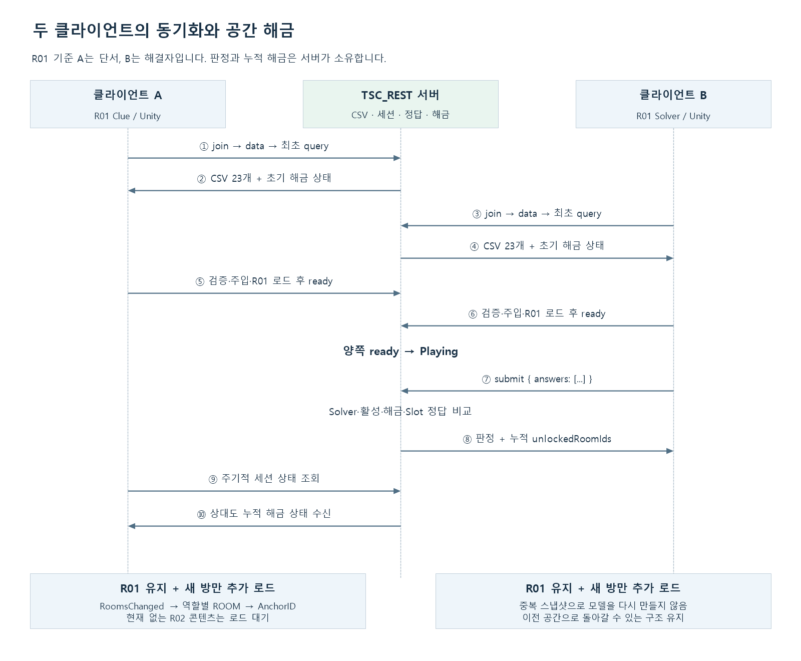

# 2인 협동 방탈출 HTTP 서버

기준일: **2026-10-19**. 현재 저장소의 코드와 자동 검사 결과를 기준으로 설명합니다. 이전 기획서와 차이가 있으면 현재 요구사항과 데이터 테이블을 우선합니다.

Node.js / TypeScript 서버가 두 참가자의 세션과 진행 상태를 소유합니다. 시작할 때 `data/` CSV를 한 번 읽어 검증·클래스 변환하고, 접속한 Unity 클라이언트에 같은 메모리 원본을 전달합니다. 퍼즐 입력은 서버가 슬롯 정답과 비교하며 다음 공간은 누적 해금합니다. 실제 통신은 **HTTP + JSON**입니다.

현재는 **프로세스당 메모리 세션 하나**입니다. 여러 세션 매칭·영구 저장·재시작 후 복구는 후속 범위이며, 음성은 Unity/Vivox가 담당합니다.

## 1. 설치와 실행

**Node.js 24 이상, npm**이 필요합니다. TypeScript strict, ES2022, CommonJS이며 Node 기본 HTTP 모듈을 사용합니다. Windows PowerShell은 `npm.cmd`, Linux는 `npm`을 사용합니다.

```powershell
npm.cmd ci
if (!(Test-Path .env.local)) { Copy-Item .env.local.example .env.local }
if (!(Test-Path .env.test)) { Copy-Item .env.test.example .env.test }
npm.cmd run run:local
```

다른 창에서 `Invoke-RestMethod http://127.0.0.1:3000/health`를 실행합니다. 종료는 Ctrl+C입니다. `/health`는 HTTP 수신 확인이며 클라이언트 준비·음성·콘텐츠 전체 검증을 의미하지 않습니다.

| 목적 | Windows / Linux 진입점 | npm 명령 |
|---|---|---|
| 같은 PC 개발 | run-local.cmd / run-local.sh | `npm run run:local` |
| LAN / 두 PC | run-test.cmd / run-test.sh | `npm run run:test` |
| 로컬 Docker | run-docker-local.cmd / run-docker-local.sh | `npm run docker:local` |
| SSH 원격 배포 | deploy-cloud.cmd / deploy-cloud.sh | `npm run docker:cloud` |

local/test 실행기는 환경 파일 읽기 → TypeScript 빌드 → 설정 검증 → 서버 실행을 수행합니다. 빌드 실패 시 이전 dist를 실행하지 않습니다. 서버 내부에서는 **CSV 로드·검증·클래스 변환이 성공한 뒤에만 HTTP 수신**을 시작합니다. CSV 오류는 시작 실패로 처리합니다. `npm start`는 기존 `dist/main.js`를 실행하므로 빌드·환경 파일 로드는 자동 수행하지 않습니다.

## 2. 환경과 주소

| 변수 | local 예제 | test 예제 | 의미 |
|---|---|---|---|
| HOST | 127.0.0.1 | 0.0.0.0 | 수신 IP |
| PORT | 3000 | 3001 | 1~65535 정수 포트 |
| PARTICIPANT_TIMEOUT_MS | 10000 | 10000 | 마지막 heartbeat 이후 만료 기준 |
| EXPIRATION_CHECK_INTERVAL_MS | 500 | 500 | 만료 검사 간격 |

시간은 양의 정수 ms이며 검사 간격은 만료 시간 이하여야 합니다. HOST를 직접 생략한 코드 기본값은 0.0.0.0이고 프로필 예제값과 구분합니다. 외부 환경변수가 환경 파일보다 우선합니다. 실제 `.env.*`는 공유하지 않고 `.example`만 Git에 보관합니다.

클라이언트 주소는 같은 PC에서 local `http://127.0.0.1:3000`, test/Docker `http://127.0.0.1:3001`입니다. 다른 PC는 `http://서버PC의실제IP:3001`을 사용합니다. 0.0.0.0은 수신 설정이고, 다른 PC에서 127.0.0.1은 그 PC 자신입니다. Linux의 sh 파일은 `sh 파일명.sh`로 실행할 수 있습니다.

## 3. 구조와 디자인패턴


[확대 가능한 SVG](docs/images/server-architecture.svg)

| 계층 | 담당 / 책임 |
|---|---|
| 실행·조립 | `main.ts`: 데이터 로드, 설정·객체 DI, 서버·주기 작업 수명 |
| HTTP 라우터 | `createSessionHttpServer`: 메서드·경로를 Controller 작업에 연결 |
| Controller | `SessionController`: 요청 연결과 제출 본문 제한 |
| 공통 응답 | `ParticipantHttpHandler`: 토큰 헤더, no-store, 도메인 결과 → HTTP 상태 |
| 서비스 | `SessionService`: 인증 후 세션·진행 모델을 조정하는 Facade |
| 세션 모델 | `GameSession`: A/B 자리, ready, Waiting/Loading/Playing 스냅샷 |
| 진행 모델 | `RoomProgression`: CSV 기반 Solver·슬롯 비교·누적 해금 |
| 참가자 관리 | `ParticipantRegistry`, `HeartbeatLease`: 토큰과 정수 시간 생존 기간 |
| 데이터 | `CsvDataSet`, `CsvDataStore`, `CsvGameData`: 불변 원본·등록·변환 캐시·읽기 전용 모델 |
| 검증 | `CsvValidator`, 스키마·규칙 모듈: 설정과 재사용 가능한 규칙 조합 |
| 인프라 | UTF-8 파일 입력, Node 타이머·시계 어댑터 |

서버는 MVC의 Model/Controller 책임과 서비스·인프라 경계를 분리합니다. 생성자와 조립 함수로 의존성을 주입하며 데이터 정의와 변경 가능한 세션 상태를 섞지 않습니다. CSV 매핑은 변환 함수, 검증은 규칙 객체 조합, 주기 실행은 Scheduler 포트를 사용합니다. `CsvDataStore.onRegistered`는 등록 완료 이벤트입니다. HTTP 요청/응답 서버이므로 모든 처리를 이벤트로 감싸거나 enum 상태마다 State 클래스를 만들지는 않습니다.

```text
src/
  main.ts                      데이터 로드·조립·수신·종료
  controllers/                 Controller·ParticipantHttpHandler
  infrastructure/http/         Node HTTP 라우터
  services/                    SessionService·ParticipantRegistry
  models/                      GameSession·RoomProgression
  contracts/                   성공/실패 결과·코드
  config/                      환경설정 검증
  common/csv/                  CSV 파서·Loader·문서/행
  common/timing/               주기 작업·스케줄러 포트
  data/                        원본·등록소·매핑·전송 묶음
    validation/                스키마·공통 및 게임 관계 검사
    tables/                    23개 행 모델·공통 Room/Anchor·CsvGameData
  infrastructure/data/         UTF-8 파일 입력·loadGameData
  infrastructure/timing/       Node 타이머 어댑터
  tools/                       CSV 읽기·검증 CLI
data/                          런타임 CSV 23개
tests/                         Node 자동 검사
protocol/, scripts/            Protobuf·실행·배포·도식 도구
```

## 4. CSV 메모리 등록과 클래스 사용

`data/`는 `dist/main.js` 기준 상위의 프로젝트 data 디렉터리에서 읽습니다. 작업 디렉터리나 클라이언트 CSV에 의존하지 않습니다.

```text
readCsvDirectory → Utf8CsvFileSource → CsvLoader / CsvParser
    → CsvDataSet → CsvValidator → CsvDataStore
    → CsvGameData → SessionService / RoomProgression
    → createGameDataBundle → GET /sessions/{id}/data
```

| 모듈 | 동작 |
|---|---|
| `readCsvDirectory` | CSV 파일을 엄격한 UTF-8로 읽고 원본·해석 오류를 스냅샷에 보존 |
| `CsvValidator` | 파일 재열기 없이 스냅샷의 문법·스키마·참조·게임 관계 검사 |
| `CsvDataStore.initialize` | 같은 store의 초기화를 공유하고 최초 성공 원본을 재사용 |
| `register` | 검증 성공 시만 교체·캐시 무효화·등록 이벤트 발행, 실패 시 이전 상태 보존 |
| `CsvTableMapping<T>` | 시트 이름·변환 함수를 묶고 같은 매핑의 변환 결과 재사용 |
| `CsvGameData` | 함수·모델에 주입하는 readonly 테이블 묶음, 객체·목록도 동결 |
| `createGameDataBundle` | 메모리 원본을 CSV 문자열로 직렬화하고 SHA-256 version을 계산하여 캐시 |

데이터 API마다 디스크를 다시 읽거나 데이터 클래스를 다시 만들지 않습니다. 재등록 가능한 저장소 API는 있지만 실행 중 CSV 파일 변경을 감시·반영하는 핫 리로드는 연결하지 않았습니다. 서버 데이터를 바꾸면 검증 후 프로세스를 재시작합니다.

```typescript
const store = new CsvDataStore();
const data = await loadGameData(csvFolder, undefined, store);
const rooms = data.roomsB;
const slots = data.puzzleSlots;
// 소비자에는 data 또는 필요한 readonly 테이블만 생성자로 주입합니다.
```

CSV는 UTF-8·쉼표 구분이고 첫 번째 비어 있지 않은 레코드가 헤더입니다. BOM·인용부호 안 쉼표/줄바꿈·따옴표 이스케이프를 지원합니다. 앞 4행을 건너뛰지 않습니다. 문자열·앞자리 0을 보존하며 정답은 숫자처럼 보여도 문자열입니다. ID·ms는 int32 정책, Y/N은 boolean, Unity 표현용 소수는 유한한 JavaScript number로 보존합니다. `GAME_CONFIG`는 선언된 Type에 맞게 접근합니다.

23개 모델은 ROOM_A/B, 두 ANCHOR, ARROW, CARD, CHARACTER_STAT, COLOR_LETTER, COMPONENT, CONSOLE, FORMULA, FRAME, GAME_CONFIG, LOCK, PAPER, PREFAB, PUZZLE, PUZZLE_SLOT, REGISTRY, SOUND, SOUND_LINK, TV, WIRE에 대응합니다. RoomData·AnchorData·CsvRowReader를 공통으로 사용합니다.

스키마는 [CsvSchema.ts](src/data/validation/CsvSchema.ts)입니다. 필수 컬럼·형식·범위·중복·REGISTRY·ID 참조·ROOM/ANCHOR 공통 키·Next 순환·Solver/Clue·입력 앵커·슬롯·사운드 관계를 검사합니다. Unity의 XML 스키마와 규칙 변경을 함께 반영해야 합니다. 서버는 Unity 프리팹·씬 오브젝트 존재를 검사하지 않습니다.

```powershell
npm.cmd run csv:validate
npm.cmd run csv:validate -- "D:/다른/data"
npm.cmd run csv:read -- "D:/경로/테이블.csv"
```

## 5. API 계약

모든 응답은 JSON입니다. 참가자 요청은 join 응답의 `sessionId`, `participantToken`을 사용하고 토큰을 `x-participant-token` 헤더로 전달합니다. 토큰은 상태 스냅샷에 넣지 않습니다.

| 메서드 / 경로 | 토큰 | 성공 응답 |
|---|---|---|
| GET /health | 불필요 | 200, status=ok |
| POST /sessions/join | 불필요 | 201, success·sessionId·player·participantToken |
| GET /sessions/{id}/data | 필요 | 200, success·version·tables[{name,csv}] |
| GET /sessions/{id} | 필요 | 200, success·snapshot |
| POST /sessions/{id}/ready | 필요 | 200, success·snapshot |
| POST /sessions/{id}/heartbeat | 필요 | 200, success=true |
| POST /sessions/{id}/leave | 필요 | 200, success=true |
| POST /sessions/{id}/puzzles/{puzzleId}/submit | 필요 | 200, success·accepted·correct·snapshot |

snapshot은 `sessionId`, `phase`, `players[{id,role,ready}]`, `unlockedRoomIds`를 포함합니다. 해금 목록은 양쪽 방의 ID를 포함하므로 각 클라이언트는 자기 역할의 ROOM 테이블로 선택합니다. 데이터의 version은 전송 묶음 식별값이며 조건부 GET이나 클라이언트 해시 재검증은 구현하지 않았습니다.

제출 본문은 `{"answers":["값1","값2"]}`입니다. 순서는 PUZZLE_SLOT.Slot 순서이며 문자열 배열만 받습니다. HTTP 본문 8192 bytes, 최대 64개·문자열당 길이 256으로 제한합니다. 다른 참가자 요청은 본문이 필요하지 않습니다.

| 실패 / 판정 | 의미 |
|---|---|
| 409 SESSION_FULL | 빈자리 없음 |
| 400 PARTICIPANT_TOKEN_REQUIRED | 토큰 헤더 누락·공백 |
| 403 INVALID_PARTICIPANT | 잘못되거나 만료·폐기된 토큰 |
| 404 SESSION_NOT_FOUND | 없는 세션 |
| submit 400 / 413 | 잘못된 JSON·answers 형식 / 본문 크기 초과 |
| submit 200, accepted=false | Playing 아님, 비활성/없는 퍼즐, Solver 역할 아님 또는 잠긴 방 |
| submit 200, accepted=true, correct=false | 제출은 유효하지만 슬롯 정답과 다름 |

인증 실패는 success=false와 code로 반환합니다. 제출 거절·오답은 통신 실패와 구분합니다. 참가자 공통 응답에는 `Cache-Control: no-store`를 적용하고 미등록 경로는 404입니다.

## 6. 동기화와 누적 해금



[확대 가능한 SVG](docs/images/server-sync-sequence.svg)

1. 입장 순서와 빈자리에 따라 A/B를 배정합니다.
2. 클라이언트가 서버 CSV·최초 상태를 받아 검증·주입하고 Ingame을 로드합니다.
3. 자기 R01이 준비되면 ready를 보고합니다. 두 명 모두 보고하면 Playing입니다.
4. Solver가 입력값을 submit합니다. 서버는 활성 퍼즐·해금된 SolverRoom·참가자 역할을 확인합니다.
5. Slot 순서의 Answer와 대소문자를 무시한 문자열 비교를 수행합니다. 성공하면 solved에 기록합니다.
6. SolvedEach는 해당 퍼즐, BothSolved는 같은 방 번호의 양쪽 퍼즐 완료를 확인하고 Next를 추가합니다. Next=0은 마지막입니다.
7. 제출 응답과 상대의 상태 조회에 누적 unlockedRoomIds를 포함합니다. 클라이언트가 새 방을 추가하고 기존 방을 유지합니다.

동일 정답 제출은 해금 목록을 중복 증가시키지 않습니다. 방의 ID·순서·퍼즐은 CSV에서 읽으며 R01/R02 번호를 진행 모델에 하드코딩하지 않습니다. 현재 R01은 A=Clue, B=Solver이고 퍼즐 5001 성공 시 1001/1002에 1003/1004를 추가합니다. R02 실제 모델·앵커는 Unity에서 추후 완성할 범위입니다.

서버는 프리팹을 생성하거나 위치·시점·다이얼 회전을 실시간 중계하지 않습니다. 현재 판정은 슬롯 정답 비교와 해금까지이며, 퍼즐별 입력 UI·표현·오답 잠금·문 열기 허가·타이머·엔딩은 추가 연결이 필요합니다.

## 7. 세션 수명과 연결 유지

Waiting은 참가자 부족, Loading은 두 명 중 ready 미완료, Playing은 두 명 모두 ready인 상태입니다. ready는 씬 로딩 완료 보고이며 대기실 준비 버튼이 아닙니다.

heartbeat 성공만 생존 시간을 갱신합니다. 조회·ready·data·제출은 갱신하지 않습니다. 만료된 토큰은 늦은 heartbeat로 복구하지 않습니다. 기본 500ms 주기 검사와 입장·인증 요청 시 정리를 병행합니다. 정상 퇴장과 만료는 토큰·자리를 함께 제거합니다.

한 명이 나가면 남은 참가자의 ready와 진행 상태는 유지되고 새 참가자는 빈 역할·ready=false로 입장합니다. **모두 나간 뒤 다음 입장 시 진행을 초기화**하며 세션 ID는 프로세스 동안 유지합니다. 서버 재시작은 세션·참가자·토큰·진행을 초기화합니다. 다중 판·재접속 정책은 후속 설계 범위입니다.

## 8. Docker와 Protobuf

Dockerfile은 Node 24 빌드·실행 단계를 분리하고 node 사용자로 실행하며 `data/`도 이미지에 포함합니다. 코드·CSV 변경 후 이미지 재빌드·컨테이너 교체가 필요합니다. 로컬 node_modules를 복사하지 않습니다.

```powershell
if (!(Test-Path .env.deploy-local)) { Copy-Item .env.deploy-local.example .env.deploy-local }
if (!(Test-Path .env.docker-test)) { Copy-Item .env.docker-test.example .env.docker-test }
npm.cmd run docker:local -- --plan
npm.cmd run docker:local
```

원격은 `.env.deploy-cloud`와 `.env.docker-cloud`를 준비해 `npm run docker:cloud`로 실행하는 수동 SSH 배포 도구입니다. 실제 클라우드 배포·Git push 기반 CI/CD·자동 롤백은 미완료입니다. 재배포로 메모리 세션은 초기화됩니다. [Docker 안내](docs/docker-deployment.md)의 설정을 참고합니다.

Protobuf 원본은 `protocol/escape/v1`이며 생성 코드를 직접 편집하지 않습니다. `npm run proto:setup`, `npm run proto:sync`, `npm run proto:sync -- --apply`로 생성·검사·대상 배포합니다. 로컬 대상은 `protocol.projects.local.json`에 설정하고 생성·교차 검사에는 .NET SDK 10도 필요합니다. 현재 HTTP API 전체와 데이터·제출 계약이 Protobuf로 전환된 상태는 아닙니다. [도구 안내](protocol/TOOL.md)를 참고합니다.

## 9. 검사와 도식 재생성

```powershell
npm.cmd test
npm.cmd run csv:validate
```

서버 빌드와 **128개 자동 검사 통과**, CSV **23개·오류 0·경고 0**, 모든 **2,861개 셀**의 클래스 변환·전송 왕복 보존을 확인했습니다. 검사에는 세션·HTTP·만료·타이머·설정·Protobuf·배포 도구·CSV·진행 모델을 포함합니다. 클라우드 배포 검사는 대역을 사용하므로 실제 클라우드 성공을 뜻하지 않습니다.

Unity 저장소의 `Tools/CsvValidation.Tests`는 96개, `Tools/WorldPlayVerification/Run.ps1 -IncludeServer`는 실제 HTTP와 격리 Unity Play 33개를 통과했습니다. 게임 빌드 UI·렌더링·실제 음성 송수신은 별도 검증입니다.

도식의 PNG·SVG와 Windows PowerShell/System.Drawing 생성기를 함께 보관합니다.

```powershell
./scripts/docs/BuildReadmeDiagrams.ps1 -Project Server -OutputDirectory ./docs/images
```

[과거 종합 안내](docs/project-overview/README.md), [두 PC 검사](docs/TestGuid.md), [퇴장·음성](docs/session-leave-and-voice.md), [기초 CSV 파서 안내](docs/csv-reader.md)는 상세·과거 기록입니다. 현재 API·데이터·완료 범위는 이 루트 README를 우선합니다. 게임 서버는 음성을 중계하지 않으며 실제 Vivox 송수신·장치 검증은 보류 상태입니다.
