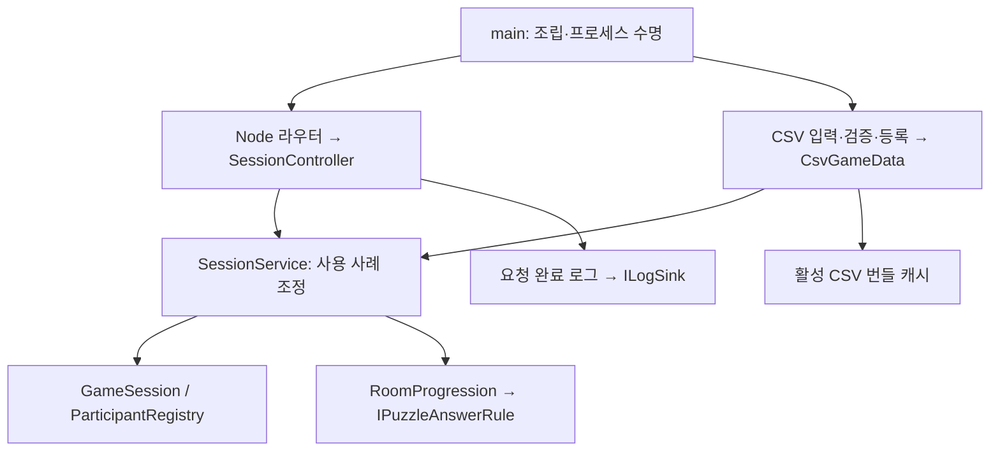

# 2인 협동 방탈출 HTTP 서버

기준일: **2026-10-23**. 실제 구현과 이번 자동 검사 결과를 기준으로 설명합니다. [서버 구조 점검·수정 이유·코드 해설](docs/ArchitectureReview.md), [서버 상세 구조](docs/ServerCodeArchitecture.md), [서버·클라 종합 안내](docs/project-overview/README.md)를 함께 봅니다. 클라이언트 최신 문서는 Unity 프로젝트 `Docs/ArchitectureReview.md`와 `Docs/ClientArchitectureReview.md`에 있습니다.

## 1. 역할과 현재 범위

Node.js/TypeScript 서버는 A/B 두 참가자의 세션·ready·생존·퍼즐 정답·문 허가·누적 방 해금을 소유합니다. 각 클라이언트의 위치·문 각도·카메라·소리·영상은 로컬 표현입니다. 음성은 Unity/Vivox 별도 서비스입니다.

현재 **프로세스당 메모리 세션 하나**입니다. 서버 재시작/재배포 시 세션 ID·토큰·진행이 초기화됩니다. 다중 매칭·영구 저장·신분 복구·호스트 이전은 구현되지 않았습니다.

클라이언트에는 config 주소 선택·Start_UI 탈출하기 입장·조건부 WaitingRoom_UI, 방/앵커/프리팹 구성, 1인칭 이동·시점·A/B 손, 좌클릭 Closeup·정답 UI·문 API, 방 연결, 양쪽 7번 방 완료 후 영상/탈출 시간/Result_UI가 연결되어 있습니다. 전체 콘텐츠·물리·실제 음성·빌드 검증과 코드 구현을 구분합니다.

## 2. 설치와 실행

**Node.js 24 이상**이 필요합니다. TypeScript strict, ES2022, CommonJS와 Node 기본 HTTP를 사용합니다. PowerShell에서는 `npm.cmd`, Linux에서는 `npm`을 사용합니다.

```powershell
npm.cmd ci
if (!(Test-Path .env.local)) { Copy-Item .env.local.example .env.local }
if (!(Test-Path .env.test)) { Copy-Item .env.test.example .env.test }
npm.cmd run run:local
```

다른 창에서 `Invoke-RestMethod http://127.0.0.1:3000/health`로 HTTP 수신을 확인합니다. 종료는 Ctrl+C입니다. health 정상은 두 참가자 준비·음성·전체 콘텐츠 검증을 뜻하지 않습니다.

| 목적 | Windows / Linux 진입점 | npm |
|---|---|---|
| 같은 PC | run-local.cmd / run-local.sh | npm run run:local |
| LAN 테스트 | run-test.cmd / run-test.sh | npm run run:test |
| 로컬 Docker | run-docker-local.cmd / run-docker-local.sh | npm run docker:local |
| 내 PC → 원격 Docker | deploy-cloud.cmd / deploy-cloud.sh | npm run docker:cloud |

실제 값은 로컬 환경 파일과 배포 설정을 따릅니다. 실행 기본값은 .env.local.example/.env.test.example과 [ServerConfig](src/config/ServerConfig.ts), 원격·컨테이너 설정은 [Docker 배포 가이드](docs/docker-deployment.md)를 봅니다.

## 3. 기능 계층·설계 규격



정의·가변 상태·도메인 규칙·전송/인프라를 분리합니다. 생성자/함수 주입, 필요 지점의 Strategy/Adapter, 완료 이벤트 Observer와 Facade를 조합합니다. phase/Set 상태 모델을 GoF State 패턴으로 과장하거나 모든 객체를 인터페이스로 바꾸지 않습니다. 실제 패턴·다형성과 선정 이유는 [구조 점검 2절](docs/ArchitectureReview.md#2-계층다형성패턴)을 따릅니다.

## 4. HTTP·Google Protobuf·Swagger

게임 API는 **HTTP + Google Protobuf 바이너리**, Content-Type은 `application/protobuf`입니다. 참가 토큰은 `x-participant-token` 헤더를 사용합니다. health/OpenAPI 등 운영 경로는 JSON입니다. Protobuf를 사용하지만 gRPC 서버는 아닙니다.

| 경로 | 기능 |
|---|---|
| POST /sessions/join | 참가·역할/토큰 발급 |
| GET /sessions/{sessionId} | 상태 조회 |
| POST /sessions/{sessionId}/ready | 실제 씬 준비 보고 |
| POST /sessions/{sessionId}/heartbeat | 생존 갱신 |
| POST /sessions/{sessionId}/leave | 정상 퇴장 |
| GET /sessions/{sessionId}/data | 검증한 활성 CSV 번들 |
| POST /sessions/{sessionId}/rooms/answer | 방 번호·정답으로 판정 |
| POST /sessions/{sessionId}/rooms/door | 방 번호로 문 허가 확인 |
| POST /sessions/{sessionId}/puzzles/{puzzleId}/submit | 기존 퍼즐 ID 디버그 제출 |
| GET /health, /openapi.json, /swagger/ | 상태·계약·대화형 Swagger UI |

정답/문 판정의 false는 정상 결과이며 통신·인증 실패와 구분합니다. 허가 후 문 개폐는 클라 캐시로 처리합니다. 7번 BothSolved에서 먼저 맞힌 사용자는 정답=true, doorAllowed=false가 정상이며 상대 완료를 기다립니다. 두 ready가 모여야 Playing이 됩니다.

[API·Protobuf 설명](docs/room-api-and-protobuf.md), [Swagger 가이드](docs/swagger-api-guide.md)를 봅니다.

## 5. 데이터 연결과 활성 정책

Excel/스프레드시트 → UTF-8 CSV → 원본 메모리 로드 → 문법/형식/범위/중복/참조/기능 계약 검사 → CsvDataStore 등록 → 타입 정의·활성 번들 순서입니다. 요청마다 파일을 다시 읽지 않습니다.

현재 서버 원본 CSV는 **24개**, REGISTRY 활성 시트는 **14개**입니다. 23종 범용 행 모델은 확장/검사 호환을 위해 유지하지만 **REGISTRY.Active=Y인 시트만 CsvGameData 런타임 목록에 주입하고 번들에 전송**합니다. 비활성/미등록 시트는 빈 목록입니다. 원본 파일 읽기/검증과 도구의 명시적 매핑은 유지합니다. 원본 폴더의 오래된 파일은 검증 경고를 만들 수 있습니다.

ROOM_A/B의 역할별 ID·RoomNo·Next·PuzzleID → PUZZLE/PUZZLE_SLOT 판정, ANCHOR의 역할/방/AnchorID·PrefabID → 클라 실제 Transform/프리팹, PREFAB.Components → COMPONENT 기능 선언으로 연결됩니다. ROOM.ID와 방 번호는 같은 값이 아닙니다.

게임 사운드는 CSV를 사용하지 않고 클라 GameFeedback 에셋에서 관리합니다. SOUND/SOUND_LINK는 비활성이고 번들/런타임 주입에서 제외합니다. 미래 WIRE/ARROW를 사용할 때는 클래스/파일뿐 아니라 REGISTRY 활성 등록과 콘텐츠 참조도 필요합니다. 조명은 기존 앵커 스폰 구조를 따르며 Light Probe 작업은 보류입니다.

```powershell
npm.cmd run csv:validate
npm.cmd run csv:verify-client
```

검증 규칙은 [데이터 기반 상호작용](docs/DataDrivenInteraction.md), [기획자 시트 가이드](docs/DesignerDataTableGuide.md)를 참고합니다. 최신 종합 데이터 연결 도식은 클라 Docs/ArchitectureReview.md에 있습니다.

## 6. 계약 생성과 로컬 배포 자동화

| 원본 | 생성/검증 |
|---|---|
| protocol/escape/v1/*.proto | TS/C# 메시지·직렬화 |
| protocol/http/openapi.json | HTTP 경로·operationId·호출 계약·Swagger |
| protocol/data/content-contract.json | 양쪽 기능명·파라미터·퍼즐 종류·검증 계약 |

```powershell
npm.cmd run content:check
npm.cmd run content:generate
npm.cmd run api:verify
npm.cmd run api:sync
npm.cmd run api:sync -- --apply
```

sync는 생성/검사/계획을 만들고 `--apply`에서 로컬 관리 생성물을 해시 확인·백업 후 반영합니다. 새 도메인 메서드·Unity Handler·콘텐츠 프리팹까지 자동 작성하지는 않습니다. 서버 실행이나 Docker 배포도 로컬 C#을 자동 갱신하지 않습니다. Git 반영은 사용자가 직접 합니다.

## 7. 배포·로그·자원 소유권

기존 배포 도구는 대상 확인 → 기존 컨테이너 유지 상태에서 새 이미지 빌드 → 새 이미지 환경/CSV 검증 → 지정 컨테이너 교체 → 내부·공개 health 확인 순서입니다. 무중단/자동 롤백은 아닙니다. production 의존성에는 Protobuf와 Swagger 자원이 포함됩니다.

입장·정답·문 등 HTTP 완료 로그는 구조화된 stdout으로 출력합니다. 토큰·정답 원문을 기록하지 않는 현재 정책을 유지합니다. Docker에서는 `docker logs --follow --tail 100 <컨테이너이름>`으로 봅니다. 컨테이너 이름은 배포 설정값을 사용합니다.

배포 도구는 json-file 로그 회전을 적용하며 기본 **파일당 10MB·최대 3개**입니다. 이는 Docker daemon의 로그 파일 관리이고 앱 Error 전용 파일 로깅은 미구현입니다. CPU/RAM 제한 옵션도 현재 배포 도구에는 없습니다. 자세한 동작은 [Docker 가이드](docs/docker-deployment.md)를 따릅니다.

## 8. 2026-10-23 검증

| 검사 | 결과 |
|---|---|
| npm.cmd test: 빌드·전체 서버 회귀 | **176개 통과** |
| 현재 서버 CSV | **24개·오류 0·경고 15**, 활성 등록 14개 |
| 실제 C# ↔ Node HTTP/Protobuf | **24개 통과** |
| 콘텐츠 공통 생성 계약 | content:check 통과 |
| 클라 순수 핵심 / 플레이어 / 사운드 / 엔딩 | **329 / 78 / 48 / 41개 통과** |
| Unity DLL 참조 전체 Editor/런타임 분리 컴파일 | 각각 오류 0, SerializeField/호환 DTO 정적 경고 64개 |

현재 콘텐츠와 활성 23종을 보존한 고정 검사 코퍼스를 구분합니다. 원본/활성 파일 수와 과거 셀 수를 고정 성공 조건으로 사용하지 않습니다. 비활성·미등록 시트의 런타임 제외와 원본 보존 회귀를 추가했습니다.

이번에는 실제 EC2 재배포·Unity Play·빌드·청취·GPU/Memory Profiler를 실행하지 않았습니다. 배포 도구 대역 검사를 클라우드 성공으로 설명하지 않습니다. 결과 UI 이후 영상 자원 해제와 배경음 재활성화는 실제 Unity 검토 항목입니다. Closeup 정적 미리보기의 매 프레임 렌더링은 측정 후 최적화할 후보입니다.
