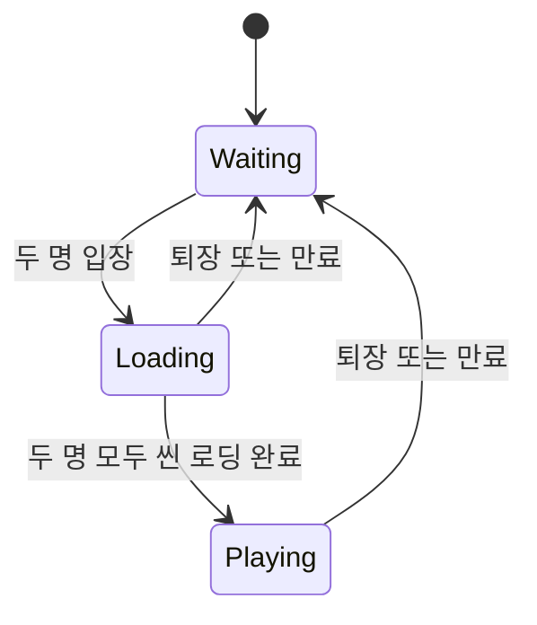
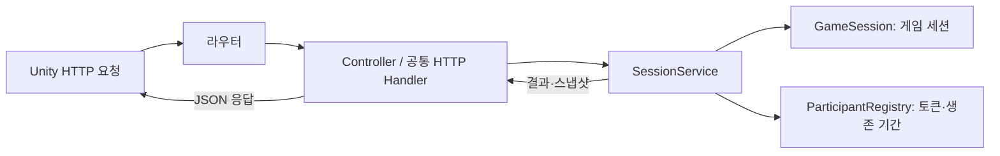

# 2인 네트워크 방탈출 — 서버

기준일: **2026-10-15**. 현재 소스와 지금까지의 검사 기록을 기준으로 정리합니다.

두 참가자의 입장, 역할 배정, 씬 로딩 완료, 연결 유지와 퇴장을 관리하는 **Node.js / TypeScript HTTP 프로토타입**입니다. 게임 세션은 서버가 소유하며, Unity 클라이언트는 최신 상태를 조회해 화면에 반영합니다.

현재는 프로세스 하나에 메모리 세션 하나가 있습니다. 퍼즐·이동·상호작용 동기화, 여러 방, 저장·복구는 아직 구현하지 않았습니다. **실제 통신은 HTTP + JSON**입니다. Protobuf는 코드 생성·배포와 런타임 검증까지 준비했습니다.

전체 흐름은 [종합 README](docs/project-overview/README.md), 두 PC 실행 검사는 [빌드 테스트 가이드](docs/TestGuid.md)를 참고합니다. 클라이언트 README는 별도 Unity 프로젝트 루트에 있습니다.

## 1. 구현한 기능

| 기능 | 현재 동작 | 주요 담당 |
|---|---|---|
| 입장·역할 | 두 명까지 입장, 빈 역할 A/B와 참가 토큰 발급 | SessionService, GameSession |
| 씬 로딩 완료 | 각 참가자의 완료 기록과 단계 계산 | GameSession |
| 상태 조회 | 세션 ID·단계·참가자 목록 스냅샷 반환 | SessionService.query |
| 생존 확인 | 마지막 유효한 수신 시간 갱신 | ParticipantRegistry, HeartbeatLease |
| 참가자 만료 | 기본 10000ms 미수신 시 토큰·자리 제거 | SessionService, PeriodicTask |
| 정상 퇴장 | 요청자의 토큰·자리 즉시 제거 | SessionService.leave |
| 결과 공통화 | 도메인 결과와 HTTP 응답 변환 분리 | SessionResults, ParticipantHttpHandler |
| 환경별 실행 | Windows/Linux 진입점과 공통 Node 실행기 | scripts/run.cjs |
| Docker | 로컬 실행과 SSH 원격 배포 절차 | scripts/docker-deploy |
| Protobuf | TS/C# 생성·교차 검사·대상 배포 | protocol, scripts/protocol-tool |
| CSV | UTF-8 CSV를 읽기 전용 헤더·문자열 행으로 로드 | common/csv, infrastructure/data |

## 2. 로컬 실행

개발 PC에는 **Node.js 24 이상과 npm**이 필요합니다. Windows PowerShell에서는 npm.ps1 실행 정책 문제를 피하도록 `npm.cmd`를 사용합니다. Linux에서는 `npm`으로 바꿉니다.

서버 폴더에서 최초 한 번 준비합니다. 환경 파일은 없을 때만 복사합니다.

```powershell
npm.cmd ci
if (!(Test-Path .env.local)) { Copy-Item .env.local.example .env.local }
if (!(Test-Path .env.test)) { Copy-Item .env.test.example .env.test }
npm.cmd run run:local
```

다른 창에서 확인합니다. `status: ok`는 HTTP 응답 확인이며 게임 입장이나 음성 연결 성공까지 뜻하지는 않습니다. 종료는 Ctrl+C입니다.

```powershell
Invoke-RestMethod http://127.0.0.1:3000/health
```

| 목적 | Windows 실행 파일 | Linux 실행 파일 | 공통 npm 명령 |
|---|---|---|---|
| 같은 PC 개발 | run-local.cmd | sh run-local.sh | npm run run:local |
| LAN / 두 PC 테스트 | run-test.cmd | sh run-test.sh | npm run run:test |
| 로컬 Docker | run-docker-local.cmd | sh run-docker-local.sh | npm run docker:local |
| 내 PC → 클라우드 | deploy-cloud.cmd | sh deploy-cloud.sh | npm run docker:cloud |

cmd/sh는 진입점이며 공통 Node 코드가 절차를 수행합니다. local/test는 실행 목적이고 OS 구분이 아닙니다. `run:test`는 테스트용 서버 실행이며, 자동 검사는 `npm.cmd test`입니다.

local/test 실행 순서는 **환경 파일 읽기 → TypeScript 빌드 → 설정 검증 → 서버 시작**입니다. 빌드 실패 시 이전 dist를 실행하지 않습니다. `npm start`는 기존 dist/main.js만 실행하며 빌드와 환경 파일 로드를 자동 수행하지 않습니다. OS를 옮기면 node_modules를 복사하지 않고 npm ci로 다시 설치합니다.

## 3. 환경설정과 주소

| 서버 변수 | local 예제 | test 예제 | 의미 |
|---|---|---|---|
| HOST | 127.0.0.1 | 0.0.0.0 | 요청을 받을 주소 |
| PORT | 3000 | 3001 | 1~65535 정수 포트 |
| PARTICIPANT_TIMEOUT_MS | 10000 | 10000 | 마지막 생존 확인 이후 만료 기준 |
| EXPIRATION_CHECK_INTERVAL_MS | 500 | 500 | 만료 검사 간격 |

시간은 정수 ms입니다. 양의 안전한 정수인지 검사하며, 검사 간격은 만료 시간 이하여야 합니다. 검사 간격 최대값은 Node 타이머에 맞춰 2147483647ms입니다. 생존 확인 설정을 생략하면 위 기본값을 사용합니다.

local/test 실행기는 외부 환경변수를 환경 파일보다 우선합니다. 파일 누락과 잘못된 값은 시작 오류입니다. `$VAR` 치환이나 셸 명령 실행은 지원하지 않습니다. 실제 .env.*는 Git에서 제외하고 .example만 공유합니다.

| 서버 실행 | 같은 PC의 클라이언트 | 다른 PC의 클라이언트 |
|---|---|---|
| local 기본값 | http://127.0.0.1:3000 | 기본값은 LAN 수신용이 아님 |
| test 기본값 | http://127.0.0.1:3001 | http://서버PC의실제IP:3001 |
| 로컬 Docker 기본값 | http://127.0.0.1:3001 | http://서버PC의실제IP:3001 |

0.0.0.0은 수신 설정입니다. 게임에는 실제 접속 주소를 입력합니다. 다른 PC에서 127.0.0.1을 입력하면 그 PC 자신에게 접속합니다. LAN에서는 서버 PC의 해당 TCP 포트 접근도 허용되어야 합니다.

## 4. 세션 규칙

| 단계 | 판단 기준 |
|---|---|
| Waiting | 참가 인원이 정원 2명보다 적음 |
| Loading | 정원 충족, 아직 씬 로딩을 마치지 않은 참가자 있음 |
| Playing | 두 참가자 모두 씬 로딩 완료 |



`ready`는 **씬 로딩 완료 보고**입니다. 대기실 준비 버튼이나 플레이 시작 명령이 아닙니다. 같은 참가자가 재보고해도 ready는 true로 유지됩니다. 먼저 보고한 클라이언트는 조회로 상대의 완료와 Playing 전환을 확인합니다.

한 명이 나가면 남은 참가자의 완료 값은 유지됩니다. 새 참가자는 빈 역할을 받고 ready=false로 시작합니다. 퍼즐 진행 상태나 라운드 초기화 규칙은 아직 없습니다.

서버 시작마다 session-UUID를 발급하고 프로세스가 유지되는 동안 사용합니다. 모두 나가도 새 방 ID를 만들지는 않습니다. 재시작하면 세션·참가자·토큰이 초기화됩니다.

## 5. API와 결과 코드

모든 응답은 JSON입니다. 인증 요청은 입장 응답의 참가 토큰을 `x-participant-token` 헤더에 넣습니다. 세션 ID도 입장 응답 값을 사용하며 고정 ID를 가정하지 않습니다.

| 메서드 / 경로 | 토큰 | 성공 응답 | 역할 |
|---|---|---|---|
| GET /health | 불필요 | 200, status=ok | HTTP 응답 확인 |
| POST /sessions/join | 불필요 | 201, sessionId·player·participantToken | 신규 입장 |
| POST /sessions/{sessionId}/ready | 필요 | 200, success·snapshot | 본인 씬 로딩 완료 |
| GET /sessions/{sessionId} | 필요 | 200, success·snapshot | 최신 상태 조회 |
| POST /sessions/{sessionId}/heartbeat | 필요 | 200, success=true | 생존 시간 갱신 |
| POST /sessions/{sessionId}/leave | 필요 | 200, success=true | 본인 정상 퇴장 |

현재 요청에는 본문이 필요하지 않습니다. snapshot은 sessionId, phase, players를 포함하고 player는 id, role, ready를 포함합니다. 토큰은 스냅샷에 포함하지 않습니다.

| HTTP 상태 | code | 의미 |
|---|---|---|
| 409 | SESSION_FULL | 입장 가능한 자리 없음 |
| 400 | PARTICIPANT_TOKEN_REQUIRED | 토큰 헤더 누락·공백 |
| 403 | INVALID_PARTICIPANT | 잘못되었거나 만료·폐기된 토큰 |
| 404 | SESSION_NOT_FOUND | 존재하지 않는 세션 ID |

실패 결과는 success=false와 code입니다. 한국어 UI 문구는 클라이언트가 담당합니다. 등록되지 않은 경로는 별도 404 응답입니다. 참가자 요청 응답에는 Cache-Control: no-store를 적용합니다.

SessionResults는 도메인 결과, ParticipantHttpHandler는 헤더와 HTTP 상태, SessionController는 작업 연결을 담당합니다. 같은 인증·응답 처리를 API마다 복사하지 않기 위한 구조입니다.

## 6. 연결 유지와 자리 정리

클라이언트는 기본 **3000ms**마다 생존 확인을 보냅니다. 서버는 마지막 유효한 수신 이후 **10000ms**가 지나면 만료 대상으로 봅니다. 첫 생존 확인 전까지는 입장 시각부터 계산합니다.

heartbeat 성공만 시간을 갱신합니다. 조회·ready·health와 실패한 heartbeat는 갱신하지 않습니다. 만료된 토큰은 늦은 heartbeat로 복구하지 않습니다.

기본 500ms 주기 검사와 입장·인증 요청 시 정리를 함께 수행합니다. 요청이 없어도 만료 대상이 제거됩니다. 실제 제거 시각은 이벤트 루프와 다음 검사 시점에 영향을 받습니다.

정상 퇴장과 만료는 같은 제거 함수로 **토큰과 게임 자리**를 함께 지웁니다. 폐기된 토큰으로 다시 퇴장해도 새 참가자의 자리를 지울 수 없습니다. 강제 종료 시 HTTP 퇴장 전달을 보장할 수 없어 만료가 최종 정리를 담당합니다.

## 7. 코드 지도와 요청 흐름

```text
src/
  main.ts                      설정·객체 조립, 수신·종료·타이머 수명
  infrastructure/http/        라우터 createSessionHttpServer
  controllers/                Controller와 공통 HTTP 응답
  services/                   SessionService, ParticipantRegistry
  models/                     GameSession: 인원·역할·로딩 규칙
  contracts/                  결과 코드·성공/실패 형식
  config/                     환경설정 검증
  common/                     정수 시계·생존 기간·주기 작업·CSV
  infrastructure/timing/      Node 타이머 어댑터
  infrastructure/data/        UTF-8 파일 어댑터
  generated/                  Protobuf 생성 코드
  tools/                      CSV 수동 로드 도구
```



시계와 타이머는 인터페이스로 주입합니다. 서비스가 Node 타이머를 직접 만들지 않아 실제 시간을 기다리지 않고 경계 조건을 검사할 수 있습니다. 종료 시 주기 예약도 해제합니다.

서버 로그에는 시작 설정이 출력됩니다. 현재 모든 요청을 개별 로그로 남기지는 않으므로 요청 로그가 없다는 이유만으로 실패라고 판단하지 않습니다.

## 8. Docker와 원격 배포

로컬은 .env.deploy-local.example과 .env.docker-test.example을 각각 .example 없는 이름으로 복사합니다. 실행 PC에 Node.js 24+, Docker CLI가 필요하고 로컬 Docker 엔진은 Linux 컨테이너 모드여야 합니다.

```powershell
node scripts/deploy-docker.cjs local --plan
npm.cmd run docker:local
```

--plan은 계획만 출력합니다. 실제 절차는 **설정 검사 → 이미지 빌드 → 이미지 내부 설정 검사 → 기존 컨테이너 교체 → 로그 → 내부·외부 health 확인**입니다. 기본 이미지 escape-server:lan-test, 컨테이너 escape-server-lan-test, 포트 PC 3001 → 컨테이너 3000입니다.

Dockerfile은 빌드/실행 단계를 분리하고 실행 시 node 사용자를 사용합니다. 로컬 node_modules를 복사하지 않습니다. 코드 변경은 이미지 재빌드·컨테이너 교체 후 반영됩니다. 콘텐츠 CSV의 이미지 포함·마운트는 아직 연결하지 않았습니다.

클라우드는 .env.deploy-cloud의 SSH_TARGET·PUBLIC_HEALTH_URL과 .env.docker-cloud를 준비한 뒤 `npm.cmd run docker:cloud`로 실행하는 **수동 원격 배포 도구**입니다. 사용자님 PC의 Docker CLI가 SSH 대상 엔진에서 빌드·실행합니다.

로컬 Docker는 검사했고 실제 클라우드 대상 배포는 미검증입니다. Git push 기반 CI/CD는 아직 없습니다. 교체 시 메모리 세션이 초기화되며 교체 후 실패의 자동 롤백은 없습니다. 자세한 설정은 [Docker 안내](docs/docker-deployment.md)에 있습니다.

## 9. Protobuf와 CSV

### Protobuf

원본은 protocol/escape/v1/common.proto와 session.proto입니다. 계약은 오류·역할·단계·참가자 스냅샷·조회 응답입니다. 입장·heartbeat·leave 전체가 Protobuf 계약으로 전환된 상태는 아닙니다. 생성 코드는 직접 편집하지 않습니다.

```powershell
npm.cmd run proto:setup
npm.cmd run proto:sync
npm.cmd run proto:sync -- --apply
```

대상은 protocol.projects.example.json을 복사한 protocol.projects.local.json에 설정합니다. sync는 생성·검사·예정 목록까지 수행하고 --apply로 배포합니다. 생성·교차 검사에는 .NET SDK 10이 추가로 필요합니다.

Unity에는 Google.Protobuf DLL·생성 코드가 있고 Standalone의 ESCAPE_PROTOBUF_RUNTIME도 활성화되어 있습니다. protocol 하위 문서의 런타임 설치 전 설명은 당시 단계의 기록입니다. 명령과 배포 소유권은 [도구 안내](protocol/TOOL.md)를 참고합니다.

### CSV

Excel·스프레드시트에서 내보낸 UTF-8 쉼표 CSV를 직접 읽습니다. 파일 접근은 Utf8CsvFileSource, 연결은 CsvLoader, 문법 해석은 CsvParser입니다. 결과는 읽기 전용 CsvDocument/CsvRow이고 셀은 문자열로 유지합니다.

```powershell
npm.cmd run csv:read -- "C:\경로\테이블.csv"
```

헤더·따옴표·칸 수 등 구조를 검사합니다. 실제 테이블·필수 컬럼·ID·정수 변환·참조 관계·자동 시작 로드는 아직 정하지 않았습니다. [CSV 안내](docs/csv-reader.md)에 규칙과 검사 방법이 있습니다.

## 10. 검증 기록과 남은 범위

작성일 직전 서버 자동 검사 결과는 **77개 통과**입니다. `npm.cmd test`가 빌드 후 tests/*.test.cjs를 실행합니다. 세션·HTTP·만료 경계·타이머 수명·설정·Protobuf 도구·배포 도구·CSV를 포함합니다. 배포 자동 검사는 대역을 사용하며 실제 클라우드 검사를 대신하지 않습니다.

CSV는 공통 입력 27개 C#/TypeScript 결과 일치, 독립 C# 검사·Unity 참조 컴파일을 확인했습니다. 실제 Editor import/Play와 새 빌드는 별도입니다. 이번 README 정리는 실행 코드를 바꾸지 않았으며 게임 테스트를 재실행하지 않았습니다.

남은 범위는 콘텐츠 규칙·테이블 확정, 데이터 변환·검증 연결, 게임 명령/상태 동기화, 기존 참가자 복구, 실제 클라우드 검증과 CI/CD입니다. 음성 송수신·Bluetooth 장치 문제는 사용자님 요청으로 보류 중입니다. 게임 HTTP 서버는 음성을 중계하지 않습니다.

## 11. 설계 원칙과 상세 문서

정의·변경 가능한 상태·규칙·인프라를 분리하고 명시적으로 주입합니다. 기본 수치·시간은 정수 단위입니다. 정수만으로 결정론을 보장하지 않으므로 향후 명령 순서·난수·상태 소유·시간 기준을 추가로 설계해야 합니다.

| 문서 | 용도 |
|---|---|
| [종합 README](docs/project-overview/README.md) | 전체 연결과 완료·보류·후속 범위 |
| [빌드 테스트 가이드](docs/TestGuid.md) | 두 PC 검사·결과 기록 |
| [퇴장·음성 해설](docs/session-leave-and-voice.md) | 기능 의도와 코드 흐름 |
| [Docker 안내](docs/docker-deployment.md) | 로컬·원격 실행 설정 |
| [Protobuf 도구](protocol/TOOL.md) | 생성·검사·배포 |
| [CSV 안내](docs/csv-reader.md) | 로딩 구조와 오류 규칙 |
