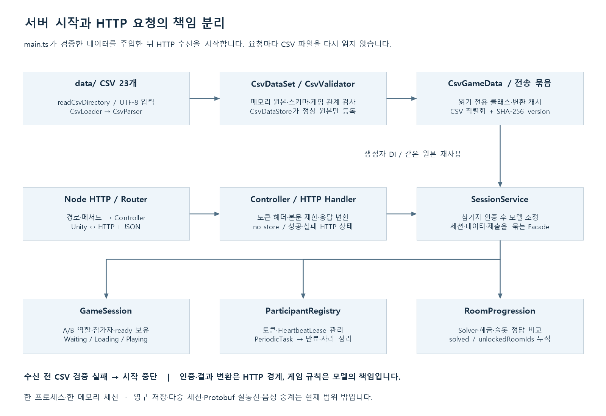

# 2인 협동 방탈출 HTTP 서버

기준일: **2026-10-20**. 현재 저장소의 코드와 자동 검사 결과를 기준으로 설명합니다. 이전 기획서와 차이가 있으면 현재 요구사항과 데이터 테이블을 우선합니다.

Node.js / TypeScript 서버가 두 참가자의 세션과 진행 상태를 소유합니다. 시작할 때 `data/` CSV를 한 번 읽어 검증·클래스 변환하고, 접속한 Unity 클라이언트에 같은 메모리 원본을 전달합니다. 퍼즐 입력은 서버가 슬롯 정답과 비교하며 다음 공간은 누적 해금합니다. 게임 API의 실제 통신은 **HTTP + Google Protobuf 바이너리**입니다. 운영 확인 `/health`와 계약 `/openapi.json`은 JSON입니다.

현재는 **프로세스당 메모리 세션 하나**입니다. 여러 세션 매칭·영구 저장·재시작 후 복구는 후속 범위이며, 음성은 Unity/Vivox가 담당합니다.

## 1. 설치와 실행

**Node.js 24 이상, npm**이 필요합니다. TypeScript strict, ES2022, CommonJS이며 Node 기본 HTTP 모듈을 사용합니다. Windows PowerShell은 `npm.cmd`, Linux는 `npm`을 사용합니다.

```powershell
npm.cmd ci
if (!(Test-Path .env.local)) { Copy-Item .env.local.example .env.local }
if (!(Test-Path .env.test)) { Copy-Item .env.test.example .env.test }
npm.cmd run run:local
```

다른 창에서 `Invoke-RestMethod http://127.0.0.1:3000/health`를 실행합니다. 종료는 Ctrl+C입니다. `/health`는 HTTP 수신 확인이며 클라이언트 준비·음성·콘텐츠 전체 검증을 의미하지 않습니다.

| 목적 | Windows / Linux 진입점 | npm 명령 |
|---|---|---|
| 같은 PC 개발 | run-local.cmd / run-local.sh | `npm run run:local` |
| LAN / 두 PC | run-test.cmd / run-test.sh | `npm run run:test` |
| 로컬 Docker | run-docker-local.cmd / run-docker-local.sh | `npm run docker:local` |
| SSH 원격 배포 | deploy-cloud.cmd / deploy-cloud.sh | `npm run docker:cloud` |

Docker 배포 도구는 새 컨테이너에 로그 순환을 적용합니다. 기본 **파일당 10MB·최대 3개**이며 `.env.deploy-local`/`.env.deploy-cloud`의 `LOG_MAX_SIZE_MB`·`LOG_MAX_FILES`로 조정합니다. 기존 설정 파일에 항목이 없어도 기본값을 사용합니다. 실제 적용은 다음 컨테이너 교체부터이며 [설정·검사 안내](docs/docker-deployment.md)를 따릅니다.

local/test 실행기는 환경 파일 읽기 → TypeScript 빌드 → 설정 검증 → 서버 실행을 수행합니다. 빌드 실패 시 이전 dist를 실행하지 않습니다. 서버 내부에서는 **CSV 로드·검증·클래스 변환이 성공한 뒤에만 HTTP 수신**을 시작합니다. CSV 오류는 시작 실패로 처리합니다. `npm start`는 기존 `dist/main.js`를 실행하므로 빌드·환경 파일 로드는 자동 수행하지 않습니다.

## 2. 환경과 주소

| 변수 | local 예제 | test 예제 | 의미 |
|---|---|---|---|
| HOST | 127.0.0.1 | 0.0.0.0 | 수신 IP |
| PORT | 3000 | 3001 | 1~65535 정수 포트 |
| PARTICIPANT_TIMEOUT_MS | 10000 | 10000 | 마지막 heartbeat 이후 만료 기준 |
| EXPIRATION_CHECK_INTERVAL_MS | 500 | 500 | 만료 검사 간격 |

시간은 양의 정수 ms이며 검사 간격은 만료 시간 이하여야 합니다. HOST를 직접 생략한 코드 기본값은 0.0.0.0이고 프로필 예제값과 구분합니다. 외부 환경변수가 환경 파일보다 우선합니다. 실제 `.env.*`는 공유하지 않고 `.example`만 Git에 보관합니다.

클라이언트 주소는 같은 PC에서 local `http://127.0.0.1:3000`, test/Docker `http://127.0.0.1:3001`입니다. 다른 PC는 `http://서버PC의실제IP:3001`을 사용합니다. 0.0.0.0은 수신 설정이고, 다른 PC에서 127.0.0.1은 그 PC 자신입니다. Linux의 sh 파일은 `sh 파일명.sh`로 실행할 수 있습니다.

## 3. 구조와 디자인패턴



[확대 가능한 SVG](docs/images/server-architecture.svg)

| 계층 | 담당 / 책임 |
|---|---|
| 실행·조립 | `main.ts`: 데이터 로드, 설정·객체 DI, 서버·주기 작업 수명 |
| HTTP 라우터 | `createSessionHttpServer`: 메서드·경로를 Controller 작업에 연결 |
| Controller | `SessionController`: 요청 연결과 제출 본문 제한 |
| 공통 응답 | `ParticipantHttpHandler`: 토큰 헤더, no-store, 도메인 결과 → HTTP 상태 |
| 접근 로그 | `HttpAccessLogger`·`HttpRequestLogContext`: 요청 ID·최종 게임 판정·HTTP 완료/중단을 수집하고 `ILogSink`로 출력 |
| 서비스 | `SessionService`: 인증 후 세션·진행 모델을 조정하는 Facade |
| 세션 모델 | `GameSession`: A/B 자리, ready, Waiting/Loading/Playing 스냅샷 |
| 진행 모델 | `RoomProgression`: CSV 기반 Solver·슬롯 비교·누적 해금 |
| 참가자 관리 | `ParticipantRegistry`, `HeartbeatLease`: 토큰과 정수 시간 생존 기간 |
| 데이터 | `CsvDataSet`, `CsvDataStore`, `CsvGameData`: 불변 원본·등록·변환 캐시·읽기 전용 모델 |
| 검증 | `CsvValidator`, 스키마·규칙 모듈: 설정과 재사용 가능한 규칙 조합 |
| 인프라 | UTF-8 파일 입력, Node 타이머·시계 어댑터 |

서버는 MVC의 Model/Controller 책임과 서비스·인프라 경계를 분리합니다. 생성자와 조립 함수로 의존성을 주입하며 데이터 정의와 변경 가능한 세션 상태를 섞지 않습니다. CSV 매핑은 변환 함수, 검증은 규칙 객체 조합, 주기 실행은 Scheduler 포트를 사용합니다. `CsvDataStore.onRegistered`는 등록 완료 이벤트입니다. HTTP 요청/응답 서버이므로 모든 처리를 이벤트로 감싸거나 enum 상태마다 State 클래스를 만들지는 않습니다.

```text
src/
  main.ts                      데이터 로드·조립·수신·종료
  controllers/                 Controller·ParticipantHttpHandler
  infrastructure/http/         Node HTTP 라우터
  services/                    SessionService·ParticipantRegistry
  models/                      GameSession·RoomProgression
  contracts/                   성공/실패 결과·코드
  config/                      환경설정 검증
  common/csv/                  CSV 파서·Loader·문서/행
  common/timing/               주기 작업·스케줄러 포트
  common/logging/              전송과 독립적인 구조화 로그 출력 계약
  data/                        원본·등록소·매핑·전송 묶음
    validation/                스키마·공통 및 게임 관계 검사
    tables/                    23개 행 모델·공통 Room/Anchor·CsvGameData
  infrastructure/data/         UTF-8 파일 입력·loadGameData
  infrastructure/timing/       Node 타이머 어댑터
  infrastructure/logging/      stdout JSON 로그 어댑터
  tools/                       CSV 읽기·검증 CLI
data/                          런타임 CSV 23개
tests/                         Node 자동 검사
protocol/, scripts/            Protobuf·실행·배포·도식 도구
```

## 4. CSV 메모리 등록과 클래스 사용

`data/`는 `dist/main.js` 기준 상위의 프로젝트 data 디렉터리에서 읽습니다. 작업 디렉터리나 클라이언트 CSV에 의존하지 않습니다.

```text
readCsvDirectory → Utf8CsvFileSource → CsvLoader / CsvParser
    → CsvDataSet → CsvValidator → CsvDataStore
    → CsvGameData → SessionService / RoomProgression
    → createGameDataBundle → GET /sessions/{id}/data
```

| 모듈 | 동작 |
|---|---|
| `readCsvDirectory` | CSV 파일을 엄격한 UTF-8로 읽고 원본·해석 오류를 스냅샷에 보존 |
| `CsvValidator` | 파일 재열기 없이 스냅샷의 문법·스키마·참조·게임 관계 검사 |
| `CsvDataStore.initialize` | 같은 store의 초기화를 공유하고 최초 성공 원본을 재사용 |
| `register` | 검증 성공 시만 교체·캐시 무효화·등록 이벤트 발행, 실패 시 이전 상태 보존 |
| `CsvTableMapping<T>` | 시트 이름·변환 함수를 묶고 같은 매핑의 변환 결과 재사용 |
| `CsvGameData` | 함수·모델에 주입하는 readonly 테이블 묶음, 객체·목록도 동결 |
| `createGameDataBundle` | 메모리 원본을 CSV 문자열로 직렬화하고 SHA-256 version을 계산하여 캐시 |

데이터 API마다 디스크를 다시 읽거나 데이터 클래스를 다시 만들지 않습니다. 재등록 가능한 저장소 API는 있지만 실행 중 CSV 파일 변경을 감시·반영하는 핫 리로드는 연결하지 않았습니다. 서버 데이터를 바꾸면 검증 후 프로세스를 재시작합니다.

```typescript
const store = new CsvDataStore();
const data = await loadGameData(csvFolder, undefined, store);
const rooms = data.roomsB;
const slots = data.puzzleSlots;
// 소비자에는 data 또는 필요한 readonly 테이블만 생성자로 주입합니다.
```

CSV는 UTF-8·쉼표 구분이고 첫 번째 비어 있지 않은 레코드가 헤더입니다. BOM·인용부호 안 쉼표/줄바꿈·따옴표 이스케이프를 지원합니다. 앞 4행을 건너뛰지 않습니다. 문자열·앞자리 0을 보존하며 정답은 숫자처럼 보여도 문자열입니다. ID·ms는 int32 정책, Y/N은 boolean, Unity 표현용 소수는 유한한 JavaScript number로 보존합니다. `GAME_CONFIG`는 선언된 Type에 맞게 접근합니다.

23개 모델은 ROOM_A/B, 두 ANCHOR, ARROW, CARD, CHARACTER_STAT, COLOR_LETTER, COMPONENT, CONSOLE, FORMULA, FRAME, GAME_CONFIG, LOCK, PAPER, PREFAB, PUZZLE, PUZZLE_SLOT, REGISTRY, SOUND, SOUND_LINK, TV, WIRE에 대응합니다. RoomData·AnchorData·CsvRowReader를 공통으로 사용합니다.

스키마는 [CsvSchema.ts](src/data/validation/CsvSchema.ts)입니다. 필수 컬럼·형식·범위·중복·REGISTRY·ID 참조·ROOM/ANCHOR 공통 키·Next 순환·활성 방 시작점 1개·전체 활성 방 연결·ExitRule 허용값(SolvedEach/BothSolved)·Solver/Clue·입력 앵커·슬롯·사운드 관계를 검사합니다. 활성 방 사이의 연결이 비활성 방으로 끊겨도 오류입니다. Unity의 XML 스키마와 규칙 변경을 함께 반영해야 합니다. 서버는 Unity 프리팹·씬 오브젝트 존재를 검사하지 않습니다.

```powershell
npm.cmd run csv:validate
npm.cmd run csv:validate -- "D:/다른/data"
npm.cmd run csv:read -- "D:/경로/테이블.csv"
```

## 5. API 계약

게임 API는 `application/protobuf` 바이너리를 사용합니다. 메시지는 `protocol/escape/v1`, HTTP 바인딩은 `protocol/http/openapi.json`이 기준입니다. `/openapi.json`으로 Swagger/OpenAPI 계약을 확인할 수 있습니다. 참가자는 `x-participant-token` 헤더로 인증하고 토큰은 스냅샷에 포함하지 않습니다.

| 메서드 / 경로 | 요청 본문 | GameApiResponse 성공 분기 |
|---|---|---|
| POST /sessions/join | 없음 | joined (201) |
| GET /sessions/{id}/data | 없음 | data |
| GET /sessions/{id} | 없음 | snapshot |
| POST /sessions/{id}/ready | 없음 | snapshot |
| POST /sessions/{id}/heartbeat | 없음 | completed |
| POST /sessions/{id}/leave | 없음 | completed |
| POST /sessions/{id}/rooms/answer | RoomCommandRequest: room_no + answers | room: value=정답 여부 |
| POST /sessions/{id}/rooms/door | RoomCommandRequest: room_no, answers 비움 | room: value=문 허가 여부 |
| POST /sessions/{id}/puzzles/{puzzleId}/submit | PuzzleCommandRequest: answers | puzzle (기존 디버그 호출 호환) |

join 외의 성공 상태는 200입니다. 실패는 `failure` oneof의 정수 SessionErrorCode와 HTTP 상태로 구분합니다. 올바른 false 응답도 room 분기를 가지며 통신·인증·역할 오류를 false로 변환하지 않습니다. 요청은 8192바이트, 답은 최대 64개·각 문자열 길이 256입니다. JSON 게임 본문은 415로 거절합니다. 응답에는 no-store와 nosniff를 적용합니다.

## 6. 동기화·문 허가·누적 해금

1. 입장 후 서버 CSV와 최초 상태를 받아 검증·주입하고 Ingame을 로드합니다.
2. 두 참가자의 씬 준비 보고가 끝나면 Playing입니다.
3. 정답 제출은 방 번호로 요청합니다. 서버가 토큰에서 A/B를 결정하고 ROOM → PUZZLE → PUZZLE_SLOT을 조회합니다.
4. Solver의 정답은 solved에 기록하고 자신의 ExitRule이 만족되면 자기 문을 허가하고 Next를 해금합니다.
5. 상대는 자기 문과 처음 상호작용할 때 서버 확인을 받습니다. 이때 그쪽 문과 Next가 허가됩니다.
6. 허가받은 문은 클라 캐시를 재사용해 이후 열기·닫기 통신을 생략합니다. 잠김 false는 재확인할 수 있습니다.
7. 기존 방은 유지하고 퇴장·재입장·연결 종료 시 클라 허가 캐시를 초기화합니다.

R01에서 B가 퍼즐 5001을 맞히면 먼저 1004가 추가되고, A가 자기 문을 확인하면 1003이 추가됩니다. 7번 BothSolved에서는 정답 여부와 doorAllowed가 다를 수 있습니다. Next=0은 추가 방이 없다는 뜻이며 엔딩 기능은 별도입니다.

정답 비교와 문 허가는 공통 도메인에 모으고 프리팹·위치·손·문 애니메이션은 서버가 동기화하지 않습니다. 실제 입력 UI·1인칭 플레이어·문 연출·오답 잠금·타이머·엔딩은 추가 연결 범위입니다. 최신 연결 도식과 코드 설명은 [문·정답 API 안내](docs/room-api-and-protobuf.md)를 참고합니다.

## 7. 세션 수명과 연결 유지

Waiting은 참가자 부족, Loading은 두 명 중 ready 미완료, Playing은 두 명 모두 ready인 상태입니다. ready는 씬 로딩 완료 보고이며 대기실 준비 버튼이 아닙니다.

heartbeat 성공만 생존 시간을 갱신합니다. 조회·ready·data·제출은 갱신하지 않습니다. 만료된 토큰은 늦은 heartbeat로 복구하지 않습니다. 기본 500ms 주기 검사와 입장·인증 요청 시 정리를 병행합니다. 정상 퇴장과 만료는 토큰·자리를 함께 제거합니다.

한 명이 나가면 남은 참가자의 ready와 진행 상태는 유지되고 새 참가자는 빈 역할·ready=false로 입장합니다. **모두 나간 뒤 다음 입장 시 진행을 초기화**하며 세션 ID는 프로세스 동안 유지합니다. 서버 재시작은 세션·참가자·토큰·진행을 초기화합니다. 다중 판·재접속 정책은 후속 설계 범위입니다.

## 8. Docker와 Protobuf

Dockerfile은 Node 24 빌드·실행 단계를 분리하고 node 사용자로 실행하며 `data/`와 빌드 단계에서 정리한 production 의존성(@bufbuild/protobuf)을 이미지에 포함합니다. 코드·CSV 변경 후 이미지 재빌드·컨테이너 교체가 필요합니다. 로컬 node_modules를 복사하지 않습니다.

```powershell
if (!(Test-Path .env.deploy-local)) { Copy-Item .env.deploy-local.example .env.deploy-local }
if (!(Test-Path .env.docker-test)) { Copy-Item .env.docker-test.example .env.docker-test }
npm.cmd run docker:local -- --plan
npm.cmd run docker:local
```

원격은 `.env.deploy-cloud`와 `.env.docker-cloud`를 준비해 `npm run docker:cloud`로 실행하는 수동 SSH 배포 도구입니다. 실제 클라우드 배포·Git push 기반 CI/CD·자동 롤백은 미완료입니다. 재배포로 메모리 세션은 초기화됩니다. [Docker 안내](docs/docker-deployment.md)의 설정을 참고합니다.

Protobuf 원본은 `protocol/escape/v1`이며 생성 코드를 직접 편집하지 않습니다. `npm run proto:setup`, `npm run proto:sync`, `npm run proto:sync -- --apply`로 생성·검사·대상 배포합니다. 로컬 대상은 `protocol.projects.local.json`에 설정하고 생성·교차 검사에는 .NET SDK 10도 필요합니다. 현재 게임 API는 Protobuf로 전환했습니다. `npm run api:sync -- --apply`는 OpenAPI/메시지 생성·교차 검사·임시 클라 실제 HTTP 검사 후 로컬 양쪽 생성 폴더에 반영합니다. `npm run api:verify`는 현재 클라 소스로 HTTP 왕복을 검사합니다. [도구 안내](protocol/TOOL.md)를 참고합니다.

## 9. 검사와 도식 재생성

```powershell
npm.cmd test
npm.cmd run csv:validate
```

서버 빌드와 **157개 자동 검사 통과**, 현재 서버 CSV **23개·오류 0·경고 52개**를 확인했습니다. 경고는 비활성 앵커를 참조하는 콘텐츠(2199, 2030)이며 오류와 구분해 표시합니다. 모든 **3,190개 셀**을 클래스와 전송 왕복 결과에 대조했습니다. 셀 개수와 경고 없음 자체를 고정 성공 조건으로 사용하지 않습니다. 검사에는 세션·실제 HTTP·만료·타이머·설정·Protobuf·배포 도구·CSV·진행 모델·캐릭터 정수 범위/관계와 MouseSensitivity/PitchLimit 검증을 포함합니다. 클라우드 배포 검사는 대역을 사용하므로 실제 클라우드 성공을 뜻하지 않습니다.

Unity 저장소의 `Tools/CsvValidation.Tests` **234개**, `Tools/PlayerSpawn.Tests` **72개**가 최신 클라이언트 CSV로 통과했습니다. 화면 제거와 씬 진입 수명 분리, 게임 소유자 취소, 방/플레이어 초기화 실패 시 자리 정리, CSV 캐릭터 값 거부와 정수 시점/조작 상태를 포함합니다. 이 환경은 .NET 8 SDK가 없어 같은 소스를 임시 net10 프로젝트에서 실행했습니다. Unity 6.2 참조 환경에서 런타임(Editor 정의)·에디터 도구·Windows 런타임을 분리 컴파일했습니다. 과거 실제 HTTP/격리 Unity Play 18/33개 기록은 이번 변경의 Play 통과로 간주하지 않습니다. 현재 Unity Play·빌드·실제 음성 송수신은 사용자 검토가 필요합니다.

이번 콘텐츠 검토 수정의 의도·파일별 설명·연결 도식은 [콘텐츠 검토 수정 안내](docs/content-review-fixes.md)에 정리했습니다. 기존 퍼즐 ID 디버그 진입점은 PuzzleSubmissionResult를 유지합니다. 새 방 번호 API는 bool 판정을 사용하고 오류는 별도 실패 경로로 전달합니다.

클라이언트의 에디터/테스트/안정화 환경별 접속 config 및 확정된 Google Protobuf 통신 전환 요구사항은 [접속·상호작용·API 작업 범위](docs/client-environment-and-api-plan.md)를 참고합니다. 현재 게임 API는 HTTP+Protobuf입니다. 문·정답 판정과 허가 캐시, 공통 앵커 플레이어 생성과 WASD 정수 이동, 정수 마우스 시점·공통 조작 잠금·손 모델 벽 끼임 보정을 구현했습니다. 실제 문/입력 UI·Closeup·다음 방 연결은 별도 기능 검토 단위입니다.

클라이언트 Git Pull 이후 ANCHOR_INTERACT / ANCHOR_NONINTERACT / CARD / PREFAB CSV 4개가 서버와 다릅니다. 최신 클라이언트는 3248개 셀·경고 39개이며 서버 데이터와 구분합니다. 이번에는 CSV 원본을 덮어쓰지 않았습니다. 최신 로컬 방 배치 검토는 클라이언트 테스트 A로 수행하고, 온라인 검증 전 서버 번들과의 정합성을 맞춰야 합니다.

도식의 PNG·SVG와 Windows PowerShell/System.Drawing 생성기를 함께 보관합니다.

```powershell
./scripts/docs/BuildReadmeDiagrams.ps1 -Project Server -OutputDirectory ./docs/images
```

[서버·클라이언트 종합 안내](docs/project-overview/README.md), [두 PC 검사](docs/TestGuid.md), [퇴장·음성](docs/session-leave-and-voice.md), [기초 CSV 파서 안내](docs/csv-reader.md)는 상세·과거 기록입니다. 현재 API·데이터·완료 범위는 이 루트 README를 우선합니다. 게임 서버는 음성을 중계하지 않으며 실제 Vivox 송수신·장치 검증은 보류 상태입니다.

## 10. 2026-10-20 정합성 보완

- 당시 정합성 보완 이후 Git Pull로 서버/클라이언트 CSV 4개에 차이가 있습니다. 현재 배포 데이터를 동일하다고 간주하지 않습니다. 이번 기능 작업은 기존 행·경로를 보존하면서 양쪽 PREFAB에 Components 열만 연결했습니다. 이후 CSV 갱신은 서버 재시작/Docker 이미지 교체 및 클라 리소스 빌드 반영을 구분합니다.
- 서버 `CsvCharacterStatRule`은 float32 → 정수 milli 단위로 캐릭터 값을 검사합니다. 속도/가감속 0, 정수 안전 범위, 눈높이·캡슐 지름·단차·FOV 관계를 데이터 등록 전에 거절합니다. Unity는 같은 기준의 `CharacterStatUnits`를 CSV 검사와 플레이어 생성에 공유합니다.
- 방 API 오류도 `SessionErrorCodes` 공통 정의를 사용합니다. HTTP 상태·Protobuf 숫자·정상 true/false 계약은 유지합니다.
- Unity는 씬 로드 시작 전까지 요청 화면의 취소를 따르고, 시작 후에는 지속 게임 수명으로 전환합니다. `WorldRuntime`의 실제 로더와 첫 방을 조립한 뒤 플레이어를 생성하며 두 준비 조건을 모두 만족해야 ready를 보고합니다.
- **B 역할의 R01_LEDPanelPoint는 현재 실제 프리팹에 없습니다.** 공통 스폰과 B 임시 모델의 개발자 미리보기는 가능하지만, 정상 B 방 로드 및 두 참가자 Playing 전체 검증은 콘텐츠 배치 완료 후 진행합니다. 누락을 임의 앵커나 준비 완료로 대체하지 않습니다.

현재 구조·파일별 수정 의도와 Unity 검토 메뉴는 클라이언트 `Docs/EntryConsistency.md` 및 클라이언트 README를 참고합니다.

## 11. 데이터 기반 상호작용 선언

[기획 작업자 적용 가이드](docs/DesignerDataTableGuide.md) · [상호작용 테스트 가이드](docs/InteractionTestGuide.md) · [기능별 코드 연결](docs/DataDrivenInteraction.md)

PREFAB.Components를 COMPONENT.ID의 `|` 목록으로 보존하고 양의 정수·중복·외래 키를 검증합니다. 헤더는 필수이며 셀은 비어 있어도 됩니다. InteractDistance는 Unity와 같은 float32 → int32 mm 기준으로 검사합니다. 원본 Asset 엑셀의 PREFAB!B5에서 Components 추출 제외를 해제했으며 기존 CSV 행·경로는 보존했습니다.

클라이언트 첫 단위는 선언 기반 대상 탐색·강조·Closeup입니다. 정답 입력 UI·문 동작·다음 방 연결을 완성한 변경은 아닙니다. 새 기능은 개발자가 공통 처리기를 등록하고 기획자가 기존 기능을 데이터로 조합합니다. 원본 Excel 73행과 클라이언트 PREFAB 76행 및 기존 경로 차이는 먼저 정리해야 전체 자동 추출을 안전하게 적용할 수 있습니다.

이번 검증: 서버 157개, 클라이언트 공통 234개·플레이어 72개, Unity 상호작용 21개 및 에디터/Windows 분리 컴파일. 실제 마우스 조작은 사용자 검토 항목입니다. Unity 검사는 임시 씬에서 수행하며 원본 방 프리팹을 수정하지 않습니다.

## 12. 정답 입력 UI와 API 연결

[정답 입력 연결·기획 적용·코드 해설·검사](docs/AnswerApiConnection.md). 기존 Protobuf 방 번호 API의 계약은 변경하지 않고 Unity 입력 UI를 공개 IRoomAnswerService에 연결했습니다. UI는 토큰·내부 예외·HTTP·생성 메시지를 참조하지 않으며 정상 true/false와 실패 코드를 구분합니다. 서버 코드·CSV·엑셀·프리팹 변경은 없습니다.

확인: 서버 157개, 정답 분리 39개, 이전 정상 클라이언트 데이터 회귀 273개, 실제 C#·서버 Protobuf HTTP 22개, Unity UI·로컬 서비스 9개, 에디터/Windows 분리 컴파일 통과. 최신 클라이언트의 작성 중인 PREFAB 13079·13080·13081 누락으로 전체 등록은 별도이며 해당 데이터를 임의 수정하지 않았습니다. 실제 마우스 조작·빌드와 문 개폐·다음 방 연결은 다음 검토 범위입니다.

## 13. HTTP 접근 로그 — 2026-10-22

[구현 위치·설계 의도·로그 필드·클라우드 조회·후속 패킷 추적 안내](docs/http-access-logging.md).

모든 HTTP 요청을 요청당 JSON 한 줄로 stdout에 기록합니다. 입장·정답·문뿐 아니라 ready·조회·heartbeat·데이터·퇴장·health·미등록 경로도 포함합니다. HTTP 200의 오답/잠긴 문을 각각 incorrect/locked로 구분하며, 요청 ID·참가 역할·방 번호·실패 코드·해금 목록·소요 시간·응답 완료/중단을 기록합니다. 참가 토큰·답 문자열·원본 본문·URL 쿼리는 기록하지 않습니다.

라우터가 요청별 Context와 응답 이벤트 Observer를 연결하고, Controller/Protobuf 응답 경계에서 필요한 필드만 수집합니다. 도메인 게임 판정은 변경하지 않았습니다. 공통 ILogSink와 stdout Adapter를 분리해 후속 패킷 처리 단계별 이벤트를 추가할 경계를 마련했습니다. 수신·디코딩·인증·판정별 상세 이벤트와 영속 로그 큐는 후속 범위입니다.

TypeScript 빌드와 서버 검사 **164개(신규 접근 로그 7개 포함)**가 통과했습니다. 클라우드는 기존 deploy-cloud.cmd로 새 이미지를 배포한 뒤 다음 명령으로 확인합니다. 이번 구현에서 실제 클라우드 배포는 수행하지 않았으며, API 계약 변경이 없어 로그 추가만으로 클라이언트를 다시 빌드할 필요는 없습니다.

```powershell
ssh escape-cloud "docker logs --follow --timestamps --tail 100 escape-server-cloud"
```
