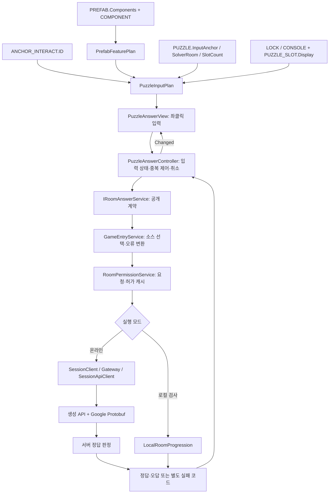

# 정답 입력 UI와 Protobuf API 연결

2026-10-20. 이번 기능 단위는 **시트 기반 입력 UI → 공통 요청 서비스 → 기존 Protobuf API → 결과 표시**입니다. 문 개폐 연출·실제 다음 방 공간 연결은 다음 검토 단위입니다.

## 1. 기능과 설계 의도

정답 입력 오브젝트마다 방 번호·버튼 개수·HTTP 주소를 코드에 적지 않습니다. PREFAB.Components의 DialLock 또는 ButtonConsole 선언을 선택하고, PUZZLE.InputAnchor로 해당 퍼즐을 찾습니다. LOCK 또는 CONSOLE에서 입력 선택지를 읽고 PUZZLE_SLOT의 Slot·Display로 슬롯 수·표시 순서를 구성합니다. 입력 계획은 정답 Answer 값을 보관하거나 비교하지 않습니다.

정답 제출은 방 번호와 순서대로 정리한 문자열 배열을 사용합니다. 온라인은 서버가 판단하고, 로컬 테스트 모드는 기존 LocalRoomProgression이 판단합니다. 온라인 통신 실패를 로컬 판정으로 대체하지 않습니다.



Factory는 이미 등록된 기능을 조합하며, View는 입력 명령과 상태 표시를 담당합니다. GameEntryService는 공통 진입 Facade, 온라인 Gateway는 통신 Adapter입니다. 상태 변경을 반영한 뒤 Changed 이벤트를 통지합니다. UI에 인증 토큰·내부 통신 예외·생성 메시지 타입이 들어가지 않습니다.

## 2. 추가·수정한 코드

| 파일 | 기능과 의미 |
|---|---|
| World/IRoomAnswerService.cs | 입력이 사용하는 공개 계약. RoomAnswerResult는 정상 bool과 실패 코드를 구분합니다. |
| World/GameEntryService.cs | 공개 계약을 구현하고 기존 SubmitRoomAnswerAsync로 위임합니다. 내부 SessionResultException은 공개 결과로 바꾸고 게임 수명 토큰을 연결합니다. |
| Interaction/PuzzleInputPlan.cs | 역할·활성 퍼즐·앵커·SolverRoom·슬롯·입력 종류를 검증합니다. 문자는 DialLetters, 색은 COLOR_LETTER, 버튼은 CONSOLE.Buttons에서 읽습니다. |
| Interaction/PuzzleAnswerController.cs | 슬롯 값·선택 위치·편집/제출/정답/오답/실패/취소 상태를 소유합니다. 중복 제출·진행 중 수정·정답 후 재제출을 차단합니다. |
| Interaction/PuzzleAnswerView.cs | 공통 패널에 슬롯·이전/다음·버튼 선택지·제출·초기화·상태 표시를 생성합니다. 버튼 순서는 선택 슬롯에 값을 넣고 다음 슬롯으로 이동합니다. 많은 슬롯은 스크롤로 표시합니다. |
| Interaction/AnswerInputMessages.cs | 결과·오류를 한글로 표시합니다. 위/아래 같은 표시 이름만 바꾸고 요청 값 Up/Down은 보존합니다. |
| Interaction/PlayerInteractionDriver.cs | Closeup이 열릴 때 입력 계획·Controller·View를 조립하고 닫을 때 정리합니다. 다른 역할의 입력은 안내만 표시합니다. |
| Interaction/WorldInteractionTarget.cs | 앵커와 같은 CsvGameData를 보관해 불변 정의를 입력 계획에 전달합니다. |
| Interaction/CloseupPanelView.cs | 입력 영역과 안내 표시를 제공합니다. HTTP나 정답 규칙을 소유하지 않습니다. |
| Player/PlayerSpawnDriver.cs, World/GameFlowBootstrapper.cs | 게임 소유자의 공개 요청 서비스를 명시적으로 주입합니다. 전역 검색으로 네트워크 객체를 가져오지 않습니다. |
| Editor/AnswerInputChecks.cs | 독립 로컬 B 검사와 Unity UI 이벤트·서비스 연결 검사를 제공합니다. 원본 CSV/프리팹은 수정하지 않습니다. |
| Tools/CsvValidation.Tests/PuzzleAnswerChecks.cs | 데이터 조합·요청 상태·취소·게임 Facade 계약 검사입니다. |
| Tools/CsvValidation.Tests/ProtocolHttpChecks.cs | 실제 TypeScript 서버와 C# 입력 Controller의 Protobuf 왕복을 검사합니다. |

## 3. 데이터 작성 방법

1. 활성 ANCHOR_INTERACT 행의 PrefabID를 PREFAB에 연결하고 실제 프리팹·Collider·앵커를 준비합니다.
2. 다이얼은 `Interactable + CloseUpUI + DialLock`, 버튼 순서는 `Interactable + CloseUpUI + ButtonConsole`을 Components로 연결합니다. 한 대상에 두 입력 종류를 동시에 지정하지 않습니다.
3. PUZZLE.InputAnchor는 위 앵커의 **ID**입니다. AnchorID 이름이나 PrefabID가 아닙니다. 활성 PUZZLE 하나가 연결되어야 합니다.
4. PUZZLE.SolverRoom은 입력할 역할의 ROOM.ID이며 실제 RoomNo와 일치해야 합니다. API에는 ROOM.ID가 아닌 **RoomNo**를 보냅니다.
5. 다이얼은 같은 AnchorRef의 LOCK 행 하나가 필요합니다. Number1_9·Number0_9·Letter9·Color6를 지원합니다. Letter9는 서로 다른 DialLetters 9개, Color6는 COLOR_LETTER의 ID 순서로 서로 다른 색 6개를 사용합니다.
6. 버튼은 같은 AnchorRef의 CONSOLE 행 하나가 필요합니다. Buttons가 선택지이며 SlotCount는 퍼즐과 같아야 합니다.
7. PUZZLE_SLOT은 Slot=1부터 빈 번호·중복 없이 SlotCount개를 작성합니다. Display는 UI 슬롯 표시, Answer는 판정 데이터입니다. UI는 Answer를 가져와 자동 입력하지 않습니다.

현재 실제 R01의 입력 앵커 2030은 Active=N이고 PREFAB 13045의 Components도 비어 있습니다. 이를 임의로 바꾸지 않았습니다. 따라서 정상 R01 콘텐츠에서 입력 UI를 사용하려면 기획·아트 작업자가 이 연결을 완성해야 합니다. 기존 Closeup 임시 큐브는 PUZZLE이 연결되지 않아 미리보기 안내만 표시하며 정답 요청을 보내지 않습니다.

## 4. API 계약과 처리 상태

현재 서버 라우터는 생성 경로를 사용하여 `POST /sessions/{sessionId}/rooms/answer`를 SessionController.room으로 연결합니다. 요청은 `RoomCommandRequest(roomNo, answers)`, 응답은 `GameApiResponse.room`의 bool Value와 DoorAllowed 및 스냅샷입니다. 실제 본문은 application/protobuf 바이너리입니다. JSON으로 새 요청 경로를 만들거나 기존 계약을 바꾸지 않았으므로 이번 UI 연결에 코드 재생성은 필요하지 않습니다.

정상 Value=true는 정답, false는 오답입니다. 준비 전 요청·권한 없음·만료·통신 실패는 실패 코드로 처리합니다. 정답과 문 허가는 분리되어 있으므로 UI에서 모든 정답 응답을 즉시 문 개방으로 바꾸지 않습니다. 허가 캐시는 기존 RoomPermissionService가 유지합니다.

| 상태 | 입력/제출 | 표시 |
|---|---|---|
| 편집 | 가능. 버튼 입력은 모든 슬롯이 채워져야 제출 가능 | 조작 안내 |
| 제출 중 | 값 변경·중복 제출 차단 | 서버 확인 중 |
| 정답 | 해당 패널의 입력·제출·초기화 차단 | 정답, 문에서 진행 확인 안내 |
| 오답 | 수정·재시도 가능 | 오답 안내 |
| 실패 | 재시도 가능 | 기존 공통 코드의 한글 설명 |
| 취소/닫기 | 패널 수명 종료 시 요청 취소 | 이전 패널의 늦은 응답 반영 금지 |

값은 정수 슬롯 위치와 원본 문자열로 관리합니다. UI 배치·스크롤 같은 Unity 표현 경계에서만 float를 사용합니다. 네트워크 라이브러리 분리 시에도 공개 계약과 데이터 기반 입력 계획을 경계로 유지할 수 있으며, 이번 변경이 다른 권한/동기화 구조를 자동으로 제공하는 것은 아닙니다.

## 5. 테스트 절차

### 자동 검사

Play 종료 상태에서 **Tools → Game → 정답 입력 UI 자동 검사**를 실행합니다. 현재 로컬 CSV가 미완성이면 먼저 데이터 검증 오류를 해결해야 합니다. 개발자 자동화에서 `AnswerInputChecks.VerifyFromDirectory(검증할CSV폴더)`로 명시한 별도 데이터의 UI 연결도 검사할 수 있습니다. 이를 현재 클라이언트 CSV 전체 통과로 기록하지 않습니다.

프로젝트 루트의 기존 공통 검사와 플레이어 검사 명령은 InteractionTestGuide를 따릅니다. 정답 기능만 지정된 CSV로 분리 검사하려면:

```powershell
dotnet run --project Tools/CsvValidation.Tests -- --answers "서버프로젝트의 data 절대경로" .
```

실제 C# 입력 Controller ↔ TypeScript 서버 왕복은 **서버 프로젝트 루트**에서 실행합니다. 임시 테스트 서버와 참가자를 만들고 종료하므로 운영 서버나 현재 플레이 세션을 대상으로 실행하지 않습니다.

```powershell
npm.cmd run api:verify -- --client C:/Users/m/Desktop/listen
```

### 화면에서 직접 검사

1. Play 상태에서 **Tools → Game → 정답 입력 UI 로컬 검사**를 실행합니다. 독립적인 로컬 B 첫 방의 판정 상태를 사용합니다. 현재 실제 게임 입장의 역할·서버 세션·원본 데이터를 바꾸지 않습니다.
2. 로컬 CSV가 작업 중이면 빈 씬 또는 Ingame 단독 Play에서 **정답 UI 검사 데이터 폴더 선택**을 실행하고 검증 가능한 서버 `data` 폴더를 선택합니다. 이 선택은 검사 도구에만 적용되며 게임 접속 설정은 바꾸지 않습니다.
3. 이전/다음 버튼으로 일부러 틀린 값을 선택하고 제출합니다. 오답 표시 후 수정·재제출이 가능해야 합니다.
4. 검사 데이터의 해당 PUZZLE_SLOT.Answer 순서대로 값을 선택해 제출합니다. 현재 R01 예시는 3·7·2·5이지만 데이터가 바뀌면 표를 기준으로 합니다. 정답 표시와 제출 잠금을 확인합니다.
5. 돌아가기로 닫고 다시 검사 메뉴를 실행합니다. 이전 UI·잠금·판정 상태가 남지 않아야 합니다. 이 독립 검사창의 종료는 돌아가기 버튼을 사용합니다.
6. 정상 콘텐츠의 Closeup에서는 제출 중 돌아가기/Esc·대상 제거·플레이어 비활성화도 검사합니다. 닫힌 UI를 이전 응답이 다시 열거나 수정해서는 안 됩니다.

네트워크 실패·준비 전·권한 오류는 자동 검사에서 별도로 검증합니다. 화면의 로컬 검사 성공만으로 실제 서버 접속 테스트까지 통과했다고 간주하지 않습니다. 실제 B 콘텐츠 검사는 R01_LEDPanelPoint 등 기존 누락 배치가 완성된 뒤 수행합니다.

## 6. 현재 데이터와 검증의 한계

작업 시작 시 최신 클라이언트 ANCHOR_NONINTERACT가 PREFAB 13079·13080·13081을 참조하지만 PREFAB.csv에는 해당 행이 없었습니다. 사용자님이 다른 작업자분의 추가 작업 중이라고 확인하셨으므로 CSV·엑셀·방 프리팹을 수정하거나 검증을 우회하지 않습니다. 그 상태에서 정상 Join이 차단되는 것은 기존 등록 규칙에 따른 동작입니다.

서버 데이터 분리 검사, 이전 정상 데이터의 회귀 검사, 최신 클라이언트 전체 검사는 각각 구분해 기록합니다. 기획 데이터가 완성되면 CSV 검증 → 로컬 A/B 진입 → 실제 입력 대상 → 서버 모드 → 새 빌드 순으로 확인합니다. 문 개폐와 실제 다음 방 정렬·이동은 이번 단위 검토 후 진행합니다.

## 7. 이번 실행 결과

- 서버 데이터 기반 정답 입력 분리 검사 39개 통과.
- 이전 정상 CSV 스냅샷에 새 코드를 적용한 공통 회귀 검사 273개 통과. 최신 클라이언트 CSV 전체 검증 통과로 간주하지 않습니다.
- 실제 TypeScript 임시 서버 ↔ C# Controller/공개 서비스/생성 API의 Protobuf HTTP 검사 22개 통과.
- 서버 기존 검사 157개 통과, 에디터 런타임·에디터 도구·Windows 런타임 컴파일 통과.
- Unity 임시 씬에서 버튼 이벤트 → 입력 Controller → 로컬 GameEntryService·허가 캐시 연결 9개 통과. 제출 중 취소·UI 정리도 포함합니다.
- 최신 클라이언트 전체 등록/정상 B 콘텐츠/실제 마우스 조작·빌드는 사용자 검토 항목입니다. 작성 중인 13079~13081 데이터는 변경하지 않았습니다.
