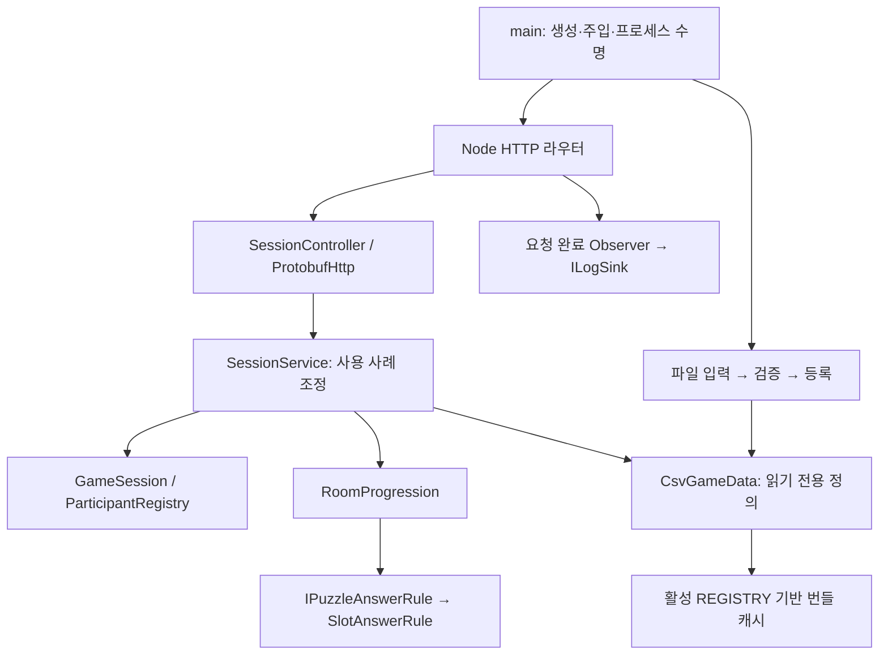
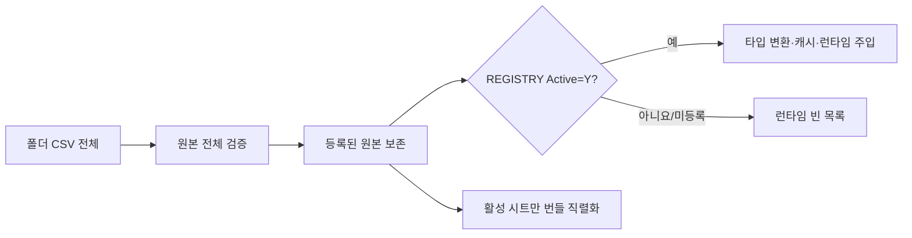

# 서버 구조 점검·수정 보고서

기준일: 2026-10-23. 현재 소스와 이번 자동 검사에 근거합니다. 과거 기능별 검증 기록과 실제 클라우드 실행 결과는 별개입니다.

## 목차

1. [판단과 범위](#1-판단과-범위)
2. [계층·다형성·패턴](#2-계층다형성패턴)
3. [발견한 문제와 수정](#3-발견한-문제와-수정)
4. [성능·네트워크·시간](#4-성능네트워크시간)
5. [검증과 향후 규격](#5-검증과-향후-규격)

## 1. 판단과 범위

서버의 **정답·문 허가 권한, 검증된 데이터 주입, HTTP와 도메인의 분리**는 기존 설계 방향을 유지합니다. 이번 수정은 사용 사례나 API를 재설계하지 않고, CSV 공개 정책과 실제 런타임 정의가 달랐던 경계를 맞춥니다.

점검 대상은 진입점 → 라우터 → Controller → Service → 세션/퍼즐 도메인 → 데이터/생성 계약 → 로그/배포 도구입니다. 서버 src의 TypeScript 파일 76개를 기준으로 구조를 분류하고 핵심 실행 경로·계약·수명 코드를 대조했습니다. 생성 코드 전체의 개별 알고리즘을 수작업 재검증하거나 클라우드를 재배포한 작업은 아닙니다. `npm.cmd test`로 전체 서버 회귀를 수행합니다.

문서에서 발견한 별도 불일치는 Swagger UI와 접근 로그를 아직 미구현으로 설명한 부분, 현재 동작하는 클라이언트 UI·엔딩을 모두 미래 항목으로 묶은 부분입니다. README와 [기존 상세 구조](ServerCodeArchitecture.md)를 함께 갱신했습니다.

## 2. 계층·다형성·패턴

### 2.1 정의·상태·규칙·인프라

| 경계 | 코드 | 설계 의도·확인 결과 |
|---|---|---|
| 정의 | [CsvGameData](../src/data/tables/CsvGameData.ts), 행 모델 | 콘텐츠 수치·ID를 HTTP 처리와 분리. readonly 및 freeze 사용 |
| 가변 상태 | [GameSession](../src/models/GameSession.ts), [RoomProgression](../src/models/RoomProgression.ts) | 참가/ready와 solved/permitted/unlocked의 소유자를 분리 |
| 사용 사례 | [SessionService](../src/services/SessionService.ts) | 인증 후 순서 조정. 문 애니메이션·클라 Transform을 소유하지 않음 |
| 전송 | [SessionController](../src/controllers/SessionController.ts), [ProtobufHttp](../src/controllers/http/ProtobufHttp.ts) | Protobuf 해석·입력 제한·HTTP 상태를 도메인 판정과 분리 |
| 인프라 | 파일 소스·Node 타이머·stdout·Docker CLI | 외부 라이브러리/환경을 어댑터에서 연결 |

### 2.2 실제 사용하는 추상화와 다형성

| 계약·구성 | 실제 구현과 호출 | 판단 |
|---|---|---|
| `IPuzzleAnswerRule` | `PuzzleAnswerRules`가 Type으로 선택한 `SlotAnswerRule.matches` 호출 | Strategy 확장점. 현재 7가지 Type은 **같은 슬롯 비교 구현**을 사용 |
| `ICsvTextSource` | 파일 입력 또는 검사용 메모리 입력을 CsvLoader에 주입 | I/O 교체를 위한 Adapter |
| `IMillisecondClock`, `IIntervalScheduler` | 실제 시계·Node scheduler와 검사 대역 | 만료 시간/주기 작업을 테스트 가능하게 분리 |
| `ILogSink` | stdout sink와 테스트 sink | 기록 대상 교체 경계. 게임 규칙이 stdout을 직접 소유하지 않음 |
| `CsvValidationRule` 계열 | 규칙 목록을 순회하여 동일 계약으로 validate | 독립된 검증 책임을 합성 |
| `RoomData`, `AnchorData` 공통 모델 | 역할/앵커별 데이터 정의가 공통 필드를 공유 | 데이터의 is-a 관계. 행동을 억지 상속하지 않음 |

`SessionService`와 `RoomProgression`의 일부 의존성은 구체 클래스입니다. 현재 구현이 하나이고 사용 사례가 명확하므로 전부 인터페이스로 바꾸지는 않았습니다. 교체 가능한 외부 의존성이나 독립된 판정 방식에 인터페이스를 우선합니다.

### 2.3 패턴 이름을 붙이는 기준

- **Facade/Application Service:** SessionService가 참가·진행 모델의 호출 순서를 묶습니다.
- **Strategy:** 정답 규칙 선택 및 배포 대상 Local/Ssh 선택. 7개의 서로 다른 퍼즐 알고리즘이 완성됐다는 뜻은 아닙니다.
- **Adapter:** 파일 입력, HTTP/Protobuf, 시계/스케줄러, 로그 출력, Docker CLI.
- **Observer:** 데이터 등록 완료와 HTTP 응답 완료 관찰. 요청 명령을 전역 이벤트로 우회하지 않습니다.
- **Data Mapper:** 문자열 행을 타입 정의로 변환. DB ORM/Repository로 설명하지 않습니다.
- **상태 모델:** phase와 진행 Set을 사용하지만 현재 GoF State 객체 패턴은 아닙니다.
- **Decorator:** 현재 필요한 구현 근거가 없습니다. 패턴 수를 늘리기 위한 래퍼는 추가하지 않았습니다.

## 3. 발견한 문제와 수정

### 3.1 CSV 활성 정책과 런타임 변환 불일치 — 수정 완료

**문제:** 기존 `createGameDataBundle`은 REGISTRY.Active=Y만 전송하지만 `CsvGameData`는 알려진 CSV 파일이 존재하면 비활성/미등록 파일도 타입 객체로 만들었습니다. SOUND/SOUND_LINK를 사용하지 않는다는 결정과 맞지 않았고, 원본 행과 타입 객체를 불필요하게 함께 보유했습니다. 등록에서 제거한 미래용 시트가 우연히 파일에 남은 경우도 동일했습니다.

**수정 이유:** 활성 시트의 기준이 서버 번들·서버 런타임·클라 런타임에서 다르면, 소비자에 따라 사용할 수 있는 테이블이 달라집니다. 오디오만 이름으로 예외 처리하면 새 폐기 시트마다 분기가 늘어납니다.

**수정 방향과 코드:** [CsvGameData.ts](../src/data/tables/CsvGameData.ts) 생성자가 REGISTRY를 먼저 읽고 Active=Y인 Sheet 집합을 만듭니다. 각 필드는 공통 `resolve`를 통과하며, 비활성 또는 미등록 시트에는 빈 읽기 전용 목록을 주입합니다. 활성 시트만 기존 `resolveTable`의 변환 캐시를 사용합니다. 도구가 따로 만들어 둔 매핑 캐시도 활성 정책을 우회하지 못합니다. 클라 C#도 같은 규칙입니다.

**변경 범위:** 원본 CSV 삭제·스키마 삭제·WIRE/ARROW 확장 클래스 삭제는 하지 않았습니다. 원본 파일 읽기·원본 검증은 유지하므로 비활성 파일의 문법 오류도 검증 대상입니다. 이 수정은 모든 비활성 파일 I/O를 없앴다는 의미가 아닙니다. `CsvDataStore.MapTable`은 검사 도구가 명시적으로 사용할 수 있는 저수준 API로 남깁니다.

**확장 규격:** 미래 WIRE/ARROW를 실제로 주입하려면 파일/필수 참조뿐 아니라 REGISTRY에 해당 Sheet를 Active=Y로 등록해야 합니다. 클래스만 존재한다고 자동 활성화하지 않습니다.

### 3.2 문서가 코드보다 뒤처짐 — 수정 완료

README의 현재 범위와 검사 수를 갱신하고, 과거 변경 기록의 수치는 당시 기록임을 명시했습니다. 상세 구조 문서의 Swagger·접근 로그 설명도 실제 구현으로 고쳤습니다. 클라이언트 최신 점검 문서는 클라이언트 `Docs`에 두었습니다.

## 4. 성능·네트워크·시간

### 4.1 유지한 최적화와 현재 한계

| 항목 | 현재 판단 |
|---|---|
| 요청마다 CSV 디스크 읽기 | 없음. 시작 시 등록한 원본·타입 캐시 사용 |
| 요청마다 CSV 번들 텍스트 재생성 | 없음. SessionService 생성 시 번들 생성/캐시 |
| 응답 Protobuf 인코딩·snapshot 복사 | 요청별 수행. 공유 가변 상태 유출 방지에 의미가 있으며 현재 2인·7방 규모에서 제거 근거 없음 |
| 퍼즐 슬롯 filter/sort·방 검색 | 제출/문 요청 시 수행. 작은 데이터의 요청 경로이며 프레임 루프가 아님. 실제 측정 없이 전체 인덱스 계층을 추가하지 않음 |
| 접근 로그 | 요청 완료마다 stdout. 테스트 관찰 목적을 유지. 토큰·정답 원문을 기록하지 않는 현재 정책 유지 |
| Docker 로그 | 배포 도구가 json-file 회전 적용. 기본 파일당 10MB·최대 3개이며 daemon 관리 파일. 앱 Error 파일 로거 구현과 다름 |
| CPU/RAM 제한 | 현재 배포 도구에 `--memory`/`--cpus` 설정은 없음. 로그 회전을 메모리 제한으로 설명하지 않음 |

### 4.2 권한·재현성

온라인 정답과 문 허가는 서버 권한입니다. 클라 문 각도·입력·오디오·카메라는 로컬 표현입니다. 상태 ID와 요청 값은 직렬화 가능하지만 P2P·호스트 이전·다중 서버로 즉시 바꿀 수 있는 구조는 아닙니다.

생존 시간은 단조 시계의 ms를 사용합니다. 요청 순서는 현재 Node 이벤트 루프와 서비스 호출 순서에 의존합니다. 네트워크 도착 순서와 Unity 물리·부동소수점이 포함되므로 정수 단위를 사용한다는 이유로 결정적 replay가 보장되지는 않습니다.

## 5. 검증과 향후 규격

이번 실행 결과는 README와 클라이언트 종합 점검 문서의 검사표를 함께 봅니다. 서버 전체 검사에는 실제 로컬 HTTP·인증·ready·만료·정답·문·CSV·Swagger·접근 로그·배포 도구 대역 검사가 포함됩니다. 클라우드 EC2 배포·부하 검사를 새로 수행한 것은 아닙니다.

| 이번 검사 | 결과 |
|---|---|
| TypeScript 빌드·서버 전체 회귀 | 176개 통과 |
| 실제 C# ↔ Node HTTP/Protobuf | 22개 통과 |
| 현재 서버 CSV | 원본 24개·오류 0·경고 15, 활성 등록 14개 |
| 콘텐츠 공통 생성 계약 | content:check 통과 |

CSV 검사기의 출력도 원본 파일 수와 REGISTRY 활성 시트 수를 구분하도록 고쳤습니다. 원본 24개를 읽었다는 사실을 24개 런타임 테이블을 사용한다는 의미로 표시하지 않습니다.

신규 회귀는 비활성 시트와 REGISTRY에서 제거된 시트가 파일에 남아 있어도 런타임에 노출되지 않는지, 타입 캐시를 만들지 않는지, 원본 검증 입력은 보존하는지 확인합니다. 활성 시트 23종의 필드 보존 검사는 별도 고정 코퍼스로 유지합니다.

앞으로는 **기능 → 상태/권한 소유자 → 데이터·안정 ID → 명령 → 완료 이벤트 → 어댑터 → 수명/취소 → 실패 검사** 순서로 확장합니다. API/메시지 계약을 바꾼 경우에만 기존 생성·동기화 도구를 실행합니다. 이번 수정은 경로·Protobuf 필드·API 동작 변경이 없습니다.
