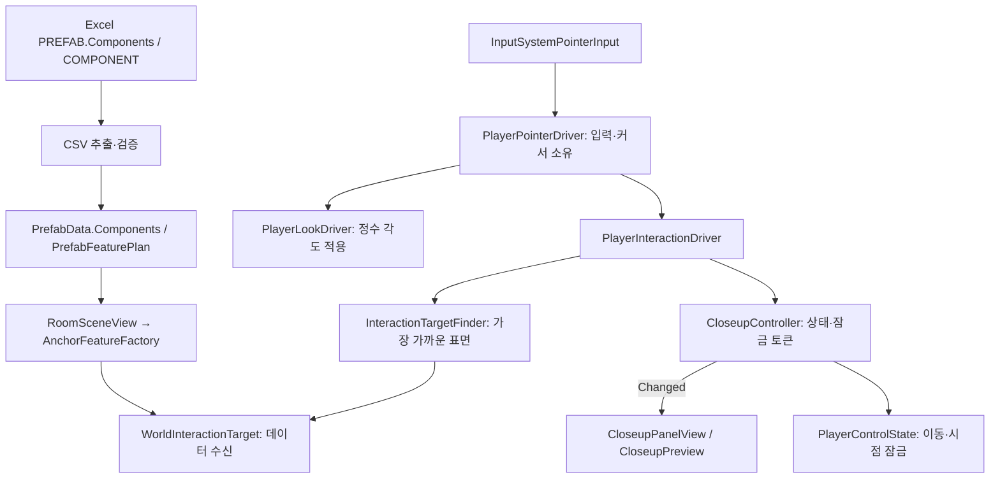

# 데이터 기반 상호작용: 첫 기능 단위

> 문서 대조일: **2026-10-26**. 현재 코드·설정을 기준으로 설명을 점검했습니다. 본문의 과거 검사 수치·실행 기록은 해당 날짜의 결과입니다. [현재 상태·문서 검토 범위](문서_현행화_점검표.md)를 함께 확인합니다.

이 문서는 첫 Closeup 단위의 기록입니다. 이후 추가된 입력 UI·API는 [정답 입력 연결 안내](AnswerApiConnection.md)를 따릅니다.

## 의도와 구현 범위

프리팹마다 스크립트와 방 번호를 수동 연결하면 시트와 실제 동작이 어긋납니다. 기존 원본의 PREFAB.Components 선언을 CSV와 데이터 모델까지 보존하고, 방 로드 중 공통 Factory가 기능을 구성하도록 연결했습니다. 이번 단위는 **대상 탐색 → 강조 → Closeup 열기 → 돌아가기/Esc**입니다. 정답 입력 UI와 문 통신·개폐·실제 다음 방 연결은 검토 후 진행합니다.

기획 작업 절차와 현재 데이터의 주의점은 [기획 작업자용 가이드](DesignerDataTableGuide.md)를 따릅니다.

## 파일별 책임과 기존 대비 변경

| 파일 | 변경과 이유 |
|---|---|
| EXCEL/SILENT_Asset_Datatable.xlsx, PREFAB!B5 | Components를 CSV 추출 제외 목록에서 제거. 다른 셀 값은 보존 |
| Data/CsvTableMapping.cs | 공통 ID 목록 변환 IdList 추가. 각 테이블에서 파싱을 반복하지 않음 |
| Data/Tables/PrefabData.cs | 불변 Components 목록 추가. 경로·분류와 기능 선언을 함께 전달 |
| Data/CsvValidation/Rules/PrefabComponentRule.cs | 양의 정수·중복·COMPONENT 참조 검사. 서버 TypeScript에도 대응 규칙 |
| World/PrefabFeaturePlan.cs | Script 등록·기능 조합·CamOffset 정수 mm 정규화. Unity 객체와 독립된 정의 |
| World/RoomSceneView.cs | 앵커 데이터 주입 전에 Factory로 기능 구성. 기존 생성/실패 정리 흐름 유지 |
| Interaction/WorldInteractionTarget.cs | Factory와 Unity 어댑터. 활성 상호작용 앵커만 수신하고 색·Collider·기능 설정 검증 |
| Player/PlayerPointerDriver.cs | 기존 시점 Driver의 입력·커서 수명 분리. 시점과 클릭이 하나의 입력 결과를 소비 |
| Player/PlayerLookDriver.cs | 커서/입력 생성 책임을 제거하고 시점 각도 적용에 집중 |
| Player/LocalPlayerFactory.cs | 공통 조작 상태에 포인터·시점·이동 의존성 주입 |
| Player/PlayerSpawnDriver.cs | 표현 에셋과 거리 데이터를 주입해 PlayerInteractionDriver 구성. 초기화 실패 시 플레이어 정리 |
| Data/Tables/CharacterStatUnits.cs | CSV 검증·생성이 같은 정수 InteractDistanceMm 사용 |
| World/GameFlowBootstrapper.cs | 상호작용 준비까지 성공해야 PlayerReady로 판단 |
| Interaction/InteractionTargetFinder.cs | 버퍼 재사용 Raycast, 자기 몸·Trigger 제외, 벽 뒤 클릭 차단 |
| Interaction/TargetHighlight.cs | 공유 Material 변경 없이 PropertyBlock 적용/복원. 파괴된 대상도 안전하게 정리 |
| Interaction/CloseupController.cs | 순수 상태와 UI 잠금 토큰 소유. 중복 열기·닫기·대상 비활성화·Dispose 처리 |
| Interaction/PlayerInteractionDriver.cs | 입력 명령과 상태/표현 모듈 조정. HTTP나 세션 토큰을 소유하지 않음 |
| Interaction/CloseupPanelView.cs | 전용 uGUI 패널·돌아가기 이벤트·필요 시 EventSystem 수명 |
| Interaction/CloseupPreview.cs | Mesh/Material만 표시용 복사. RenderTexture·카메라·Mesh 정리와 원래 카메라 마스크 복원 |
| Interaction/InteractionUiFactory.cs | 정답/클로즈업 UI가 재사용하는 Rect/Text/Button 생성 모듈 |
| Resources/InteractionPresentation.asset | 공통 폰트·미리보기 레이어/해상도/FOV. 콘텐츠별 기능 선언과 표현 설정을 분리 |
| Editor/InteractionChecks.cs | 데이터 기반 임시 대상 생성과 Unity 물리·표현 자원 검사 메뉴 |

## 적용한 패턴과 수명

Factory는 선언된 기능을 구성하고 임의 Script 문자열을 Reflection으로 실행하지 않습니다. 기능 정의는 PrefabFeaturePlan으로 검증하고, MonoBehaviour는 Unity 데이터 주입·물리·Update 수명 어댑터 역할을 맡습니다. CloseupController는 변경을 반영한 뒤 Changed 이벤트를 보내고 View는 닫기 요청을 이벤트로 전달합니다. 요청과 결과 통지를 구분하며 전역 이벤트 버스를 추가하지 않았습니다.

UI 잠금은 소유 토큰으로 획득·해제합니다. 다른 UI와 중첩되어도 자신의 잠금만 해제합니다. 비활성화/제거 시 Closeup과 강조를 정리하고 입력 해제·커서 복원은 PlayerPointerDriver가 담당합니다. 프리뷰는 원본 게임 스크립트를 복제하지 않아 통신이나 입력이 두 번 실행되지 않습니다.

논리 거리·각도는 mm/millidegree 정수입니다. CSV의 기존 미터 단위 숫자는 한 번 정규화하고 물리 질의·Transform·렌더링 경계에서만 Unity float를 사용합니다. RaycastNonAlloc은 32개 버퍼를 재사용하며 포화되면 안전하게 선택을 거부합니다. 실제 핫패스 측정 전 과도한 풀링은 추가하지 않았습니다.

이번 선택·패널은 각 클라이언트의 로컬 표현입니다. 향후 서버 정답·문 허가는 기존 서비스 계약으로 요청해야 하며 이 UI가 권한을 판정하지 않습니다. P2P/전용 서버 전환 시 필요한 권한·동기화 작업을 대체하는 구현도 아닙니다.

## 검사와 사용자 확인

순수 자동 검사 33개는 잘못된 기능 ID·중복·기능 의존성·정수 거리·CamOffset·중복 요청·대상 비활성화·잠금 해제·Dispose를 검증합니다. 기존 공통 201개와 플레이어 72개도 유지합니다. 서버 157개와 에디터/Windows 컴파일을 확인합니다.

`Tools/Game/데이터 기반 상호작용 검사`은 임시 씬에서 실제 Unity Collider·가림·강조 복원·RenderTexture·카메라 격리·표현 정리·공통 UI 잠금을 검사합니다. 씬과 원본 프리팹을 저장하지 않습니다.

실제 마우스 입력 확인은 Join에서 로컬 A 입장 → `Tools/Game/클로즈업 테스트 대상 생성` → 게임 화면 커서 잡기 → 임시 큐브 좌클릭 → 패널 표시/이동·시점 중지 → 돌아가기 또는 Esc → 커서 재획득 → 이동/시점 복구 순서입니다. 정답 컨트롤과 문 서비스는 현재 연결되어 있습니다. 입력 UI·정답 제출·문 허가·다음 방 로드는 각 기능 가이드에 따라 추가 검사합니다.

## 데이터 이관의 범위

이번 PREFAB CSV 변경은 기존 행·경로를 보존하고 Components만 ID로 연결했습니다. 원본 Excel과 클라이언트 CSV의 73/76행 차이, 기존 서버/클라이언트 PREFAB 경로 차이는 자동 덮어쓰지 않았습니다. 원본과 실행 데이터를 정리하기 전 전체 추출을 바로 적용하면 기존 아트 작업을 되돌릴 수 있어 기획 가이드에 임시 추출·비교 절차를 적었습니다.

실행 확인: 연결된 Unity에서 임시 씬의 상호작용 검사 21개가 통과했습니다. 실제 좌클릭 조작·빌드 검증은 테스트 가이드에 따라 사용자님이 확인하실 항목입니다.
