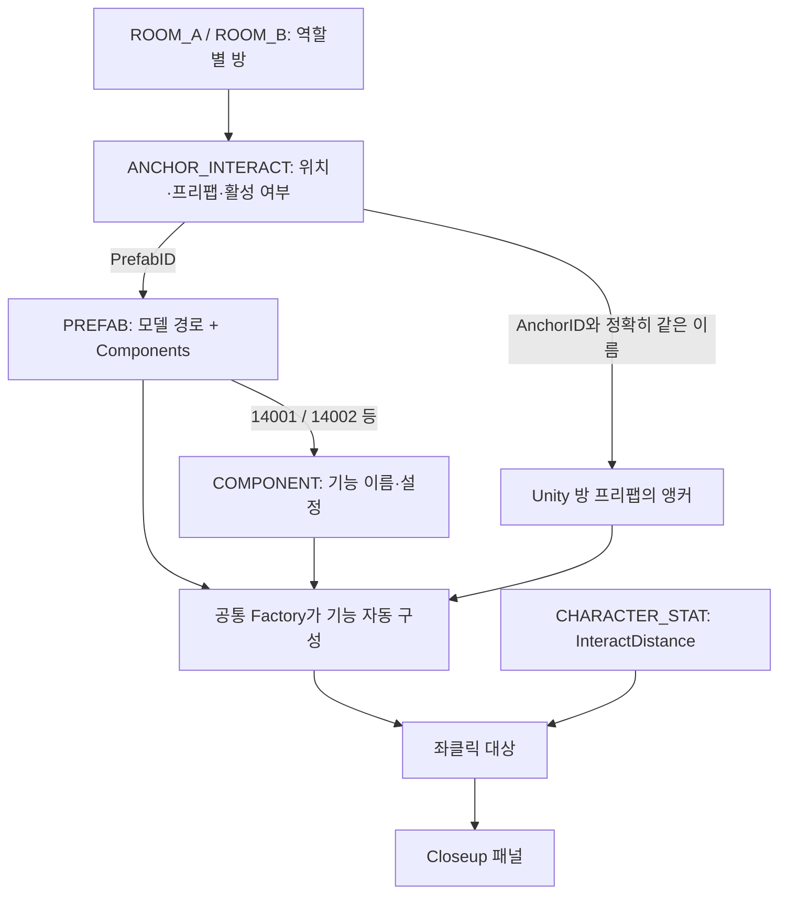

# 기획 작업자용 데이터 테이블 적용 가이드

기준: 2026-10-20. 코드에 새 오브젝트 이름이나 방별 조건을 추가하는 대신 **기존 기능을 데이터로 선택하고 연결**하는 작업 방법입니다.

현재 완료한 범위는 **좌클릭 대상 탐색·강조·Closeup과 데이터 기반 정답 입력 UI·기존 Protobuf API 연결**입니다. 문 개폐와 실제 다음 방 이동은 후속 단위입니다. 새 정답 기능의 상세 규칙과 검사는 [정답 입력 API 연결 가이드](AnswerApiConnection.md)를 따릅니다.

## 1. 먼저 이해할 연결 구조



예를 들어 프리팹 13005의 `Components=14001|14002|14003`은 Interactable·CloseUpUI·DialLock의 조합입니다. 숫자를 코드가 직접 비교하는 방식이 아니라 `COMPONENT.Script`를 읽어 공통 모듈을 선택합니다. 같은 기능을 다른 방과 모델에서 재사용할 수 있습니다.

기획 작업자는 준비된 기능의 데이터 연결을 담당합니다. 아트 작업자는 모델·앵커·Collider를 준비합니다. 개발자는 새로운 종류의 기능과 지원하는 `Params`를 한 번 등록합니다. **처음 만드는 기능 이름을 표에 적는 것만으로 새로운 프로그램이 생성되지는 않습니다.**

## 2. 어디를 수정하는가

| 목적 | 원본 / 실행 데이터 | 담당 내용 |
|---|---|---|
| 모델과 기능 조합 | EXCEL/SILENT_Asset_Datatable.xlsx → PREFAB | ID, Path, Group, Components |
| 기능별 설정 | 같은 파일 → COMPONENT | ID, Script, Params |
| 방·역할·위치 연결 | 해당 원본의 ANCHOR_INTERACT / ANCHOR_NONINTERACT | RoomNo, PlayerType, AnchorID, PrefabID, Active |
| 역할별 방 진행 | ROOM_A / ROOM_B | RoomNo, RoomPrefabID, PuzzleID, ExitRule, Next |
| 이동·조작 거리 | SILENT_Settings_Datatable → CHARACTER_STAT | InteractDistance 등 |
| 퍼즐 입력 관계 | PUZZLE / PUZZLE_SLOT / LOCK / CONSOLE | 아래 7절 참고; UI 연결은 후속 작업 |
| 클라이언트 로컬 테스트 입력 | Assets/11.CSV/*.csv | Excel에서 추출한 실행 데이터 |
| 서버 접속 모드 입력 | 서버 프로젝트 data/*.csv | 서버 시작 시 로드하고 클라이언트로 전달하는 실행 데이터 |

서버 접속 모드는 **서버가 전달한 CSV**, 클라이언트 테스트 A/B 모드는 **클라이언트에 포함된 CSV**를 사용합니다. 둘을 다르게 배포하면 같은 빌드에서도 실행 결과가 달라집니다. 서버용 데이터에는 정답이 포함되며 현재 번들은 클라이언트에도 전달되므로 정답 은닉 구조로 간주하면 안 됩니다.

## 3. PREFAB과 COMPONENT 작성 규칙

실행 CSV의 PREFAB 헤더는 다음과 같습니다.

```csv
ID,Path,Group,Components
13002,Assets/2.Model/Prefabs/Door,Shared,14001|14005
13005,Prefabs/Common/DialLock_4,Shared,14001|14002|14003
```

13002는 현재 실제 문 경로 예시입니다. 13005는 현재 표에 남아 있는 논리 경로 예시로, 그 경로의 실물 프리팹이 준비되었다는 뜻은 아닙니다. 새 대상은 실제로 등록된 프리팹 경로를 지정해야 합니다.

| 컬럼 | 작성 방법 |
|---|---|
| ID | 양의 정수 고유 ID. 기존 다른 프리팹의 ID를 재사용하지 않습니다. |
| Path | 실제 프리팹 경로. 새 프리팹은 현재 자동 수집 범위인 Assets/2.Model 아래에 둡니다. 파일 이동 후 표 경로도 갱신합니다. |
| Group | 분류용 값. 이것만 변경해서 기능이나 생성 위치가 바뀌지는 않습니다. |
| Components | COMPONENT.ID 목록을 `|`로 연결. 빈 칸은 기능 없음. 같은 ID를 중복 입력하지 않습니다. |

COMPONENT의 현재 정의와 구현 범위:

| ID | Script | Params | 현재 처리 |
|---|---|---|---|
| 14001 | Interactable | HighlightColor=Yellow | 대상 탐색·시선 강조 |
| 14002 | CloseUpUI | CamOffset=0,0.3,-0.5 | 전용 UI 패널과 모델 미리보기, 이동·시점 잠금 |
| 14003 | DialLock | - | 숫자·문자·색 다이얼 입력 UI와 정답 요청 |
| 14004 | ButtonConsole | - | 버튼 순서 입력 UI와 정답 요청 |
| 14005 | Door | - | 기능 선언 인식. 허가 요청·개폐는 후속 |
| 14006 | LetterSign | - | 메타데이터 인식. 별도 표시 동작은 후속 |
| 14007 | ScreenText | - | 메타데이터 인식. 별도 표시 동작은 후속 |
| 14009 | Spawn | - | 기존 플레이어 스폰 경로 사용. 클릭 대상이 아님 |

규칙:

- CloseUpUI·Door·DialLock·ButtonConsole에는 Interactable이 필요합니다. DialLock·ButtonConsole에는 CloseUpUI도 필요합니다.
- 같은 프리팹에 같은 Script를 가진 서로 다른 COMPONENT 행을 중복 연결할 수 없습니다.
- Script는 등록된 이름과 대소문자까지 맞춥니다. 객체 이름·Group·ID 범위로 기능을 추측하지 않습니다.
- `Params`는 `Key=Value;Key=Value` 형식입니다. 키 중복은 허용하지 않습니다. 현재 Params에서 실제로 사용하는 키는 아래 두 가지입니다. 입력 선택지는 LOCK/CONSOLE 컬럼에서 별도로 읽습니다.

| 설정 | 입력 의미 | 예시 / 제한 |
|---|---|---|
| HighlightColor | 시선을 맞춘 대상의 표시 색. 원본 Material은 바꾸지 않음 | Yellow 또는 #RRGGBB |
| CamOffset | 미리보기 카메라가 모델을 바라보는 방향과 최소 거리, x,y,z 미터 | `0,0.3,-0.5`. 각 축 ±100m, 0,0,0 금지. 모델 전체가 보이도록 거리는 자동 확대될 수 있음 |

같은 COMPONENT 행의 Params를 바꾸면 그 행을 공유하는 **모든 프리팹**에 영향을 줍니다. 특정 대상만 다르게 설정하려면 새로운 고유 COMPONENT.ID로 같은 Script와 다른 Params를 정의한 뒤 해당 프리팹에만 연결합니다.

## 4. 앵커에 배치하기

```csv
ID,RoomNo,PlayerType,AnchorID,PrefabID,Active
2002,1,ALL,R01_DoorModelPoint,13002,Y
2030,1,B,R01_Dial_table_Anchor,13045,N
```

| 컬럼 | 확인할 점 |
|---|---|
| RoomNo | 방 번호입니다. ROOM 행의 ID와 다릅니다. 1번 방은 RoomNo=1입니다. |
| PlayerType | ALL은 A/B 공통, A 또는 B는 그 역할에서만 배치합니다. |
| AnchorID | Unity 방 프리팹 내부 Transform 이름과 정확히 일치해야 합니다. 경로나 표시 문구가 아닙니다. 필요한 이름은 중복 배치하지 않습니다. |
| PrefabID | PREFAB.ID를 참조합니다. COMPONENT.ID를 넣지 않습니다. |
| Active | Y=배치 대상으로 사용, N=비활성. N인 입력 대상을 다른 테이블이 참조하면 경고가 날 수 있습니다. |

현재 R01의 활성 상호작용은 2002 문입니다. **2030 다이얼 앵커는 N**이며 연결된 프리팹 13045의 Components도 비어 있습니다. 따라서 지금 표 그대로 다이얼 Closeup이 나타나지 않는 것은 정상입니다. 단순히 2030을 Y로 바꾸는 것만으로 끝나지 않습니다. 실물 모델·앵커·Collider·Components 연결과 정답 입력 테이블 연결을 함께 확인해야 합니다.

`ANCHOR_NONINTERACT`에 Interactable 기능을 연결해도 이 Factory는 클릭 대상을 만들지 않습니다. 클릭 대상은 활성 `ANCHOR_INTERACT`에 선언합니다. 단순 배경과 플레이어 생성 위치는 기존 비상호작용/스폰 경로를 유지합니다.

아트/Unity 준비 조건:

1. 앵커 위치·회전을 맞춥니다. 자동 생성되는 모델 루트는 앵커 기준 localPosition=0, localRotation=identity로 배치됩니다. 모델의 자식 오프셋은 유지됩니다.
2. 프리팹의 보이는 클릭 부분에 활성 Collider가 있어야 합니다. Trigger나 Ignore Raycast 레이어는 클릭 대상이 되지 않습니다. Collider가 조상/자식의 어느 모델에 붙었는지도 확인합니다.
3. 클릭 대상에 메시가 있어야 Closeup 미리보기가 가능합니다. 미리보기는 Mesh/Material만 복사하며 원본 게임 스크립트·Collider를 복제하지 않습니다.
4. 기존 RoomSceneView의 포함 모델 binding을 사용하는 경우 binding 경로와 AnchorID도 일치시킵니다. 새 방 구조나 입출구 연결점은 아트·개발 작업자가 먼저 준비해야 합니다.

## 5. 조작 거리와 입력

`CHARACTER_STAT.InteractDistance=2`는 최대 2m입니다. 로드 후 **2000mm 정수**로 정규화합니다. 0이면 탐색하지 않습니다. 음수, 비정상 숫자, int32 mm로 표현할 수 없는 값은 거부합니다. 적용할 캐릭터 프로필은 기존 GAME_CONFIG의 캐릭터 선택과 PlayerPresentation 설정을 따릅니다.

현재 조작은 화면 중앙을 대상에 맞추고 좌클릭합니다. 먼저 만난 벽·다른 Collider 뒤의 오브젝트를 선택하지 않습니다. CloseUpUI 대상만 패널을 엽니다. UI가 열리면 WASD와 마우스 시점이 함께 중지되고 UI 클릭을 사용합니다. 돌아가기 또는 Esc로 닫습니다. 닫은 뒤 게임 화면을 클릭하면 커서를 다시 잡으며, 이 클릭이 동시에 대상을 작동시키지는 않습니다.

CloseUpOpenMs, HeadBob 등 표에 존재하는 모든 컬럼이 이번 기능에서 소비되는 것은 아닙니다. 이번 패널은 즉시 열리며 열기 보간 시간은 아직 적용하지 않습니다. 폰트·캔버스·미리보기 레이어/해상도는 공통 표현 에셋 `Resources/InteractionPresentation`에서 개발자가 관리합니다. 콘텐츠별 동작 선택은 표에서 합니다.

## 6. Excel → CSV → 테스트 → 배포 순서

### 추출하기 전에

원본 Asset 엑셀은 6행 헤더·7행 이후 데이터 형식입니다. 5행의 추출 제외 목록에서 **PREFAB!B5는 `Name, ModelerCode`**여야 합니다. `Components`를 제외 목록에 넣으면 기능 연결이 CSV에서 사라집니다. 이번 작업에서 이 한 셀을 수정했습니다. CSV에는 새 `Components` 헤더가 반드시 필요하며 빈 셀은 허용합니다.

**현재 원본과 실행 CSV가 완전히 일치하지 않습니다.** 원본 PREFAB은 73행, 클라이언트 CSV는 76행이며 CSV의 13076/13077/13078은 원본에 없습니다. 일부 경로도 다릅니다. 이번에는 현재 CSV 행과 경로를 보존하면서 Components만 ID로 연결했습니다. 따라서 원본을 정리하기 전에는 전체 추출 결과로 현재 CSV를 일괄 덮어쓰지 마십시오. 누락 ID·경로를 기획/아트 작업자와 먼저 맞추고 차이를 검토해야 합니다.

### 적용 순서

1. 원본 시트에서 기존 ID를 확인하고 기능·참조를 수정한 뒤 Excel 파일을 저장합니다.
2. 프로젝트 루트에서 `powershell -NoProfile -ExecutionPolicy Bypass -File EXCEL/CsvExporter/Export-Csv.ps1 -InputDirectory EXCEL -OutputDirectory Temp/CsvReview`로 임시 출력합니다. 기존 ExtractCsv.cmd는 Assets/11.CSV에 바로 쓰므로 원본 불일치 해결 전에는 이 검토용 명령을 사용합니다. 자세한 규칙은 `EXCEL/CsvExporter/사용방법.txt`를 따릅니다. CSV를 Excel에서 수동 저장할 때는 UTF-8과 따옴표 규칙을 지킵니다. CamOffset처럼 쉼표가 포함된 Params는 하나의 셀이어야 합니다.
3. 이전 CSV와 비교합니다. 삭제된 ID, 의도하지 않은 Path 변경, 빠진 Components 헤더, Active 변경을 확인합니다. 현재의 원본 불일치가 먼저 정리되어야 안전한 전체 자동 추출이 가능합니다.
4. 클라이언트 `Assets/11.CSV`에 검토한 파일을 적용합니다. Unity의 **Tools → Game → Rebuild Content References**로 참조를 갱신합니다. 빌드 때도 자동 갱신됩니다.
5. **Tools → CSV → 검사기**에서 실행 데이터와 프리팹 참조를 검사합니다. 검증 오류를 해결하고 경고의 비활성 대상이 의도된 것인지 확인합니다.
6. 서버 없는 확인은 Join의 클라이언트 테스트 A/B를 사용합니다. 자동 접속을 끄는 설정과 B 미배치 앵커 주의점은 README를 따릅니다.
7. 서버 모드도 확인할 때는 검토한 서버용 CSV를 서버 `data`에 반영하고 `npm.cmd run csv:validate` 후 서버를 재시작합니다. 실행 중 파일만 바꿔서는 메모리에 반영되지 않습니다. 새 클라이언트 입장으로 갱신된 데이터 묶음을 받습니다.
8. 다른 PC에 배포할 때는 클라이언트 새 빌드와 서버 새 데이터가 같은 기능 계약을 지원하는지 확인합니다. Docker 서버는 데이터를 포함한 이미지도 다시 빌드·교체해야 합니다.

### 이번 Closeup 기능만 확인하기

- Play 종료 상태에서 **Tools → Game → 데이터 기반 상호작용 검사**: 선언 기반 구성·거리·가림·강조 복원·UI 잠금·미리보기 자원 검사를 실행합니다.
- Join에서 클라이언트 테스트 A로 입장한 뒤 **Tools → Game → 클로즈업 테스트 대상 생성**: 카메라 앞 임시 큐브에 실제 PREFAB 13005의 기능 선언을 적용합니다. 실제 CSV와 방 프리팹은 수정하지 않습니다.
- 게임 화면에서 커서를 잡은 뒤 큐브에 시선을 맞춰 좌클릭합니다. 미리보기 패널·돌아가기·Esc·이동/시점 중지와 복귀를 확인합니다. 이 큐브는 다이얼/정답 UI 테스트 대상이 아니라 이번 Closeup 연결 확인용입니다.
- 원래 R01 문은 Interactable 강조까지이며 문 동작은 다음 기능 단위에서 검토합니다.

## 7. 정답과 문을 연결할 때 준비할 데이터

아래 데이터 구조와 서버 규칙은 존재합니다. **정답 입력 UI 연결은 추가 완료했으며 문 동작은 후속**입니다.

```text
ROOM_A / ROOM_B.PuzzleID → PUZZLE.ID
PUZZLE.InputAnchor → ANCHOR_INTERACT.ID
PUZZLE.SolverRoom / ClueRoom → ROOM_A 또는 ROOM_B.ID
PUZZLE_SLOT.PuzzleID → PUZZLE.ID / Slot 순서로 정답 문자열
LOCK.AnchorRef / CONSOLE.AnchorRef → 입력 앵커 ID
ROOM_A / ROOM_B.Next → 같은 플레이어의 다음 ROOM.ID
```

예: PUZZLE 5001은 SolverRoom=1002(B의 1번 방), ClueRoom=1001(A의 1번 방), InputAnchor=2030입니다. RoomNo=1과 ROOM.ID=1001/1002를 혼동하지 않습니다. 정답은 숫자로 강제 변환하지 않는 문자열이며 슬롯 수·순서와 함께 관리합니다. 방별 역할은 ROOM과 PUZZLE 연결로 결정합니다.

서버는 정답/문 허가 판단을 소유합니다. 클라이언트가 표의 정답만 보고 자체 통과시키지 않습니다. 정답을 입력한 측의 다음 방이 먼저 해금되고, 상대 측은 문제 해결 후 문 확인으로 자신의 다음 방을 해금하는 기존 정책을 유지합니다. 이미 허가된 문의 반복 개폐를 매번 통신하는 방식으로 바꾸지 않습니다.

## 8. 문제가 보일 때 확인표

| 증상 | 먼저 확인할 곳 |
|---|---|
| 오브젝트가 안 생김 | Active, 역할, RoomNo, AnchorID, 실제 prefab Path와 콘텐츠 참조 |
| 보이지만 클릭 안 됨 | ANCHOR_INTERACT 여부, Components의 Interactable, 거리, Collider·레이어·앞쪽 장애물 |
| 강조되지만 Closeup이 안 열림 | Components에 CloseUpUI가 있는지. Door 선언만으로 패널을 열지 않음 |
| 기능 ID 참조 오류 | PREFAB.Components와 COMPONENT.ID의 연결, 중복·빈 구분자·오타 |
| 배치 후 기능 설정 오류 | Script 이름, 필수 기능 조합, Params 형식·색·CamOffset |
| 미리보기가 없음 | 표시할 Mesh/Renderer, 전용 표현 에셋·레이어, Console 오류 |
| 로컬과 서버 테스트 결과가 다름 | 어느 쪽 CSV를 수정했는지, 서버 재시작과 새 입장 여부 |
| B에서 게임 준비가 실패함 | 기존 R01_LEDPanelPoint 미배치 문제. 데이터만 임의로 끄지 말고 아트 배치와 함께 해결 |
| CSV 추출 후 멀쩡하던 모델이 사라짐 | 원본 Excel과 현재 CSV의 ID·Path 불일치, 추출 제외 목록 |

검증 성공은 참조·값 검사가 통과했다는 뜻입니다. 프리팹 모델의 실제 배치·Collider 정합성과 Play 조작, 아직 구현되지 않은 후속 기능까지 모두 통과했다는 뜻은 아닙니다.

구체적인 조작과 항목별 통과 기준은 [상호작용 테스트 가이드](InteractionTestGuide.md)를 따릅니다.

## 정답 입력 API 연결 추가

DialLock·ButtonConsole 입력 UI와 기존 Protobuf API 연결을 추가했습니다. 위 문서의 해당 기능 '후속' 표기는 첫 Closeup 단위 당시 기록이며, 현재 적용 컬럼·입력 방식·검사 절차는 [정답 입력 API 연결 가이드](AnswerApiConnection.md)를 기준으로 합니다. 문 개폐와 실제 다음 방 연결은 계속 후속 범위입니다.

현재 PREFAB 13079·13080·13081은 다른 작업자분이 추가 중입니다. 정의가 완성되기 전 전체 로컬 검증 실패를 API 연결 실패로 판단하지 않습니다.
