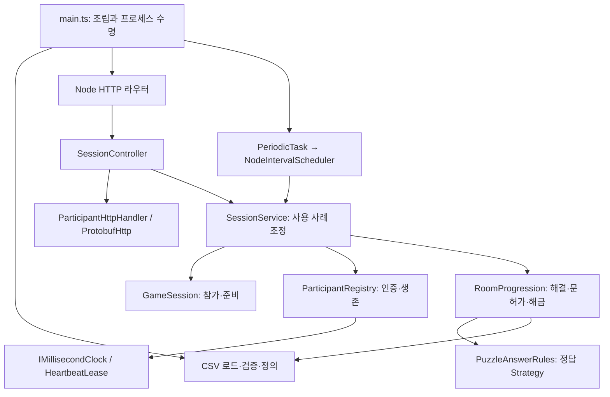
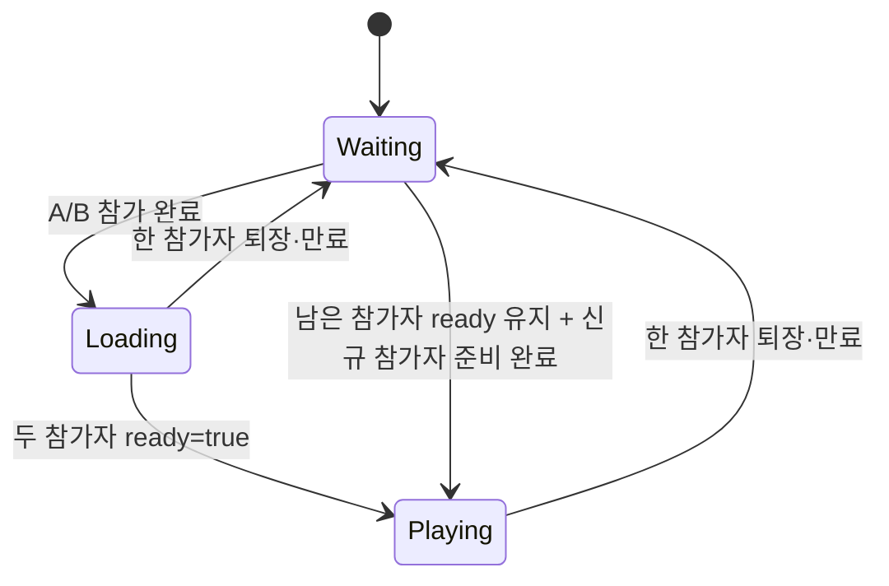
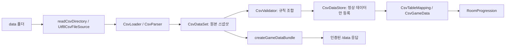
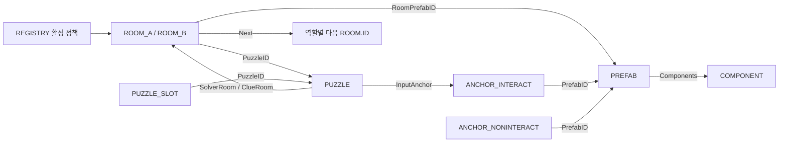
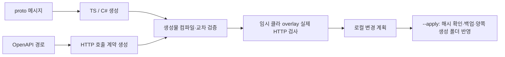

# 서버 코드·기능 계층과 설계 의도

> 문서 대조일: **2026-10-26**. 현재 코드·설정을 기준으로 설명을 점검했습니다. 본문의 과거 검사 수치·실행 기록은 해당 날짜의 결과입니다. [현재 상태·문서 검토 범위](문서_현행화_점검표.md)를 함께 확인합니다.

기준: 2026-10-23 로컬 서버 코드. 최신 점검·수정 근거는 [서버 구조 점검](ArchitectureReview.md)을 함께 봅니다. 구현 설명이며, 새 기능을 구현한 문서는 아닙니다. 각 절의 코드 링크는 확인한 실제 파일로 연결됩니다. 소스 변경 시 줄 번호와 데이터 예시는 달라질 수 있습니다.

관련 문서: [전체 구조](project-overview/README.md), [클라이언트 초기 상세 기록](ClientCodeArchitecture.md). 최신 클라이언트 구조·수정 보고서는 Unity 프로젝트 Docs/ArchitectureReview.md와 Docs/ClientArchitectureReview.md에 있습니다.

## 목차

- [1. 서버의 역할과 설계 개념](#1-서버의-역할과-설계-개념)
- [2. 실행 계층 → 초기화와 종료](#2-실행-계층--초기화와-종료)
- [3. 요청 수신 계층 → 라우터와 Controller](#3-요청-수신-계층--라우터와-controller)
- [4. 응용 계층 → 세션 사용 사례 조정](#4-응용-계층--세션-사용-사례-조정)
- [5. 도메인 계층 → 정답·문 허가·다음 방](#5-도메인-계층--정답문-허가다음-방)
- [6. 데이터 계층 → 읽기·검증·타입 변환](#6-데이터-계층--읽기검증타입-변환)
- [7. 데이터 관계 → 실제 방에서 코드까지](#7-데이터-관계--실제-방에서-코드까지)
- [8. 자동화 계층 → 생성과 배포](#8-자동화-계층--생성과-배포)
- [9. 디자인 패턴과 실제 적용 범위](#9-디자인-패턴과-실제-적용-범위)
- [10. 검사·확장·현재 제한](#10-검사확장현재-제한)

## 1. 서버의 역할과 설계 개념

### 1.1 해결하는 문제와 소유권

두 플레이어는 서로 다른 방을 로컬에서 표현합니다. 서버는 **누가 참가자인지, 어느 퍼즐이 해결됐는지, 각 역할의 문을 사용할 수 있는지, 어떤 방이 해금됐는지**를 판정합니다. Transform·문 각도·마우스·카메라·충돌을 소유하지 않습니다. 클라이언트가 `true`를 보냈다는 이유로 정답 처리하지 않고, 토큰과 서버 CSV로 요청을 해석합니다.

| 구분 | 정의 또는 상태 | 소유 코드 | 분리 이유 |
|---|---|---|---|
| 콘텐츠 정의 | 방 연결·역할·정답·프리팹 경로 | `CsvGameData` | 기획 변경을 세션 처리 코드에서 분리 |
| 참가 상태 | 자리·역할·ready | `GameSession` | HTTP와 무관하게 참가 규칙 검사 |
| 인증·생존 | 토큰 → playerId·마지막 확인 시간 | `ParticipantRegistry`, `HeartbeatLease` | 자리와 연결 생존을 같은 객체에 뒤섞지 않음 |
| 진행 상태 | solved·permitted·unlocked | `RoomProgression` | 정답, 문 허가, 다음 방 개방의 의미 구분 |
| 전송 표현 | HTTP 상태·Protobuf oneof | `ProtobufHttp` | 도메인 결과가 전송 형식에 종속되지 않게 함 |

현재 **프로세스에 세션 1개, 역할 A/B 2개, 메모리 상태**입니다. 데이터베이스·다중 매칭·재시작 복원·P2P/호스트 권한 전환은 구현되지 않았습니다. 클래스를 분리했다는 이유만으로 서버 형태를 즉시 교체할 수 있는 것은 아닙니다.

### 1.2 기능 계층과 의존 방향



상위 조립 지점이 구체 구현을 생성하고 주입합니다. 도메인 모델이 라우터나 파일 시스템을 역참조하지 않습니다. 현재 별도 DI 프레임워크 없이 생성자·함수 매개변수로 조립합니다.

## 2. 실행 계층 → 초기화와 종료

### 2.1 `main.ts.start`의 조립 순서

코드: [main.ts](../src/main.ts).

1. `loadGameData(resolve(__dirname, "../data"))`: 실행 파일 위치 기준 CSV를 읽고 검증·모델 변환합니다. 실패하면 HTTP를 열지 않습니다.
2. `loadServerConfig(process.env)`: HOST·PORT·만료/검사 간격을 검증합니다.
3. `GameSession({id: session-UUID, roles:[A,B]})`: 프로세스별 세션 ID와 역할 자리를 정의합니다. 세션 ID는 클라 음성 채널 정책에도 활용됩니다.
4. 단조 증가 시계 → `ParticipantRegistry` → `SessionService(session, participants, gameData)` → `SessionController`를 생성합니다.
5. `createSessionHttpServer(controller)`와 `PeriodicTask`를 만들고, HTTP listen 완료 후 만료 검사를 시작합니다.
6. SIGINT/SIGTERM에서 주기 작업을 정지하고 `server.close()`를 호출합니다. close 이벤트에서 시그널 구독도 해제합니다. 사용자 정의 연결 강제 종료 제한 시간은 이 코드에 없습니다.

**의도:** CSV가 잘못된 상태에서 “health만 정상인 게임 서버”를 시작하지 않으며, 타이머와 HTTP 서버의 수명을 실행 경계에서 함께 관리합니다. 코드 주석에 Bootstrapper 분리 계획이 있지만 현재 조립 지점은 실제로 `main.ts`입니다.

### 2.2 설정·시계·스케줄러 어댑터

| 코드 | 입력 → 출력 | 주요 책임과 선택 의도 |
|---|---|---|
| [ServerConfig.ts](../src/config/ServerConfig.ts) | 환경 문자열 → 검증된 설정 | 정수 포트·양의 ms·검사 간격 관계 검사. 기본값과 실행 프로필을 구분 |
| [IMillisecondClock.ts](../src/common/IMillisecondClock.ts) | `elapsedMilliseconds` 계약 | 테스트에서 가짜 시계를 주입할 수 있는 시간 포트 |
| [MonotonicMillisecondClock.ts](../src/common/MonotonicMillisecondClock.ts) | Node 단조 시간 → 정수 ms | 시스템 시각 변경의 영향을 생존 판정에서 분리 |
| [PeriodicTask.ts](../src/common/timing/PeriodicTask.ts) | scheduler·간격·작업 | start/stop 책임. 게임 모델이 setInterval을 직접 호출하지 않음 |
| [NodeIntervalScheduler.ts](../src/infrastructure/timing/NodeIntervalScheduler.ts) | 스케줄러 계약 → Node 타이머 | 런타임 의존성을 인프라 어댑터에 집중 |

기본 참가자 만료는 10000ms, 검사 주기는 500ms입니다. 실제 자리가 제거되는 시점은 주기 검사 또는 다음 입장·인증 요청 시점입니다. 10000ms 경계를 넘긴 토큰을 늦은 heartbeat로 되살리지 않습니다.

## 3. 요청 수신 계층 → 라우터와 Controller

### 3.1 라우터가 위치한 파일

**클라이언트의 HTTP 요청을 처음 받는 라우터는 [createSessionHttpServer.ts](../src/infrastructure/http/createSessionHttpServer.ts)의 `createSessionHttpServer`입니다.**

Node `createServer`의 콜백이 URL pathname을 구하고, OpenAPI에서 생성된 `gameApiOperations`의 HTTP 메서드·경로 정규식과 대조합니다. `operation.name` switch가 Controller의 메서드를 선택합니다. OpenAPI를 수정해도 새 사용 사례의 switch와 Controller 구현까지 자동 작성되지는 않습니다.

| 메서드·경로 | Controller | Service / 도메인 | 성공 결과 |
|---|---|---|---|
| `POST /sessions/join` | `join` | `join` / 자리·토큰 등록 | joined, 201 |
| `GET /sessions/{sessionId}` | `query` | `query` / snapshot | snapshot, 200 |
| `POST .../ready` | `ready` | `ready` / ready=true | snapshot |
| `POST .../heartbeat` | `heartbeat` | `heartbeat` / lease 갱신 | completed |
| `POST .../leave` | `leave` | `leave` / 토큰·자리 삭제 | completed |
| `GET .../data` | `data` | `data` / 메모리 CSV 번들 | data |
| `POST .../rooms/answer` | `room(..., true)` | `decideRoom(..., answers)` | room |
| `POST .../rooms/door` | `room(..., false)` | `decideRoom(..., undefined)` | room |
| `POST .../puzzles/{puzzleId}/submit` | `submit` | `submit` / 기존 디버그 진입점 | puzzle |
| `GET /health` | 라우터 직접 | `{status:"ok"}` | JSON |
| `GET /openapi.json` | 라우터 직접 | 생성된 OpenAPI 객체 | JSON |

### 3.2 Controller·인증 경계·직렬화의 분업

코드: [SessionController.ts](../src/controllers/SessionController.ts), [ParticipantHttpHandler.ts](../src/controllers/http/ParticipantHttpHandler.ts), [ProtobufHttp.ts](../src/controllers/http/ProtobufHttp.ts).

`SessionController.room`은 Protobuf를 해석하고 방 번호·답 목록을 검사한 다음 참가자 공통 처리에 위임합니다. 문 요청에 답이 들어 있으면 거절합니다. `ParticipantHttpHandler.handle`은 `x-participant-token`을 읽어 서비스 함수를 실행하고 응답 종류를 전달합니다. `ProtobufHttp.result`가 내부 결과를 생성 메시지로 바꾸고 전송합니다.

입력 제한은 **본문 8192바이트, 답 최대 64개, 각 문자열 길이 최대 256**입니다. 게임 본문의 Content-Type은 `application/protobuf`이며 JSON은 415로 거절됩니다. 응답에는 `no-store`, `nosniff`가 붙습니다.

`false`는 정상 게임 판정입니다. 토큰 무효·미준비·없는 방·잘못된 메시지는 failure oneof와 HTTP 상태로 구분합니다. **통신 실패를 오답으로 표시하지 않기 위한 설계**입니다. `oneof`가 존재하므로 기본값 false인 정상 메시지와 결과가 아예 없는 메시지를 구별할 수 있습니다.

## 4. 응용 계층 → 세션 사용 사례 조정

### 4.1 `SessionService` Facade

코드: [SessionService.ts](../src/services/SessionService.ts).

| 메서드 | 처리 순서 | 상태 변화 |
|---|---|---|
| `join` | 만료 정리 → 전원 부재 시 진행 reset → 빈 역할 할당 → 토큰 생성·등록 | Player 추가, ready=false. 토큰 등록 실패 시 자리 되돌림 |
| `validateParticipant` | sessionId 대조 → 만료 정리 → 토큰 조회 | 무효 토큰은 요청 거절 |
| `ready` | 인증 → `markSceneLoaded` → snapshot | 해당 참가자 ready=true |
| `query` | 인증 → snapshot | 생존 시간은 갱신하지 않음 |
| `heartbeat` | 인증 → `tryRenew` | 만료 전 lease만 갱신 |
| `leave` / `removeParticipant` | 인증 → registry 삭제 → session 자리 삭제 | 토큰과 자리 함께 제거 |
| `data` | 인증 → 생성 시 캐시한 번들 반환 | 디스크 재조회 없음 |
| `decideRoom` | 인증 → 토큰의 역할 조회 → 역할별 방 검색 → Playing 검사 → submit 또는 checkDoor | 진행 상태 갱신 후 snapshot 반환 |
| `expireParticipants` | 만료 토큰 목록 순회 → 공통 remove | 비정상 종료한 클라의 자리 회수 |

이 서비스는 HTTP 헤더나 Unity 객체를 모르며, 도메인 모델 사이의 작업 순서를 소유합니다. 단, 현재 생성자에서 `RoomProgression`을 직접 생성하고, 선택적 gameData로 데이터 없는 세션 검사를 허용합니다. 모든 내부 의존성이 인터페이스로 추상화된 완전한 포트 구조는 아닙니다.

### 4.2 참가 모델과 준비 상태

코드: [GameSession.ts](../src/models/GameSession.ts).

`addPlayer`는 정의한 역할 중 비어 있는 첫 역할을 선택합니다. `getSnapshot`은 내부 Player의 복사본을 반환합니다. `phase`는 저장된 별도 State 객체가 아니라 참가자 배열로 계산하는 상태입니다.



마지막 화살표는 중간 Loading을 거치는 논리 흐름의 요약입니다. 한 명이 나가도 남은 사람의 ready·진행은 유지됩니다. 모두 나간 뒤 다음 join에서 진행을 초기화합니다. 재시작하면 모든 상태와 세션 ID가 새로 만들어집니다.

### 4.3 참가자 생존

코드: [ParticipantRegistry.ts](../src/services/ParticipantRegistry.ts), [HeartbeatLease.ts](../src/common/liveness/HeartbeatLease.ts).

`Map<token, {playerId, lease}>`로 인증과 생존을 묶습니다. 등록 시 토큰/플레이어 ID 중복을 막고, `getPlayerId`는 만료된 lease를 반환하지 않습니다. 서버는 heartbeat **수신 성공**을 기준으로 갱신하고, 클라는 heartbeat **정상 응답 수신**으로 연결을 감시합니다. 양방향 감시지만 동일 시각에 종료되는 동기 시계는 아닙니다.

## 5. 도메인 계층 → 정답·문 허가·다음 방

### 5.1 세 종류의 진행 상태를 분리한 이유

코드: [RoomProgression.ts](../src/models/RoomProgression.ts).

| Set | 키 | 의미 | 예시 |
|---|---|---|---|
| `solved` | PUZZLE.ID | 서버가 인정한 정답 | 5001 해결 |
| `permitted` | ROOM.ID | 그 역할의 문 사용 허가 | B 1002 문 허가 |
| `unlocked` | ROOM.ID | 클라가 로드 가능한 방 | B 1004 추가 |

방 번호 1은 A/B가 공유하지만 ROOM.ID는 1001/1002로 다릅니다. 이를 섞으면 B가 정답을 맞혔을 때 A의 다음 방까지 즉시 열리는 문제가 생깁니다. Set은 누적이므로 다음 방을 열어도 기존 방 ID는 제거하지 않습니다.

### 5.2 `submit`과 정답 Strategy

`submit(role,puzzleId,answers)`는 활성 퍼즐, 해당 역할의 SolverRoom, SolverRoom 해금을 확인합니다. `PUZZLE_SLOT`을 `Slot` 순서로 정렬하고 `PuzzleAnswerRules.evaluate`로 판정합니다. 정답이면 solved를 기록하고 **제출자의 방에 대해** `checkDoor`를 호출합니다.

코드: [PuzzleAnswerRules.ts](../src/models/PuzzleAnswerRules.ts).

`IPuzzleAnswerRule.matches`가 Strategy 계약, `SlotAnswerRule`이 현재 구현, `PuzzleAnswerRules`의 Type→규칙 Map이 선택기입니다. `CardLetter`, `FrameCount`, `ArrowSequence`, `WireRank`, `TwistedFormula`, `TVLetter`, `ColourWord`가 모두 같은 슬롯 비교 규칙을 공유합니다. **7가지 별도 퍼즐 알고리즘이 구현된 상태는 아닙니다.** 비교는 개수 일치 및 순서별 대문자 변환 문자열 일치이며 자동 trim이나 숫자 변환을 하지 않습니다.

새 판정 방식은 `IPuzzleAnswerRule` 구현과 Type 등록으로 확장하고 인증·HTTP 코드를 복제하지 않습니다. 클라의 입력 UI 종류인 Dial/Sequence와 서버의 Puzzle.Type은 서로 다른 분류입니다.

### 5.3 `checkDoor`와 ExitRule

1. 역할과 roomNo로 활성 ROOM을 찾고 현재 방의 해금을 확인합니다.
2. 이미 permitted이면 true를 재사용합니다.
3. `SolvedEach`는 해당 ROOM.PuzzleID, `BothSolved`는 같은 RoomNo의 활성 A/B ROOM.PuzzleID가 모두 solved인지 봅니다.
4. 만족하면 그 ROOM.ID만 permitted에 추가하고 Next가 0이 아니면 Next ID를 unlocked에 추가합니다.

`RoomExitRules`가 허용 정책을 해석합니다. 모르는 정책은 검증·실행에서 차단합니다. 7번 방에서는 **정답=true이면서 문 허가=false**가 정상일 수 있습니다. 서버는 문을 실제로 회전시키지 않고 허가와 snapshot만 반환합니다.

## 6. 데이터 계층 → 읽기·검증·타입 변환

### 6.1 계층을 나눈 의도



코드: [loadGameData.ts](../src/infrastructure/data/loadGameData.ts), [CsvDataSet.ts](../src/data/CsvDataSet.ts), [CsvDataStore.ts](../src/data/CsvDataStore.ts), [CsvGameData.ts](../src/data/tables/CsvGameData.ts).

CSV 파서는 문법만, 검증기는 의미와 관계만, Store는 등록·캐시·알림만, 행 모델은 타입 변환만 담당합니다. `RoomProgression`이 파일을 열거나 CSV 문자열을 해석하지 않는 이유입니다.

### 6.2 원본·등록·매핑의 메서드별 계약

| 메서드/클래스 | 상세 동작 |
|---|---|
| `readCsvDirectory` | 폴더에서 CSV를 수집하고 파일명 stem을 시트 이름으로 사용. REGISTRY.File로 런타임 파일 경로를 동적으로 결정하는 구조가 아님 |
| `Utf8CsvFileSource` | 엄격한 UTF-8 입력 어댑터. 잘못된 인코딩을 정상 문자열로 무시하지 않음 |
| `CsvParser` | BOM, 인용부호, 쉼표·줄바꿈·따옴표 이스케이프. 첫 비어 있지 않은 레코드가 헤더 |
| `CsvDataSet` | 문서·행과 읽기/파싱 오류의 스냅샷. 모든 값을 처음에는 문자열로 보존 |
| `CsvDataStore.initialize` | 성공한 최초 초기화 재사용, 동시 호출이 같은 로딩 작업 공유. 최초 호출자가 실제 로드 취소 수명 소유 |
| `register` | 검증 성공 후에만 원본 교체·캐시 clear·등록 완료 알림. 실패한 재등록은 이전 정상 상태 보존 |
| `CsvTableMapping<T>` | 시트 이름과 행 변환 함수를 결합. 새 시트를 클래스에 연결하는 명시적 매핑 |
| `CsvGameData` | REGISTRY 활성 시트만 읽기 전용 타입 주입. 비활성/미등록은 빈 목록, 원본 검증 유지 |

등록 이벤트는 `onRegistered`가 구독 해제 함수를 반환하는 Observer입니다. 현재 서버는 이 이벤트로 파일 감시나 hot reload를 자동 실행하지 않습니다. 새 데이터 정의를 기존 `RoomProgression`에 즉시 갈아끼우는 수명 정책도 연결되어 있지 않습니다.

### 6.3 검증 규칙의 계층

코드: [CsvValidator.ts](../src/data/validation/CsvValidator.ts), [CsvSchema.ts](../src/data/validation/CsvSchema.ts), [CsvTableRules.ts](../src/data/validation/CsvTableRules.ts), [CsvGameRules.ts](../src/data/validation/CsvGameRules.ts), [CharacterStatRule.ts](../src/data/validation/CharacterStatRule.ts), [PrefabComponentRule.ts](../src/data/validation/PrefabComponentRule.ts).

`CsvValidator`는 `ICsvValidationRule[]`를 순회하고 한 Context에 issue를 누적합니다. 스키마·참조·방·퍼즐·값 관계·캐릭터 단위·프리팹 기능 규칙을 조합합니다. 실패 즉시 다음 규칙으로 넘기는 Chain of Responsibility라기보다 **검증 규칙 파이프라인**입니다.

| 단계 | 검증 내용 |
|---|---|
| 문법·구조 | UTF-8·CSV 파싱·필수 컬럼·기본키·복합키·미등록 컬럼 경고 |
| 값 | int32·유한 소수·범위·허용 문자열·Y/N·필수/선택값 |
| 관계 | REGISTRY 등록·Parent/Uses·ParentKey·다른 테이블 ID·비활성 대상 경고 |
| 방 그래프 | Next 순환·시작점 1개·활성 방 전체 연결·A/B ROOM 공통 ID 영역 |
| 퍼즐 | Solver/Clue 역할·방 일치·InputAnchor 소속·슬롯 수와 순서 |
| 기능 | PREFAB.Components 존재·허용 Script·기능 의존성·CamOffset/HighlightColor 등 |
| 캐릭터 | 정수 단위 변환·범위·눈높이/캡슐/단차 관계 |

서버는 Unity 프리팹의 실제 Transform·Collider·Shader를 검사할 수 없습니다. 테이블 참조가 맞는 것과 씬이 준비된 것은 다른 조건입니다.

### 6.4 CSV 번들의 의미

코드: [GameDataBundle.ts](../src/data/GameDataBundle.ts).

`createGameDataBundle`은 검증된 문서를 시트명 순서로 정렬하고 문자열을 CSV 인용 규칙으로 재직렬화합니다. `{name,csv}` 목록의 JSON 표현에 SHA-256을 적용한 version을 만듭니다. `SessionService` 생성 시 캐시하고 `/data`에서 Protobuf로 전달합니다.

이 번들은 **CSV 문자열 묶음**입니다. Unity AssetBundle·Addressables·프리팹 다운로드·암호화 파일이 아닙니다. version은 데이터 내용 식별값이며 자동 패치/비밀보호 기능을 의미하지 않습니다. 현재 PUZZLE_SLOT.Answer도 전체 데이터와 함께 전달되므로 정답 비공개 구조는 아닙니다. 서버 판정 권한과 정답 데이터 은닉은 별도 문제입니다.

## 7. 데이터 관계 → 실제 방에서 코드까지

### 7.1 관계 지도와 키의 의미



RoomNo는 화면 방 번호, ROOM.ID는 A/B를 구분한 고유 번호입니다. 참가자 A/B와 ROOM.Role의 Clue/Solver도 다른 구분입니다.

### 7.2 1번 방의 실제 데이터 추적

B 1번 방은 ROOM_B.ID=1002, RoomNo=1, PuzzleID=5001, Next=1004입니다. A 1번 방 ID는 1001이고 같은 퍼즐의 단서 방입니다. PUZZLE 5001의 SolverRoom=1002, ClueRoom=1001, InputAnchor=2030이며 슬롯 4개를 비교합니다.

B의 정답 제출은 B의 문과 1004를 먼저 해금합니다. A는 자기 문 허가 확인 뒤 1003을 해금합니다. 마지막은 A 1013/퍼즐 5007, B 1014/퍼즐 5008, BothSolved·Next=0이며 공동 완료 후 영상을 시작합니다.

서버는 예시의 `LOCK.DialFace`를 이용해 UI를 만들지 않습니다. UI는 클라이언트가 만들고 서버는 `PUZZLE.Type`의 규칙 및 `PUZZLE_SLOT.Answer`로 판정합니다. 이 분리 덕분에 UI 표현 변경이 인증·진행 로직으로 전파되지 않습니다.

### 7.3 원본 24개와 활성 시트의 컬럼·사용 상태

| 테이블 | 상태 | 행 수 | 컬럼 |
|---|---|---:|---|
| [ANCHOR_INTERACT](../data/ANCHOR_INTERACT.csv) | 활성 | 16 | `ID`, `RoomNo`, `PlayerType`, `AnchorID`, `PrefabID`, `Active` |
| [ANCHOR_NONINTERACT](../data/ANCHOR_NONINTERACT.csv) | 활성 | 35 | `ID`, `RoomNo`, `PlayerType`, `AnchorID`, `PrefabID`, `Active` |
| [ARROW](../data/ARROW.csv) | 비활성·미등록 원본 | 0 | `AnchorRef`, `Order`, `Dir`, `IsAnswer` |
| [CARD](../data/CARD.csv) | 비활성·미등록 원본 | 50 | `ID`, `AnchorRef`, `CardNo`, `TopMark`, `BottomMark`, `IsAnswer` |
| [CHARACTER_STAT](../data/CHARACTER_STAT.csv) | 활성 | 1 | `ID`, `WalkSpeed`, `Acceleration`, `Deceleration`, `MouseSensitivity`, `PitchLimit`, `FOV`, `EyeHeight`, `CapsuleHeight`, `CapsuleRadius`, `StepOffset`, `InteractDistance`, `CloseUpOpenMs`, `HeadBob` |
| [COLOR_LETTER](../data/COLOR_LETTER.csv) | 활성 | 6 | `ID`, `PuzzleID`, `Letter`, `Color`, `SignAnchor` |
| [COMPONENT](../data/COMPONENT.csv) | 활성 | 8 | `ID`, `Script`, `Params` |
| [CONSOLE](../data/CONSOLE.csv) | 활성 | 1 | `AnchorRef`, `SlotCount`, `Buttons` |
| [FORMULA](../data/FORMULA.csv) | 비활성·미등록 원본 | 0 | `AnchorRef`, `Symbol`, `IsAnswer` |
| [FRAME](../data/FRAME.csv) | 비활성·미등록 원본 | 0 | `AnchorRef`, `Color`, `Wall`, `IsAnswer` |
| [GAME_CONFIG](../data/GAME_CONFIG.csv) | 활성 | 5 | `ID`, `Value`, `Type`, `Unit` |
| [LOCK](../data/LOCK.csv) | 활성 | 7 | `AnchorRef`, `DialFace`, `DialLetters`, `DisplayFace` |
| [PAPER](../data/PAPER.csv) | 비활성·미등록 원본 | 0 | `AnchorRef`, `Equation1`, `Equation2`, `IsAnswer` |
| [PREFAB](../data/PREFAB.csv) | 활성 | 53 | `ID`, `Path`, `Group`, `Components` |
| [PUZZLE](../data/PUZZLE.csv) | 활성 | 8 | `ID`, `Type`, `SolverRoom`, `ClueRoom`, `InputAnchor`, `SlotCount`, `Active` |
| [PUZZLE_SLOT](../data/PUZZLE_SLOT.csv) | 활성 | 44 | `ID`, `PuzzleID`, `Slot`, `Display`, `Answer` |
| [REGISTRY](../data/REGISTRY.csv) | 활성 | 16 | `ID`, `Sheet`, `File`, `Parent`, `ParentKey`, `Uses`, `LoadOrder`, `Required`, `Active` |
| [ROOM_A](../data/ROOM_A.csv) | 활성 | 7 | `ID`, `RoomNo`, `Role`, `RoomPrefabID`, `PuzzleID`, `TargetMs`, `ExitRule`, `Active`, `Next` |
| [ROOM_B](../data/ROOM_B.csv) | 활성 | 7 | `ID`, `RoomNo`, `Role`, `RoomPrefabID`, `PuzzleID`, `TargetMs`, `ExitRule`, `Active`, `Next` |
| [ROOM_LIGHT_SPAWNTABLE](../data/ROOM_LIGHT_SPAWNTABLE.csv) | 비활성·미등록 원본 | 14 | `RoomID`, `PrefabID`, `AnchorID` |
| [SOUND](../data/SOUND.csv) | 비활성·미등록 원본 | 28 | `ID`, `Category`, `Path`, `Loop`, `Volume`, `MinDist`, `MaxDist`, `Bus`, `CooldownMs`, `Active` |
| [SOUND_LINK](../data/SOUND_LINK.csv) | 비활성·미등록 원본 | 49 | `ID`, `Trigger`, `TargetSheet`, `TargetID`, `SoundID`, `Active` |
| [TV](../data/TV.csv) | 비활성·미등록 원본 | 0 | `AnchorRef`, `Letter`, `Number`, `IsAnswer` |
| [WIRE](../data/WIRE.csv) | 비활성·미등록 원본 | 0 | `AnchorRef`, `Color`, `LengthM`, `IsAnswer`, `Port` |

## 8. 자동화 계층 → 생성과 배포

### 8.1 API 계약 생성은 서버 실행과 다른 작업

코드: [game_api.proto](../protocol/escape/v1/game_api.proto), [openapi.json](../protocol/http/openapi.json), [generate-http-api.cjs](../scripts/generate-http-api.cjs), [sync-game-api.cjs](../scripts/sync-game-api.cjs), [proto-tool.cjs](../scripts/proto-tool.cjs), [Deployment.cjs](../scripts/protocol-tool/Deployment.cjs).

`.proto`가 메시지와 필드 번호·enum·oneof의 원본이고 OpenAPI가 HTTP 경로·operationId·미디어 타입·성공 outcome의 원본입니다. 현재 `/openapi.json`과 대화형 `/swagger/` 및 필요한 정적 자원을 제공합니다. [Swagger 가이드](swagger-api-guide.md)를 참고합니다. Protobuf를 쓰므로 gRPC 서비스가 자동 구성되는 것도 아닙니다.



`api:sync`는 생성·교차 검증 뒤 임시 Unity 코드 사본에 생성물을 얹어 HTTP 왕복을 검사합니다. `--apply`일 때만 관리하는 생성 파일을 로컬 서버/클라에 배포합니다. 계약·도구 fingerprint, 출력 해시, 수동 편집, 계획 이후 변경을 검사하고 기존 `.meta`와 비관리 파일을 보존합니다. 실패 시 적용한 파일만 조건부 복구합니다. Git stage/commit/push는 수행하지 않습니다.

```powershell
npm.cmd run api:sync                 # 생성·검증·계획
npm.cmd run api:sync -- --apply       # 검증 후 로컬 생성 파일 반영
npm.cmd run api:verify               # 현재 양쪽 코드 HTTP 왕복 검사
```

일반 `npm start`, Docker 배포, 클라우드 서버 실행은 클라 C#을 자동 갱신하지 않습니다. API 계약 변경 → 로컬 생성 → 기능 어댑터 연결 → 검증 → 서버 배포·클라 빌드 순서를 구분해야 합니다.

### 8.2 Docker 실행·원격 배포

코드: [Dockerfile](../Dockerfile), [deploy-docker.cjs](../scripts/deploy-docker.cjs), [DockerDeployment.cjs](../scripts/docker-deploy/DockerDeployment.cjs), [DockerCli.cjs](../scripts/docker-deploy/DockerCli.cjs), [HealthMonitor.cjs](../scripts/docker-deploy/HealthMonitor.cjs).

`DockerDeployment`가 절차를 소유하고 LocalDockerTarget/SshDockerTarget이 대상 연결을 바꿉니다. DockerCli는 프로세스 실행, HealthMonitor는 재시도 시간 예산을 담당합니다. **대상 선택 Strategy/Adapter와 절차 조정 분리**입니다.

1. Linux Docker 엔진과 대상 context/SSH를 확인합니다.
2. 기존 컨테이너를 유지하며 이미지를 빌드하고 이미지 ID를 고정합니다.
3. 새 이미지 안의 실제 `loadServerConfig`로 런타임 환경을 검사합니다.
4. 지정한 이름과 정확히 일치하는 기존 컨테이너만 stop/rm하고 검증한 이미지 ID로 새 컨테이너를 실행합니다.
5. 새 컨테이너 내부 `/health`와 외부 주소 `/health`를 모두 확인합니다.

무중단 배포·자동 롤백은 아닙니다. 교체 후 health 실패 시 새 컨테이너와 로그를 남기며 오류로 종료합니다. 재배포는 메모리 세션을 초기화합니다. Node24 다단계 Dockerfile은 컴파일·production 의존성 정리·data 복사 후 node 사용자로 실행합니다.

## 9. 디자인 패턴과 실제 적용 범위

| 개념/패턴 | 실제 코드 | 선택한 이유 | 과장하면 안 되는 부분 |
|---|---|---|---|
| Composition Root / DI | main, 생성자·함수 매개변수 | 생성·수명·설정 위치 명확화 | 전체 포트가 인터페이스인 것은 아님 |
| Facade / Application Service | SessionService | 인증 이후 사용 사례 순서 집중 | 정답 알고리즘 자체를 이 서비스에 넣지 않음 |
| Strategy | IPuzzleAnswerRule, PuzzleAnswerRules | 퍼즐 Type별 판정 확장 | 현재 7종은 같은 SlotAnswerRule 공유 |
| Adapter | UTF-8 입력·Node scheduler·HTTP 변환 | 외부 API를 내부 계약에 연결 | 도메인에 Node HTTP 객체를 전달하지 않음 |
| Observer | CsvDataStore.onRegistered | 등록 완료 후 독립 소비자 알림 | 모든 요청을 전역 이벤트 버스로 처리하지 않음 |
| Data Mapper | CsvTableMapping, 행 모델 | 문자열 원본과 타입별 정의 분리 | ORM·DB Repository는 아님 |
| 상태 모델 | GameSession.phase, 진행 Set | 명시적 상태·판정 | GoF State 객체 패턴은 사용하지 않음 |

Decorator·Object Pool·CQRS 프레임워크·Event Sourcing은 현재 적용 근거가 없습니다. 요청과 결과 알림을 구분하지만 이를 곧바로 전체 CQRS 구현이라고 부르지 않습니다.

## 10. 검사·확장·현재 제한

### 10.1 코드 변경 위치를 찾는 기준

| 변경 목표 | 먼저 볼 계층 |
|---|---|
| 새 API 경로 | proto/OpenAPI → 생성 도구 → 라우터 switch/Controller → Service |
| 새 정답 방식 | Puzzle.Type 스키마 → IPuzzleAnswerRule 구현·등록 → 회귀 검사 |
| 방/역할/정답만 변경 | CSV → 양쪽 검증 → 서버 이미지 재빌드 → 클라 자원 필요 시 새 빌드 |
| 참가자 만료 조정 | 설정·HeartbeatLease와 클라 heartbeat 설정의 관계 |
| 여러 게임 세션 | SessionService의 단일 모델 소유 구조·매칭·세션별 저장소부터 설계 |
| P2P/호스트 이전 | 권한·복제·명령 순서·보안·호스트 교체 설계가 추가 필요 |

`npm.cmd test`는 빌드 후 Node 검사, `csv:validate`는 현재 데이터 검사, `api:verify`는 계약과 HTTP 왕복 검사입니다. 검사 코드와 실제 Unity 두 PC·음성 장치·클라우드 상태를 구분합니다. 2026-10-23 점검에서는 서버 176개와 실제 C# HTTP/Protobuf 22개가 통과했습니다. 이번에 클라우드를 재배포하거나 Unity Play를 실행한 것은 아닙니다.

현재 HttpAccessLogger와 HttpRequestLogContext가 입장·정답·문 등 요청 완료를 구조화해 stdout으로 기록합니다. Docker에서는 docker logs로 확인하며 배포 도구가 기본 10MB×3개 json-file 회전을 설정합니다. 게임 코드의 Error 전용 영속 파일 로거는 아직 구현하지 않았습니다. 음성 중계, 전체 방 콘텐츠 완성, 제한 시간 승패, 자동 재접속 신분 복구도 서버 구현 완료로 간주하지 않습니다.

### 10.2 코드 찾아보기

아래 색인은 현재 소스에서 추출한 선언/메서드 이름입니다. 동작 해설은 상위 기능 절을 함께 읽으세요. 생성 메시지는 직접 편집하지 않습니다.

| 소스 | 선언 |
|---|---|
| [src/common/csv/CsvDocument.ts](../src/common/csv/CsvDocument.ts) | `CsvRow`, `CsvDocument` |
| [src/common/csv/CsvLoader.ts](../src/common/csv/CsvLoader.ts) | `ICsvTextSource`, `CsvLoader` |
| [src/common/csv/CsvParseError.ts](../src/common/csv/CsvParseError.ts) | `CsvErrorCode`, `CsvParseError` |
| [src/common/csv/CsvParser.ts](../src/common/csv/CsvParser.ts) | `FieldState`, `CsvParser` |
| [src/common/IMillisecondClock.ts](../src/common/IMillisecondClock.ts) | `IMillisecondClock` |
| [src/common/liveness/HeartbeatLease.ts](../src/common/liveness/HeartbeatLease.ts) | `HeartbeatLease` |
| [src/common/logging/ILogSink.ts](../src/common/logging/ILogSink.ts) | `DiagnosticLogEntry`, `ILogSink` |
| [src/common/MonotonicMillisecondClock.ts](../src/common/MonotonicMillisecondClock.ts) | `MonotonicMillisecondClock` |
| [src/common/timing/IIntervalScheduler.ts](../src/common/timing/IIntervalScheduler.ts) | `IIntervalScheduler` |
| [src/common/timing/PeriodicTask.ts](../src/common/timing/PeriodicTask.ts) | `PeriodicTask` |
| [src/config/ServerConfig.ts](../src/config/ServerConfig.ts) | `ServerConfig` |
| [src/contracts/SessionResults.ts](../src/contracts/SessionResults.ts) |  |
| [src/controllers/http/HttpRequestLogContext.ts](../src/controllers/http/HttpRequestLogContext.ts) | `AccessLogParticipant`, `RequestLogDetails`, `HttpRequestLogContext` |
| [src/controllers/http/ParticipantHttpHandler.ts](../src/controllers/http/ParticipantHttpHandler.ts) | `ParticipantHttpHandler` |
| [src/controllers/http/ProtobufHttp.ts](../src/controllers/http/ProtobufHttp.ts) | `ProtobufRequestError`, `ProtobufHttp` |
| [src/controllers/SessionController.ts](../src/controllers/SessionController.ts) | `SessionController` |
| [src/data/ContentContract.ts](../src/data/ContentContract.ts) |  |
| [src/data/CsvDataSet.ts](../src/data/CsvDataSet.ts) | `CsvDataSet` |
| [src/data/CsvDataStore.ts](../src/data/CsvDataStore.ts) | `CsvDataStore` |
| [src/data/CsvTableMapping.ts](../src/data/CsvTableMapping.ts) | `CsvTableMapping`, `CsvRowReader` |
| [src/data/GameDataBundle.ts](../src/data/GameDataBundle.ts) | `GameDataBundle` |
| [src/data/RoomExitRules.ts](../src/data/RoomExitRules.ts) |  |
| [src/data/tables/AnchorData.ts](../src/data/tables/AnchorData.ts) | `AnchorData` |
| [src/data/tables/AnchorInteractData.ts](../src/data/tables/AnchorInteractData.ts) | `AnchorInteractData` |
| [src/data/tables/AnchorNonInteractData.ts](../src/data/tables/AnchorNonInteractData.ts) | `AnchorNonInteractData` |
| [src/data/tables/ArrowData.ts](../src/data/tables/ArrowData.ts) | `ArrowData` |
| [src/data/tables/CardData.ts](../src/data/tables/CardData.ts) | `CardData` |
| [src/data/tables/CharacterStatData.ts](../src/data/tables/CharacterStatData.ts) | `CharacterStatData` |
| [src/data/tables/ColorLetterData.ts](../src/data/tables/ColorLetterData.ts) | `ColorLetterData` |
| [src/data/tables/ComponentData.ts](../src/data/tables/ComponentData.ts) | `ComponentData` |
| [src/data/tables/ConsoleData.ts](../src/data/tables/ConsoleData.ts) | `ConsoleData` |
| [src/data/tables/CsvGameData.ts](../src/data/tables/CsvGameData.ts) | `CsvGameData` |
| [src/data/tables/FormulaData.ts](../src/data/tables/FormulaData.ts) | `FormulaData` |
| [src/data/tables/FrameData.ts](../src/data/tables/FrameData.ts) | `FrameData` |
| [src/data/tables/GameConfigData.ts](../src/data/tables/GameConfigData.ts) | `GameConfigData` |
| [src/data/tables/LockData.ts](../src/data/tables/LockData.ts) | `LockData` |
| [src/data/tables/PaperData.ts](../src/data/tables/PaperData.ts) | `PaperData` |
| [src/data/tables/PrefabData.ts](../src/data/tables/PrefabData.ts) | `PrefabData` |
| [src/data/tables/PuzzleData.ts](../src/data/tables/PuzzleData.ts) | `PuzzleData` |
| [src/data/tables/PuzzleSlotData.ts](../src/data/tables/PuzzleSlotData.ts) | `PuzzleSlotData` |
| [src/data/tables/RegistryData.ts](../src/data/tables/RegistryData.ts) | `RegistryData` |
| [src/data/tables/RoomAData.ts](../src/data/tables/RoomAData.ts) | `RoomAData` |
| [src/data/tables/RoomBData.ts](../src/data/tables/RoomBData.ts) | `RoomBData` |
| [src/data/tables/RoomData.ts](../src/data/tables/RoomData.ts) | `RoomData` |
| [src/data/tables/SoundData.ts](../src/data/tables/SoundData.ts) | `SoundData` |
| [src/data/tables/SoundLinkData.ts](../src/data/tables/SoundLinkData.ts) | `SoundLinkData` |
| [src/data/tables/TvData.ts](../src/data/tables/TvData.ts) | `TvData` |
| [src/data/tables/WireData.ts](../src/data/tables/WireData.ts) | `WireData` |
| [src/data/validation/CharacterStatRule.ts](../src/data/validation/CharacterStatRule.ts) | `CsvCharacterStatRule` |
| [src/data/validation/ContentFeatureRule.ts](../src/data/validation/ContentFeatureRule.ts) | `ContentFeatureRule` |
| [src/data/validation/CsvGameRules.ts](../src/data/validation/CsvGameRules.ts) | `CsvRoomRule`, `CsvPuzzleRule`, `CsvValueRelationRule` |
| [src/data/validation/CsvSchema.ts](../src/data/validation/CsvSchema.ts) | `CsvColumnSchema`, `CsvReferenceSchema`, `CsvTableSchema` |
| [src/data/validation/CsvTableRules.ts](../src/data/validation/CsvTableRules.ts) | `CsvSchemaRule`, `CsvReferenceRule` |
| [src/data/validation/CsvValidation.ts](../src/data/validation/CsvValidation.ts) | `CsvValidationIssue`, `CsvValidationReport`, `ICsvValidationRule`, `CsvValidationTable`, `CsvValidationContext` |
| [src/data/validation/CsvValidator.ts](../src/data/validation/CsvValidator.ts) | `CsvValidator` |
| [src/data/validation/PrefabComponentRule.ts](../src/data/validation/PrefabComponentRule.ts) | `CsvPrefabComponentRule` |
| [src/infrastructure/data/loadGameData.ts](../src/infrastructure/data/loadGameData.ts) |  |
| [src/infrastructure/data/Utf8CsvFileSource.ts](../src/infrastructure/data/Utf8CsvFileSource.ts) | `Utf8CsvFileSource` |
| [src/infrastructure/http/createSessionHttpServer.ts](../src/infrastructure/http/createSessionHttpServer.ts) |  |
| [src/infrastructure/http/HttpAccessLogger.ts](../src/infrastructure/http/HttpAccessLogger.ts) | `HttpAccessLogEntry`, `HttpAccessLogger` |
| [src/infrastructure/http/SwaggerUiHttpHandler.ts](../src/infrastructure/http/SwaggerUiHttpHandler.ts) | `SwaggerUiHttpHandler` |
| [src/infrastructure/logging/ConsoleJsonLogSink.ts](../src/infrastructure/logging/ConsoleJsonLogSink.ts) | `ConsoleJsonLogSink` |
| [src/infrastructure/timing/NodeIntervalScheduler.ts](../src/infrastructure/timing/NodeIntervalScheduler.ts) | `NodeIntervalScheduler` |
| [src/main.ts](../src/main.ts) |  |
| [src/models/GameSession.ts](../src/models/GameSession.ts) | `Player`, `SessionDefinition`, `SessionSnapshot`, `GameSession` |
| [src/models/PuzzleAnswerRules.ts](../src/models/PuzzleAnswerRules.ts) | `IPuzzleAnswerRule`, `SlotAnswerRule`, `PuzzleAnswerRules` |
| [src/models/RoomProgression.ts](../src/models/RoomProgression.ts) | `RoomProgression` |
| [src/services/ParticipantRegistry.ts](../src/services/ParticipantRegistry.ts) | `ParticipantRecord`, `ParticipantRegistry` |
| [src/services/SessionService.ts](../src/services/SessionService.ts) | `SessionService` |
| [src/tools/readCsv.ts](../src/tools/readCsv.ts) |  |
| [src/tools/validateCsv.ts](../src/tools/validateCsv.ts) |  |
