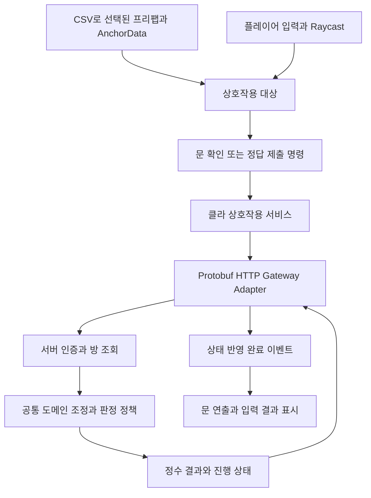

# 환경별 접속과 플레이어·상호작용·API 작업 범위

2026-10-19 사용자님 요구사항을 기준으로 합니다. 기능별 검토 후 다음 작업으로 진행합니다.

현재 상태: 환경별 접속 config, Google Protobuf 실통신, 문·정답 API와 클라 문별 허가 캐시까지 구현했습니다. 아래는 처음 정리한 작업 범위이며, 최신 구현과 검사 결과는 [문·정답 API 안내](room-api-and-protobuf.md)를 우선합니다. 1인칭 플레이어·실제 상호작용 입력과 연출은 다음 작업입니다.

## 이번 구현: 환경별 접속 설정

클라 `Assets/StreamingAssets/Configuration/connection.json`의 editor/testBuild/stableBuild를 사용합니다. Editor는 127.0.0.1:3000, Development Build는 192.168.1.34:3001, 일반 빌드는 추후 클라우드 주소입니다. 안정화 주소가 없으면 빌드 검사에서 중단됩니다. JSON은 사람이 편집하는 로컬 config 형식이며 통신 본문 형식을 의미하지 않습니다.

화면 입력값 의존성을 제거하고 검증한 불변 설정을 주입합니다. 자동 입장과 재시도는 ConfiguredServerConnection을 공유하고 기존 GameEntryService의 입장·CSV 동기화·씬 전환을 재사용합니다. 클라 README 및 Docs/ConnectionConfiguration.md에 세부 코드 설명과 검사 방법을 기록합니다.

## 다음 구현: 1인칭 플레이어와 로컬 상호작용

플레이어는 클라이언트별로 하나만 생성합니다. 1번 방 로드 완료를 기준으로 생성·카메라·입력 준비를 조정하며, 이후 방이 추가될 때 기존 플레이어를 다시 만들지 않습니다. 카메라 아래 큐브 손을 임시 표현으로 사용하고, 입력·이동/시점·대상 탐색·상호작용 명령·표현을 분리합니다. Unity 이동·회전·카메라·Physics 수치는 엔진 경계에서 float를 사용하고 논리 ID·상태·시간(ms)은 정수 기준으로 유지합니다.

CSV의 ANCHOR_INTERACT에서 선택된 스폰 객체만 상호작용 후보로 등록합니다. 프리팹의 Collider와 상호작용 컴포넌트가 AnchorInstance로 받은 ID/RoomNo를 사용합니다. 카메라 Raycast는 대상 선택까지만 담당하며 HTTP를 직접 호출하지 않습니다. 구체적인 문·입력 행동은 프리팹에 조합한 어댑터로 연결하고, 공통 요청·취소·중복 제어는 재사용합니다. 대상 이름이나 임의의 하드코딩 ID로 문 종류를 판단하지 않습니다. UI 입력 중에는 이동·시점 입력을 제한하고 해제 수명을 명확히 합니다.

현재는 독립 1인칭 클라이언트이므로 서로의 이동·손·문 애니메이션 동기화를 추가하지 않습니다. 판정 권한은 서버에 둡니다.

## 확정 요구: Google Protobuf 바이너리 통신

현재 게임 API는 HTTP+JSON이며 이번 접속 설정 수정은 이 전송 형식을 바꾸지 않습니다. 다음 API 단계에서는 기존 세션·데이터 API와 신규 문·정답 API를 포함한 게임 요청·응답 본문을 Google Protobuf 바이너리로 맞춥니다. Protobuf DLL 설치나 코드 생성만으로 전환 완료로 판단하지 않으며 실제 HTTP 왕복을 검사합니다.

메시지 원본은 .proto 하나로 유지합니다. 기존 protoc/ts-proto 생성 도구와 Google.Protobuf C# 런타임, 교차 검증·로컬 배포 도구를 확장합니다. 필드 번호·enum 숫자를 보존하고, 현재 session.proto에 없는 입장·heartbeat·퇴장·CSV 묶음·해금 목록·콘텐츠 요청/결과 등을 계약에 추가해야 합니다. 생성 메시지는 전송 계층에서 도메인 계약으로 변환합니다.

Swagger/OpenAPI는 HTTP 경로·메서드·참가 토큰 헤더·오류 상태·본문 미디어 타입·Protobuf 메시지의 연결을 관리합니다. 바이너리 본문은 application/protobuf로 명시합니다. 메시지 클래스는 .proto에서 생성하고, 호출 인터페이스를 자동 생성할 경우 해당 Protobuf 타입을 참조하게 합니다. OpenAPI에서 별도의 JSON DTO를 생성해 같은 메시지 계약을 두 벌로 관리하지 않습니다. Swagger UI 기본 JSON 입력만으로 Protobuf 실통신 검증이 된다고 주장하지 않습니다. 전용 바이너리 요청 검사 도구를 함께 마련합니다.

서버 로컬 배포 명령은 계약 검사 → TS/C# 생성 → 컴파일·교차/HTTP 검증 → 클라 로컬 생성 폴더 배포 순서로 구성합니다. 기존 생성 배포 도구의 백업·변경 감지·실패 시 미반영 원칙을 유지합니다. 일반 서버 시작마다 Unity 소스를 덮어쓰지 않으며, 사용자님이 실행하는 로컬 개발 배포 과정에 연결합니다. Git stage/commit/push는 사용자님이 직접 수행합니다.

## 다음 구현: 문·정답 API와 판정 경계

두 요청은 모두 방 번호를 사용합니다. 세션과 참가 토큰은 기존 인증 경계로 전달하고, 플레이어 A/B는 서버가 토큰에서 결정합니다. 클라이언트가 풀이 방식이나 정답 여부를 서버에 지정하지 않습니다.

- 문 확인: roomNo → 내 ROOM 테이블에서 활성·해금 여부 확인 → ExitRule과 해당 퍼즐 완료 상태 검사 → 허가/잠금 결과. 상대가 정답을 맞힌 경우에도 내 클라가 문과 상호작용했을 때 서버에 확인합니다.
- 정답 제출: roomNo + 순서가 있는 답 목록 → 내 방의 Solver 자격·해금·게임 단계 확인 → PuzzleID/Type 조회 → 공통 제출 조정 → 판정 결과. 현재 문자열 슬롯 답은 숫자·문자·방향·색을 포함하므로 단순 int 변환으로 의미를 잃지 않게 합니다.
- 기존 슬롯 비교는 공통 판정으로 재사용합니다. 퍼즐별 입력 변환이 필요하면 Adapter를, 실제 판정 규칙이 달라지면 Strategy를 선택·주입합니다. 각 퍼즐 클래스에 인증·요청·오류 처리를 복사하지 않습니다.
- 문 확인과 해금·방 로드의 시점을 명시해야 합니다. 현재 정답 처리에서 양쪽 Next를 즉시 해금하는 동작을 조정해, 사용자님이 정한 상대방 문 확인 흐름과 맞춥니다. 문 확인은 반복해도 안전하게 처리하고 이전 방은 유지합니다.

관련 기준 문서: [Protobuf 개요](https://protobuf.dev/overview/), [Protobuf MIME 형식](https://protobuf.dev/reference/protobuf/mime-types/), [OpenAPI 미디어 타입](https://swagger.io/docs/specification/v3_0/media-types/).
