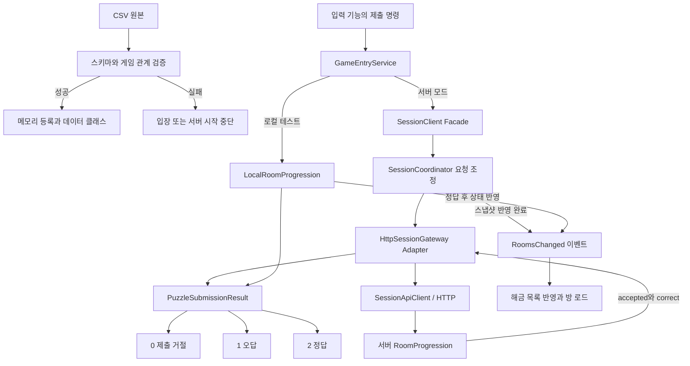

# 콘텐츠 검토 수정 — 2026-10-19

> 문서 대조일: **2026-10-26**. 현재 코드·설정을 기준으로 설명을 점검했습니다. 본문의 과거 검사 수치·실행 기록은 해당 날짜의 결과입니다. [현재 상태·문서 검토 범위](문서_현행화_점검표.md)를 함께 확인합니다.

검토에서 확인한 네 문제를 수정했습니다. CSV 원본·R01 씬·앵커·프리팹 배치는 이번 변경 대상이 아닙니다. 이 초기 기록 이후 문 HTTP·실제 개폐·다음 방 연결이 구현됐습니다. 이 문서의 수정 비교와 검사 수치는 2026-10-19 기록입니다.

## 1. 잘못된 방 연결을 등록 전에 차단

이전 검증은 참조와 순환을 검사했지만, 시작 방이 두 개이거나 일부 방이 떨어져 있어도 등록될 수 있었습니다. 서버는 임의 시작 방을 선택하고 Unity는 `Single` 예외를 낼 수 있었습니다.

이제 각 ROOM_A/B 테이블에서 Active=Y인 행을 모은 뒤, 다른 활성 방의 Next로 가리켜지지 않는 시작 행이 정확히 하나인지 확인합니다. 그 시작 행부터 Next를 따라가 모든 활성 방을 방문하고 0에서 끝나야 통과합니다. 활성 방이 없거나, 중간에 비활성 방을 가리키거나, 떨어진 순환 구간이 있어도 차단합니다. 현재 기획의 직렬 방 진행에 맞춘 검증이며 분기형 기획으로 바뀌면 이 규칙도 함께 바꿔야 합니다.

| 파일 | 역할 |
|---|---|
| 서버 `src/data/validation/CsvGameRules.ts` | `CsvRoomRule.checkActiveChain`: ID 맵·들어오는 Next 집합·방문 집합으로 시작점과 전체 연결을 검사 |
| 클라 `Data/CsvValidation/Rules/CsvGameRules.cs` | 대응하는 `CheckActiveChain`을 같은 규칙 객체에 추가; A/B 공통 사용 |
| 양쪽 검증 결과 모듈 | `RoomStartCount`, `RoomDisconnected` 추가; 클라는 한국어 표시도 추가 |
| 서버 `RoomProgression.reset`, 클라 `World/RoomLoadPlan.First` | 검증을 우회한 호출에서도 시작점이 하나인지 확인하고 원인이 분명한 예외 발생 |

정상 원본만 등록하는 기존 `CsvDataStore` 계약을 유지합니다. 실패한 재등록은 정상 데이터와 캐시를 교체하지 않습니다. 검증 규칙 객체를 조합하는 기존 구조를 확장했고 A/B별 검사 클래스를 중복 생성하지 않았습니다.

## 2. ExitRule 오타를 다른 규칙으로 처리하지 않기

이전에는 `BothSolved`가 아니면 모두 `SolvedEach`처럼 처리했습니다. 예를 들어 `BothSolvd` 오타가 있어도 의도와 다른 해금이 가능했습니다.

서버 `src/data/RoomExitRules.ts`와 클라 `Data/RoomExitRules.cs`를 규칙 해석의 공통 진입점으로 추가했습니다. `SolvedEach`는 해당 퍼즐, `BothSolved`는 같은 방 번호 양쪽 퍼즐을 요구합니다. 알 수 없는 값은 예외입니다. 서버 CSV 스키마와 클라 XML 스키마에도 두 허용값을 지정해 런타임 이전에 차단합니다.

이는 작은 정책 모듈입니다. 현재 규칙 두 개를 위해 Strategy 클래스 계층을 추가하지 않았으며, 표현 방식이 늘어나면 이 경계를 확장할 수 있습니다. 로컬과 온라인은 별도 실행 환경이므로 C#/TS 구현은 각각 유지하되 검증 계약을 일치시킵니다.

## 3. 제출 거절과 오답을 끝까지 구분

서버는 이미 `accepted`, `correct`를 별도로 반환했지만 클라가 `correct`만 사용하면서 두 상태가 합쳐졌습니다. 이제 불변 `PuzzleSubmissionResult`와 정수 enum을 공통 계약으로 사용합니다.

| accepted | correct | Outcome | 의미 |
|---|---|---|---|
| false | false | Rejected = 0 | 역할·해금·현재 상태 등의 이유로 제출 자체가 거절됨 |
| true | false | Incorrect = 1 | 제출은 허용되었으나 답이 틀림 |
| true | true | Correct = 2 | 정답 |
| false | true | 생성 불가 | 서로 모순되는 응답이므로 예외 |

`FromDecision` 팩토리가 유효한 조합만 만들게 합니다. `Accepted`, `Correct`는 enum에서 계산하는 편의 속성이므로 서로 다른 상태가 따로 저장되지 않습니다. HTTP/JSON 필드 계약은 유지하고 정수 결과는 클라 내부 계약에 사용합니다. 통신 실패·인증 실패는 기존 `SessionResultException`, 취소는 `OperationCanceledException` 경로로 전달되며 오답으로 변환하지 않습니다.

| 파일/계층 | 변경 내용과 의도 |
|---|---|
| `Session/Contracts/PuzzleSubmissionResult.cs` | Unity·HTTP를 모르는 공개 결과 계약과 생성 팩토리 |
| `Networking/SessionDtos.cs` | 조회 DTO와 제출 DTO 분리; 제출 DTO가 accepted/correct 보존 |
| `Session/Results/SessionResultValidator.cs` | 기존 인증·스냅샷 검증을 재사용하고 모순된 제출 결과 차단 |
| `Networking/SessionApiClient.cs` | 제출 전용 DTO 역직렬화와 검증 |
| `Networking/HttpSessionGateway.cs` | wire 필드 → 공개 결과 계약으로 변환하는 Adapter |
| `Session/Runtime/SessionGatewayData.cs` | 결과와 스냅샷을 묶어 코어에 전달 |
| `Session/SessionCoordinator.cs` | 기존 요청 직렬화와 스냅샷 반영을 유지하며 결과 반환 |
| `Session/Runtime/SessionClient.cs`, `ISessionContentService` | Facade를 통해 전체 결과 전달; 오류/취소 경로 유지 |
| `World/LocalRoomProgression.cs` | 서버 없는 테스트도 동일한 거절/오답/정답 계약 사용 |
| `World/GameEntryService.cs` | 공통 진입점 반환형 변경; 로컬 정답 시 기존 해금 이벤트 연결 |

`SubmitPuzzleAsync`는 `Task<bool>`에서 `Task<PuzzleSubmissionResult>`로 바뀌었습니다. 입력 UI 작성 시 `Outcome`을 분기해야 제출 거절을 오답 횟수에 넣지 않을 수 있습니다. 이번 수정에서 입력 UI나 오답 횟수 기능을 추가한 것은 아닙니다.

```csharp
using EscapeGame.Session.Contracts;

PuzzleSubmissionResult result = await service.SubmitPuzzleAsync(puzzleId, answers, token);
switch (result.Outcome)
{
    case PuzzleSubmissionOutcome.Rejected:  /* 제출 불가 안내 */ break;
    case PuzzleSubmissionOutcome.Incorrect: /* 오답 처리 */ break;
    case PuzzleSubmissionOutcome.Correct:   /* 정답 표시 */ break;
}
```



명령 반환 결과와 완료 상태 이벤트는 목적이 다릅니다. 입력 기능은 제출 결과를 보고, 방 로더는 기존 해금 이벤트를 구독합니다. UI에 HTTP DTO나 인증 토큰을 노출하지 않습니다. 온라인 판정 권한은 서버에 두고 로컬 진행은 테스트 경로에만 사용합니다.

## 4. 테스트 시계 계약 수정

`ParticipantRegistry`는 `elapsedMilliseconds`를 읽는데 일부 검사 코드가 `nowMs`만 제공하고 있었습니다. 따라서 검사에서 의도한 만료가 실행되지 않을 수 있었습니다.

서버 `tests/game-content.test.cjs`는 제어 가능한 정수 ms getter를 주입합니다. 정상 HTTP 흐름 검사 뒤 시계를 10000ms로 진행시키고 데이터 요청이 403/INVALID_PARTICIPANT로 거절되는지 확인합니다. 클라 `Tools/WorldPlayVerification/Server.cjs`는 실제 `MonotonicMillisecondClock`을 주입합니다. 시간 단위와 소유권을 명확히 유지하고 테스트 대역도 운영 코드와 같은 인터페이스를 따릅니다.

## 5. 검증과 확인 방법

- 서버: TypeScript 빌드 및 Node 테스트 **135개 통과**. `npm.cmd test` 실행.
- 클라: 기존 96개 + 신규 회귀 27개 = **123개 통과**. .NET 8 SDK용 프로젝트와 동일한 소스를 설치된 .NET 10 SDK의 임시 프로젝트에서 실행했습니다. 원본 프로젝트의 대상 프레임워크는 변경하지 않았습니다.
- Unity: 실제 클라이언트 적용본을 6000.2.8f1의 .NET Standard 2.1·UnityEngine·UnityEditor 참조로 컴파일했습니다. 데이터·월드·세션·네트워크 모듈과 Play 검증 도구의 C# 컴파일이 통과했습니다. 직렬화 필드 할당 관련 경고는 남습니다.
- Play: 이번 실행은 Unity 라이선스 클라이언트 연결 실패로 Play에 진입하지 못했습니다. 과거 Play 33개 통과 기록과 구분합니다.
- R01: 정적 바인딩 재검사에서 A 8개(스폰 2·기존 구조 재사용 6), B 14개(스폰 8·재사용 6)가 모두 정상입니다. 서버/클라 CSV 23개·2861개 셀과 스키마의 차이는 0이며, CSV 검사 오류·경고도 0입니다.

Unity에서 사용자님께서 확인하실 기능 단위는 다음과 같습니다.

1. 컴파일 완료 후 Join의 로컬 A/B로 R01이 기존과 같이 구성되는지 확인합니다.
2. CSV 검증기에 복사한 테스트 CSV를 넣어 첫 방의 Next를 0으로 바꾸면 시작점 오류가 나오는지 확인합니다. 실제 원본 CSV에는 저장하지 않습니다.
3. ExitRule을 `BothSolvd`로 바꾼 테스트 CSV가 허용값 오류로 거절되는지 확인합니다.
4. 제출 기능 소비 코드에서 역할 불일치는 Rejected, Solver의 잘못된 답은 Incorrect, 올바른 답은 Correct인지 확인합니다. 이 경로의 자동 회귀 검사는 추가했습니다.
5. 서버 포함 Unity Play 도구를 사용할 경우 Node.js 24와 정상 Unity 라이선스가 필요합니다. 수정한 반환형에 맞춰 도구도 갱신했습니다.

직접 방 구조나 해금 규칙을 변경하는 다음 기능은 이 수정의 검토 후 별도로 진행합니다.
