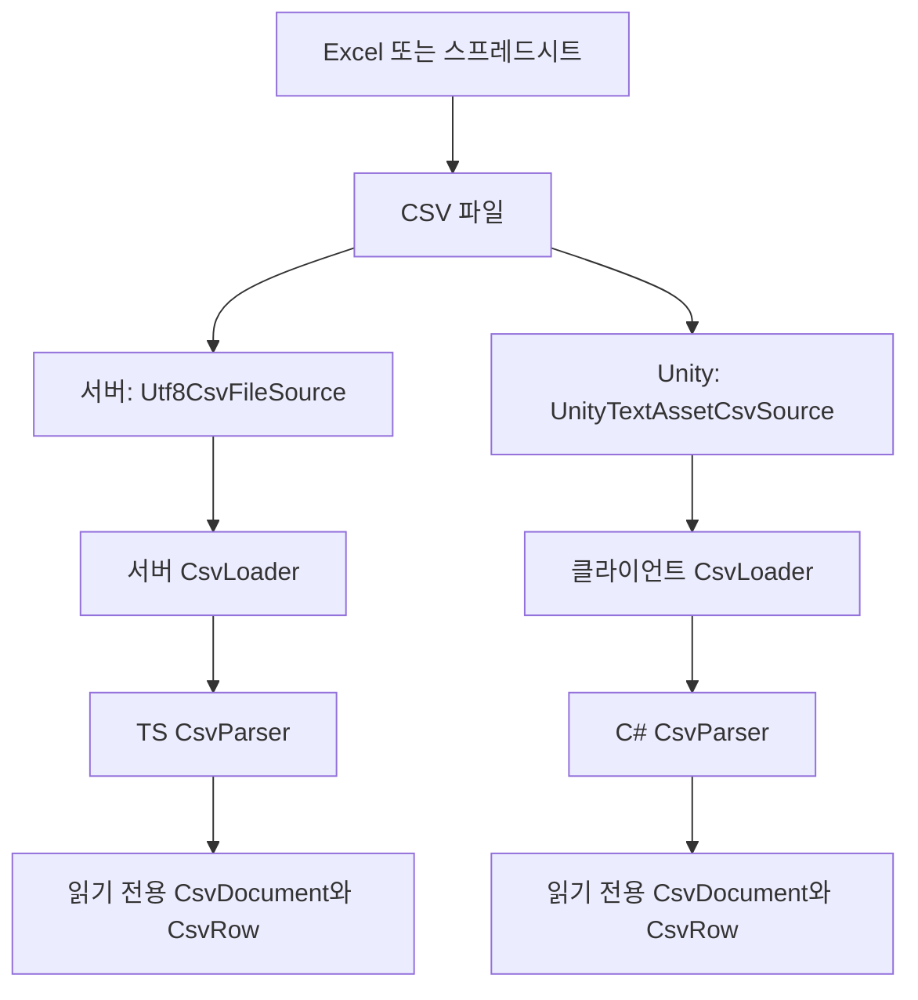

# 서버·Unity 공통 CSV Reader

## 이번 구현 범위

Excel 또는 스프레드시트에서 내보낸 CSV를 읽고, 헤더와 문자열 행을 반환합니다. 실제 게임 테이블이나 필수 컬럼은 아직 정의하지 않았습니다. 첫 번째 컬럼이 ID라는 가정도 없습니다.

기준으로 확인한 코드는 기존 2DZolablo의 `Assets/3.Script/Data/CSVPaser.cs` 안에 있는 CSVParser입니다. 기존의 ‘첫 행을 헤더로 사용하고 컬럼명으로 셀을 읽는 방식’을 유지하면서 파일 읽기와 CSV 해석을 분리했습니다. 캐릭터·스킬·퍼즐 등의 데이터 모델, 전역 DataManager, 자동 초기화, 테이블 배포·다운로드 기능은 이번 단계에 포함하지 않습니다.

## 책임과 파일

| 역할 | 서버 | Unity 클라이언트 |
|---|---|---|
| CSV 구조 오류 | src/common/csv/CsvParseError.ts | Common/Csv/CsvParseException.cs |
| 읽기 전용 헤더·행 | src/common/csv/CsvDocument.ts | Common/Csv/CsvDocument.cs, CsvRow.cs |
| CSV 문자열 해석 | src/common/csv/CsvParser.ts | Common/Csv/CsvParser.cs |
| 입력 소스 계약과 로딩 조합 | src/common/csv/CsvLoader.ts | Common/Csv/ICsvTextSource.cs, CsvLoader.cs |
| UTF-8 파일 읽기 | src/infrastructure/data/Utf8CsvFileSource.ts | Data/Infrastructure/Utf8CsvFileSource.cs |
| Unity TextAsset 읽기 | 해당 없음 | Data/Infrastructure/UnityTextAssetCsvSource.cs |
| 수동 실행 확인 | src/tools/readCsv.ts | Tests/CsvLoadTester.cs |

Unity 경로는 `Assets/3.Script` 기준입니다. 서버와 클라이언트는 서로 다른 언어로 구현되며 같은 CSV 규칙과 공통 검사 입력을 사용합니다.

## 기존 코드와 비교

| 항목 | 기존 Reader | 이번 Reader |
|---|---|---|
| 파서 입력 | Unity TextAsset | 문자열, 파일·TextAsset은 별도 어댑터 |
| 반환 형태 | 수정 가능한 문자열 Dictionary 목록 | 읽기 전용 헤더와 CsvRow 목록 |
| 첫 칸이 빈 행 | 건너뜀 | 빈 값으로 보존 |
| 행 단위 처리 | 물리적인 줄마다 정규식 분리 | 따옴표 상태를 보며 레코드 해석 |
| 셀 내부 줄바꿈 | 물리적인 줄 분리 영향 | 따옴표 안의 LF/CRLF/CR 보존 |
| 잘못된 칸 수 | 일부 값만 반영될 수 있음 | 오류 코드와 위치 제공 |
| 헤더 중복 | 같은 키가 덮어써질 수 있음 | 중복 헤더 오류 |
| 숫자 처리 | ParseInt, ParseIntList 등 호출 | 원문 문자열 유지, 컬럼별 변환은 후속 단계 |

## CSV 규칙

- 파일은 **UTF-8, 쉼표 구분 CSV**를 사용합니다. UTF-8 BOM도 지원합니다.
- 첫 번째 비어 있지 않은 레코드를 헤더로 사용합니다.
- 헤더 가장자리의 공백·탭·줄바꿈 문자는 정리합니다. 이름 비교는 대소문자를 구분합니다.
- 중복 헤더와 이름이 빈 헤더는 오류입니다.
- 본문의 칸 수는 헤더 수와 같아야 합니다. 빈 마지막 값도 구분 쉼표로 칸을 표현합니다.
- 따옴표 안의 쉼표·줄바꿈과 `""`로 표현한 따옴표 한 개를 지원합니다.
- 따옴표가 없는 셀 중간의 따옴표, 닫힌 따옴표 뒤의 추가 문자는 오류입니다.
- 공백 줄은 무시합니다. `""`나 `,`처럼 명시적으로 표현한 빈 값은 보존합니다.
- 셀의 가장자리 공백, 앞자리 0, 숫자 모양 문자열은 그대로 유지합니다.
- 원문에 들어 있는 역슬래시+n 두 글자는 그대로 보존합니다. 화면 표시용 문자 변환은 별도 책임입니다.
- 헤더만 있는 CSV는 데이터 0행으로 성공합니다. 빈 파일이나 공백 줄만 있는 파일은 헤더 누락 오류입니다.
- 파일 어댑터는 잘못된 UTF-8을 오류로 처리합니다. Unity TextAsset도 원본 bytes를 UTF-8로 해석합니다.

아직 실제 컬럼을 정하지 않았으므로 숫자·ID·범위·다른 테이블 참조에 관한 검증은 하지 않습니다. 향후 데이터 모델로 변환할 때 정수·ms와 해당 컬럼 규칙을 적용합니다.

## 결과 사용 방법

### 서버

```typescript
const loader = new CsvLoader(new Utf8CsvFileSource(), new CsvParser());
const document = await loader.load(csvFilePath, abortSignal);

console.log(document.headers);
console.log(document.rows.length);
// 실제 헤더 이름이 정해지면 row.get(columnName) 또는 row.tryGet(columnName)으로 조회합니다.
```

실제 파일을 간단히 확인하려면 서버 프로젝트에서 실행합니다.

```powershell
npm.cmd run csv:read -- "C:\경로\테이블.csv"
```

Linux에서는 `npm run csv:read -- /경로/테이블.csv`입니다. 명령이 먼저 빌드한 뒤 헤더 목록과 데이터 행 수를 출력합니다. CSV 내용 전체를 출력하지는 않습니다.

서버를 실행한다고 임의의 테이블을 자동으로 읽지는 않습니다. 필요한 로더와 파일 경로를 사용하는 서비스에 주입하는 방식입니다. Docker 실행 시 실제 CSV를 이미지에 복사하거나 마운트하는 설정은 테이블 위치가 정해질 때 연결합니다.

### Unity — TextAsset 연결

1. Excel/스프레드시트에서 내보낸 CSV를 Unity의 Assets 안에 넣습니다.
2. 빈 GameObject를 만들고 **CsvLoadTester** 컴포넌트를 붙입니다.
3. Inspector의 **Csv Asset**에 CSV 파일을 연결합니다.
4. 컴포넌트 메뉴에서 **Load CSV**를 실행합니다. Edit/Play 모드 모두 사용할 수 있습니다.
5. Console에 파일 이름, 헤더 수와 목록, 데이터 행 수가 표시되는지 확인합니다.

검사 컴포넌트는 자동 실행하지 않으며 기존 SampleScene에 추가하지 않았습니다. 실제 CSV가 없는 상태에서는 별도 게임 데이터나 가짜 콘텐츠 CSV를 준비할 필요가 없습니다.

다른 코드에서 사용할 때는 다음과 같이 구성합니다.

```csharp
var loader = new CsvLoader(new UnityTextAssetCsvSource(csvAsset), new CsvParser());
var document = await loader.LoadAsync(csvAsset.name, cancellationToken);

// document.Headers, document.Rows로 결과에 접근합니다.
// 실제 헤더가 정해지면 row.Get(columnName) / row.TryGet(columnName, out value)를 사용합니다.
```

핵심 타입의 namespace는 `EscapeGame.Data.Csv`, 입력 어댑터는 `EscapeGame.Data.Infrastructure`입니다. TextAsset 접근은 Unity 메인 스레드에서 수행합니다. 외부 데스크톱 파일을 읽을 때는 Utf8CsvFileSource를 사용할 수 있습니다.

## 오류와 취소

CSV 형식 오류는 CsvParseError(TS) / CsvParseException(C#)으로 전달합니다. 코드, 소스 이름, 물리적인 행 번호와 CSV의 논리적인 열 번호를 제공합니다. 여러 줄 셀을 포함한 행은 SourceLine에 레코드의 실제 시작 행을 보관합니다.

| 코드 | 이름 | 의미 |
|---|---|---|
| 1 | MissingHeader | 헤더가 없음 |
| 2 | InvalidQuote | 허용되지 않은 따옴표 위치 또는 닫힌 따옴표 뒤 문자 |
| 3 | UnclosedQuote | 파일이 끝나도 따옴표가 닫히지 않음 |
| 4 | EmptyHeader | 이름이 빈 헤더 |
| 5 | DuplicateHeader | 같은 이름의 헤더 중복 |
| 6 | FieldCountMismatch | 행의 칸 수와 헤더 수가 다름 |

파일 누락·접근 실패·인코딩 오류는 해당 파일 어댑터의 예외로 전달합니다. 로더가 빈 결과로 바꾸지 않습니다. 취소는 AbortSignal/CancellationToken을 사용하고 읽기 전후와 결과 반환 전에 확인합니다. 파싱은 현재 동기 처리이므로 큰 문자열을 해석하는 도중에 중단하는 기능은 없습니다.

## 설계 의도

- **Adapter**: 파일·TextAsset 읽기를 ICsvTextSource 뒤에 둡니다. CSV 파서는 Node와 Unity API를 알지 못합니다.
- **Facade / 조립**: CsvLoader는 읽기→해석을 연결하고 완성된 CsvDocument를 반환합니다. 완료 결과가 필요한 호출자가 Task/Promise를 기다립니다.
- **상태 기계**: 파서 내부는 필드 시작/일반 문자열/따옴표 내부/닫는 따옴표 이후의 상태를 구분합니다. 상태별 클래스를 따로 만들지는 않았습니다.
- **데이터 소유권**: 로드 결과의 헤더와 행은 읽기 전용입니다. 플레이 중 변경되는 상태를 이 데이터에 저장하지 않습니다.
- **확장 경계**: 실제 컬럼이 정해지면 이 결과를 입력받는 타입 변환·도메인 검증·ID 조회 계층을 붙입니다. 파일 읽기와 CSV 문법을 테이블마다 다시 구현하지 않습니다.

파싱은 전체 텍스트를 메모리에 읽어 처리합니다. 반복 Update/Tick에서 호출하는 구조가 아니며, 큰 파일의 스트리밍 파싱과 핫 리로드는 후속 요구사항입니다.

## 검증

서버 자동 검사는 기존 `npm.cmd test`에 포함됩니다. `tests/fixtures/csv-reader-cases.json`의 임의 헤더와 문자열은 로더 검증용이며 게임 테이블 정의가 아닙니다.

클라이언트의 독립 C# 파일 검사, 서버/클라 해석 교차 검사와 Unity DLL 참조 컴파일은 다음과 같이 실행합니다.

```powershell
npm.cmd run csv:verify-client -- --source-root "C:\Users\m\Desktop\listen\Assets\3.Script" --unity-editor "C:\Program Files\Unity\Hub\Editor\6000.2.8f1\Editor"
```

경로는 각 작업 PC의 실제 Unity 프로젝트 및 Editor 폴더로 바꿉니다. 생성되는 검사 산출물은 서버의 `.csv-verification`에만 기록하고 Git과 Docker 빌드 입력에서 제외합니다. 이 참조 컴파일은 실제 Unity Editor의 import/Play 실행이나 클라이언트 전체 빌드 검사를 대신하지 않습니다.

확인한 항목은 다음과 같습니다.

- 공통 입력 27개: 헤더·빈 값·BOM·따옴표·줄바꿈·오류 코드/위치가 C#/TS에서 일치.
- Node 검사: 공통 입력 27개와 읽기 전용 결과·취소·파일/인코딩 검사 3개.
- C# 추가 검사: 읽기 전용 결과, 주입 소스, 취소 전후, UTF-8 파일과 한글, 누락 파일, 잘못된 인코딩.
- Unity CSV 소스와 수동 검사 컴포넌트의 Unity DLL 참조 컴파일.
- 기준 프로젝트의 기존 SkillData.csv: 헤더 8개, 데이터 6행 로드 성공.

기존 Character.csv와 ItemData.csv는 마지막 이름 없는 헤더가 있고, StageData.csv에는 TargetKillCount 헤더가 중복되어 있습니다. 이 Reader는 해당 구조를 오류로 보고합니다. 기존 프로젝트의 CSV 파일은 수정하지 않았습니다.

## 연결 도식


