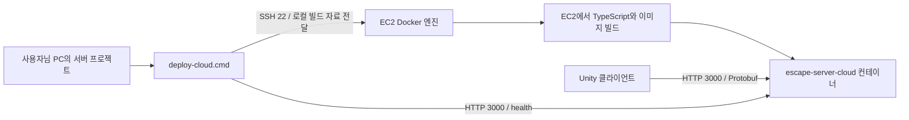

# 기존 배포 도구로 EC2에 서버 올리기

이 문서는 사용자님 PC에서 기존 `deploy-cloud.cmd`를 실행하여 현재 EC2에 배포하는 순서를 설명합니다. 서버 프로젝트를 EC2에 직접 복사하거나 Git에 올린 뒤 받을 필요는 없습니다.

## 1. 현재 대상과 실행 위치

| 항목 | 현재 설정 |
|---|---|
| AWS 리전 | 아시아 태평양(시드니), ap-southeast-2 |
| 인스턴스 | i-0966f0379c3e46fba / t3.micro |
| 운영체제 | Amazon Linux 2023, x86_64 |
| 서버 공인 IP | 3.107.80.28 |
| SSH 계정 | ec2-user |
| PC의 SSH 별칭 | escape-cloud |
| PC의 변환한 키 파일 | C:/Users/m/Desktop/TSC_SERVER.pem |
| 게임 서버 주소 | http://3.107.80.28:3000 |
| 상태 확인 주소 | http://3.107.80.28:3000/health |

아래 명령은 별도 표시가 없으면 **사용자님 PC의 PowerShell**에서 실행합니다. `deploy-cloud.cmd`는 서버 프로젝트에 들어 있습니다. PuTTY 안에서 이 파일을 실행하는 방식이 아닙니다.



PC에서는 Node.js 24 이상, Docker CLI·빌드 플러그인, OpenSSH가 필요합니다. 이 원격 배포에는 PC의 Docker 엔진을 실행할 필요가 없습니다. EC2의 Docker는 실행 중이어야 하며 SSH 계정으로 접근할 수 있어야 합니다. [Docker 공식 SSH 연결 안내](https://docs.docker.com/engine/security/protect-access/)

## 2. AWS에서 TCP 3000 허용

1. AWS 콘솔의 리전을 **시드니**로 선택합니다.
2. EC2 → 인스턴스 → 현재 인스턴스를 선택합니다.
3. 아래 **보안** 탭에서 연결된 보안 그룹을 클릭합니다.
4. **인바운드 규칙 편집 → 규칙 추가**를 누릅니다.
5. 유형은 **사용자 지정 TCP**, 포트 범위는 **3000**, 소스는 **내 IP**, 설명은 `escape-server-test`로 설정하고 저장합니다.

`내 IP`는 현재 PC 네트워크의 공인 IP를 `/32` 형식으로 지정합니다. `192.168.1.34` 같은 사설 IP를 입력하는 곳이 아닙니다. 다른 네트워크의 테스트 PC도 사용할 경우 해당 공인 IP를 소스로 하는 TCP 3000 규칙을 추가합니다. 같은 공유기를 사용하는 PC는 일반적으로 공인 IP를 공유합니다.

SSH 접속용 TCP 22도 배포 PC에 허용되어 있어야 합니다. Docker 관리는 SSH를 통하므로 Docker TCP 포트 2375·2376을 추가로 열 필요가 없습니다. 보안 그룹은 연결된 인스턴스에 허용할 프로토콜·포트·소스를 정합니다. [AWS 공식 보안 그룹 규칙](https://docs.aws.amazon.com/vpc/latest/userguide/security-group-rules.html)

## 3. SSH 설정과 최초 확인

현재 PC의 `C:/Users/m/.ssh/config`에는 다음 별칭을 준비했습니다.

```sshconfig
Host escape-cloud
    HostName 3.107.80.28
    User ec2-user
    IdentityFile C:/Users/m/Desktop/TSC_SERVER.pem
    IdentitiesOnly yes
    StrictHostKeyChecking yes
    ConnectTimeout 10
```

다음 두 명령이 모두 성공해야 합니다.

```powershell
ssh escape-cloud docker ps
docker --host ssh://escape-cloud version
```

`docker ps`에 제목 줄만 나와도 오류가 아닙니다. 실행 중인 컨테이너가 없는 상태입니다. 두 번째 명령에는 PC의 Client와 EC2의 Linux Server 정보가 나와야 합니다.

### 키 파일 권한 오류가 다시 발생한다면

현재 키 파일은 사용자님 Windows 계정의 읽기 권한을 명시하고 상속 권한을 해제하여 SSH 접속을 확인했습니다. 다른 위치에 키를 복사하면 복사한 폴더의 권한을 다시 상속할 수 있습니다.

`UNPROTECTED PRIVATE KEY FILE` 또는 `bad permissions`가 발생하면 먼저 실제 키 경로가 맞는지 확인하고, 해당 키 **한 파일에만** 아래 설정을 적용합니다.

```powershell
$sshKeyPath = 'C:\Users\m\Desktop\TSC_SERVER.pem'
$sshKeyUser = [System.Security.Principal.WindowsIdentity]::GetCurrent().Name
icacls.exe $sshKeyPath /grant:r "${sshKeyUser}:(R)"
icacls.exe $sshKeyPath /inheritance:r
```

상속을 끊어도 오류에 다른 계정의 명시적 권한이 표시된다면 해당 파일의 보안 설정에서 그 권한을 확인해야 합니다. 키 내용은 공유하지 않습니다. Amazon Linux의 기본 SSH 계정과 Windows 키 권한 문제는 [AWS 연결 문제 해결 문서](https://docs.aws.amazon.com/AWSEC2/latest/UserGuide/TroubleshootingInstancesConnecting.html)를 참고하십시오.

## 4. 프로젝트 환경 파일

서버 프로젝트의 `.env.deploy-cloud`는 **어디에 어떤 컨테이너를 배포할지** 정합니다. 현재 다음 값으로 준비했습니다.

```dotenv
SSH_TARGET=ssh://escape-cloud
IMAGE_NAME=escape-server:cloud
CONTAINER_NAME=escape-server-cloud
RUNTIME_ENV_FILE=.env.docker-cloud
BIND_ADDRESS=0.0.0.0
HOST_PORT=3000
CONTAINER_PORT=3000
RESTART_POLICY=unless-stopped
PUBLIC_HEALTH_URL=http://3.107.80.28:3000/health
HEALTH_TIMEOUT_MS=60000
HEALTH_INTERVAL_MS=500
HEALTH_REQUEST_TIMEOUT_MS=10000
STOP_TIMEOUT_MS=10000
```

원격 상태 검사 한 번에는 SSH 연결 시간도 포함되므로 이 PC의 클라우드 설정은 요청 제한을 10,000ms, 전체 제한을 60,000ms로 두었습니다.

`.env.docker-cloud`는 **컨테이너 안의 게임 서버 설정**입니다.

```dotenv
HOST=0.0.0.0
PORT=3000
PARTICIPANT_TIMEOUT_MS=10000
EXPIRATION_CHECK_INTERVAL_MS=500
```

HOST는 컨테이너 외부에서 접근할 수 있도록 `0.0.0.0`을 사용합니다. 이는 Unity에 입력할 주소가 아닙니다. Unity는 EC2의 실제 공인 IP와 공개 포트에 접속합니다.

두 실제 환경 파일과 개인키는 Git에 포함하지 않습니다. 다른 작업자는 `.example`을 복사하여 자신의 환경에 맞게 설정합니다. 서버 CSV는 현재 로컬 서버 프로젝트의 `data` 폴더가 Dockerfile에 의해 이미지에 포함됩니다.

## 5. 배포 실행

PowerShell에서 서버 프로젝트로 이동합니다.

```powershell
Set-Location 'C:\Users\m\Documents\Codex\2026-10-07\4-x20-2-x20\outputs\server'
```

먼저 설정만 확인합니다. 이 명령은 EC2에 접속하거나 컨테이너를 만들지 않습니다.

```powershell
node scripts/deploy-docker.cjs cloud --plan
```

대상 `ssh://escape-cloud`, 컨테이너 `escape-server-cloud`, 공개 포트 `3000`, 상태 확인 주소가 맞으면 실행합니다.

```powershell
.\deploy-cloud.cmd
```

또는 다음 명령을 사용할 수 있습니다.

```powershell
npm.cmd run docker:cloud
```

두 명령은 같은 도구를 실행하므로 하나만 실행합니다. `.cmd` 실행 파일은 끝난 후 결과를 읽도록 키 입력을 기다립니다. `npm.cmd`는 PowerShell에서 `npm.ps1` 실행 정책 오류가 발생하는 것을 피하는 호출 방식입니다.

도구는 다음을 순서대로 처리합니다.

1. EC2의 Linux Docker 엔진에 접속합니다.
2. PC의 빌드 자료를 전달하고 EC2에서 Dockerfile을 빌드합니다. TypeScript 빌드도 포함됩니다.
3. 새 이미지 내부에서 기존 서버 환경 검증기를 실행합니다.
4. 같은 이름의 이전 컨테이너가 있다면 중지·제거하고 새 컨테이너를 실행합니다.
5. 로그를 출력하고 컨테이너 내부와 PC에서 공개 주소의 `/health`를 확인합니다.

두 상태 검사가 성공해야 `[배포 완료] ... status: ok`가 나옵니다. 현재 `.env` 값은 이미지에 굽는 대신 컨테이너 실행 시 전달합니다. 재시작 정책은 `unless-stopped`입니다.

## 6. 배포 후 직접 확인

```powershell
docker --host ssh://escape-cloud ps
docker --host ssh://escape-cloud logs --tail 80 escape-server-cloud
Invoke-RestMethod -Uri 'http://3.107.80.28:3000/health' -TimeoutSec 10
```

확인할 결과는 컨테이너의 `Up` 상태, `3000` 포트 연결, 서버 시작 로그, 상태 응답의 `status = ok`입니다. `/health`는 JSON 상태 응답이며 게임 API의 Protobuf 통신과 구분됩니다.

### 실패 위치별 확인

| 현상 | 먼저 확인할 내용 |
|---|---|
| SSH timeout | EC2 실행 상태·공인 IP·TCP 22 소스 허용 |
| bad permissions / publickey | 키 경로·권한·SSH config·ec2-user 계정 |
| Docker socket permission denied | EC2에서 ec2-user의 docker 그룹 적용 및 재접속 |
| 이미지 빌드 실패 | 해당 빌드 단계의 첫 오류, EC2 메모리·디스크·외부 다운로드 연결 |
| CSV 검증 오류로 서버 종료 | 이미지에 포함한 서버 data CSV와 참조 관계 |
| 내부 health 성공, 공개 health 실패 | TCP 3000 보안 그룹·테스트 PC 공인 IP·공개 주소 |
| 컨테이너가 재시작을 반복 | logs와 컨테이너 종료 이유; public health 오류와 구분 |

방화벽 때문에 공개 health만 실패했다면 새 컨테이너는 이미 실행 중일 수 있습니다. 보안 그룹을 수정한 뒤 위의 직접 확인 명령으로 확인하며, 같은 이미지를 계속 다시 빌드할 필요는 없습니다.

현재 t3.micro는 메모리가 작습니다. 실제 빌드가 OOM으로 실패한다면 그때 메모리 대책을 결정합니다. 이 배포 도구는 인스턴스 크기나 AWS 요금제를 변경하지 않습니다.

## 7. 이후 서버를 수정했을 때

서버 코드나 서버 CSV를 수정했다면 다시 `.\deploy-cloud.cmd`를 실행합니다. 기존 도구가 이미지 빌드와 지정 컨테이너 교체를 처리합니다.

이미지 빌드·서버 환경 검증 실패 시에는 기존 컨테이너를 유지합니다. 교체 이후 실패까지 자동 롤백하지는 않습니다. 교체 시 짧은 중단이 있고 서버 메모리의 세션과 참가자 토큰이 초기화되므로 두 클라이언트는 다시 입장해야 합니다.

공인 IP가 바뀌면 SSH config의 HostName, `.env.deploy-cloud`의 PUBLIC_HEALTH_URL, 배포할 클라이언트의 접속 주소를 함께 바꿉니다. 고정 주소 운영 방식은 별도로 결정합니다.

## 8. 클라우드 접속용 테스트 빌드

클라이언트는 주소 입력 UI 대신 `StreamingAssets/Configuration/connection.json`을 읽습니다.

| 실행 환경 | 선택되는 설정 |
|---|---|
| Unity 에디터 | editor |
| Development Build | testBuild |
| 일반 빌드 | stableBuild |

이번 클라우드 테스트는 **Development Build**를 사용하고 `testBuild.serverBaseUrl`을 `http://3.107.80.28:3000`으로 지정합니다. 로컬/LAN용 프로젝트 설정을 유지하려면 빌드를 별도 폴더에 만든 후 생성물의 `<실행파일명>_Data/StreamingAssets/Configuration/connection.json`에서 testBuild 주소를 바꿀 수 있습니다. 파일을 수정할 때 실행 중인 클라이언트는 종료합니다.

두 PC에 exe만 복사하지 말고 빌드 폴더 전체를 전달합니다. 두 PC 모두 클라우드 주소가 지정된 새 빌드를 실행합니다. 먼저 한 명이 입장하면 상대를 기다리고, 두 명이 참가하여 씬 준비를 완료하면 플레이가 가능해야 합니다. 첫 방 생성·이동·상호작용과 서버 로그를 확인합니다. 두 PC가 다른 네트워크라면 각각의 공인 IP가 보안 그룹에 허용되어 있어야 합니다.

`stableBuild`의 주소를 비워 둔 상태에서 일반 빌드를 선택하면 현재 사전 검증에 의해 중단됩니다. 클라우드에 올렸다는 이유만으로 이번 테스트를 안정화 빌드로 전환하지 않습니다.

## 9. 현재 준비 상태 — 2026-10-21

- 키 권한 수정 후 실제 SSH 접속 성공.
- Docker 원격 API 연결 성공: EC2 Linux/amd64, Docker Engine 25.0.16.
- SSH 별칭·클라우드 환경 파일 설정 및 `--plan` 확인 완료.
- EC2에서 TypeScript·이미지 빌드 성공. 이미지 ID: `sha256:ee6c998ad3cc8daa0536343e9a88ccb0411078391de28bd0527468477c3bac9d`.
- 기존 공통 배포 도구로 `escape-server-cloud` 컨테이너 실행 및 서버 시작 로그 확인.
- EC2 호스트에서 `http://127.0.0.1:3000/health` 요청 결과 `{"status":"ok"}` 확인.
- TCP 3000 보안 그룹 미설정 상태에서 공개 상태 검사는 60,000ms 제한으로 실패했습니다. 컨테이너는 실행 상태로 남습니다. 규칙을 저장한 후 PC에서 공개 주소의 `/health`를 다시 확인해야 합니다.
- 두 PC의 클라우드 접속용 빌드 생성·실행 검사는 아직 진행하지 않았습니다.

기존 도구의 코드 역할과 설정 전체 항목은 [Docker 배포 도구 설명](docker-deployment.md)을 참고하십시오.
