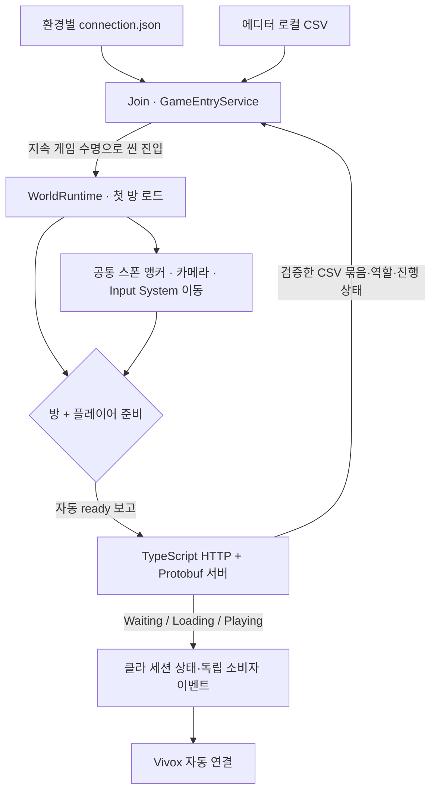

# 2인 방탈출 — 서버·클라이언트 종합

기준일: **2026-10-20**. 현재 구현과 검증 범위를 설명합니다. 세부 실행·API는 [서버 README](../../README.md), Unity의 씬·입력·검토는 별도 클라이언트 README와 Docs/EntryConsistency.md를 따릅니다.

## 현재 구조

서버는 두 참가자의 역할·세션 단계·문제 정답·문 허가·누적 방 해금을 관리합니다. 각 Unity 클라이언트는 자기 방과 1인칭 플레이어를 구성합니다. 캐릭터 위치·문 애니메이션을 서로 동기화하는 구조가 아니며 음성은 Vivox 별도 서비스입니다.

## 구현한 기능

| 영역 | 현재 구현 | 남은 범위 |
|---|---|---|
| 접속 | Editor/TestBuild/StableBuild config, 자동 입장·재시도 | StableBuild 클라우드 주소 등록 |
| 통신 | HTTP + Google Protobuf, 생성 코드/OpenAPI 로컬 배포 도구 | 실제 클라우드 운영·CI/CD |
| 세션 | 입장·역할·조회·ready·3초 heartbeat·10초 만료·퇴장 | 재접속 신분 복구·다중 세션·영구 저장 |
| 데이터 | Excel→CSV→서버/로컬 로드, 스키마·관계 검사·불변 타입 매핑 | 새 콘텐츠/시트 정의 시 검증·매핑 갱신 |
| 진행 | 정답 제출·문 허가·허가 캐시·누적 해금 | 실제 문·입력 UI·방 이동 연출 |
| 플레이어 | 공통 R01_Player 스폰, A 큐브/B 실린더, 카메라·캡슐, WASD 가감속·중력 | 손/무전기 모델·마우스 시점·좌클릭 Closeup |
| 방 | R01 실제 로더 조립, 포함 모델 재사용, 개발자 다음 방 연결 | B LEDPanel 앵커, 후속 콘텐츠와 런타임 공간 연결 |
| 음성 | 세션 기반 Vivox 자동 채널 연결 | Bluetooth 장치·실제 양방향 송수신 검토 |

## 수명과 준비 완료

Join 화면은 입력·표시·구독 수명만 소유합니다. GameEntryService는 씬 로드 시작 전까지 화면 취소를 따르고 시작 후에는 지속되는 게임 소유 토큰을 사용합니다. 씬 전환으로 화면이 제거되어도 정상 입장이 취소되지 않습니다. 게임 소유자가 종료되거나 방/플레이어 초기화가 실패하면 입장을 정리합니다.

Ingame의 WorldRuntime에 실제 로더와 첫 RoomSceneView를 연결했습니다. Bootstrapper는 로드 성공한 첫 방을 플레이어 생성기에 전달하며 **방과 플레이어가 모두 준비된 경우에만 ready**를 보고합니다. 컴파일/프리팹이 보인다는 이유로 준비를 보고하지 않습니다.

## 데이터와 정수 단위

현재 서버·클라 CSV 23개는 내용이 일치합니다. 온라인은 서버 메모리 원본, 에디터 로컬 모드는 빌드에 포함된 TextAsset 원본을 사용합니다. 서버 실패를 로컬 데이터로 대체하지 않습니다.

CHARACTER_STAT 선택은 GAME_CONFIG 16010이 지정합니다. 기본 17001은 3000mm/s, 가속 10000mm/s², 감속 12000mm/s²입니다. Unity의 CharacterStatUnits를 CSV 검사와 실제 플레이어 정의에서 공유합니다. 서버도 float32→정수 milli 단위로 동일 범위를 검사합니다. 시간은 정수 ms이며 실제 Unity Transform·물리·입력 경계에서 필요한 float 변환을 합니다. 물리 결정성·위치 동기화·replay를 완료했다는 의미는 아닙니다.

## 현재 검증과 제한

- 서버 자동 검사 **151개**, 클라 공통 순수 C# **198개**, 스폰·이동 **45개** 통과.
- 현재 데이터 **3121개 셀**을 비교했고 CSV 오류 **0개**, 콘텐츠 경고 **52개**입니다. 셀/앵커 개수와 경고 0을 고정 성공 조건으로 쓰지 않습니다.
- Unity 6.2 참조 환경에서 런타임(Editor 정의)·에디터 도구·Windows 런타임 분리 컴파일을 통과했습니다.
- 실제 Unity Play·빌드·물리·메뉴·음성 실행 결과는 별도 검토가 필요합니다. 과거 검사 기록을 이번 변경의 실행 통과로 사용하지 않습니다.
- **B 역할 R01_LEDPanelPoint가 실제 프리팹에 없습니다.** B 임시 모델·이동의 개발자 미리보기는 가능하지만 정상 B 입장/양쪽 Playing 검증은 콘텐츠 배치 후 진행합니다. 누락을 임의 위치나 준비 완료로 바꾸지 않습니다.
- 격리 Play 도구가 B 미완성으로 중단되면 종료 코드 2이며 전체 통과가 아닙니다.

## 다음 검토

1. Unity 컴파일 후 Tools > Game > Verify Ingame Wiring로 실제 씬 참조 확인.
2. Join의 로컬 테스트 A로 데이터/역할/플레이어가 씬 전환 뒤 유지되는지 확인.
3. 정상 입장 후 Verify Gameplay Readiness와 WASD·바닥/벽 충돌 확인.
4. B LEDPanel 앵커 배치 후 두 PC 입장·ready·Playing·단절/재입장 검토.
5. 별도 기능 단위로 마우스 시점·Closeup·문/정답 UI·실제 다음 방 연결 진행.
