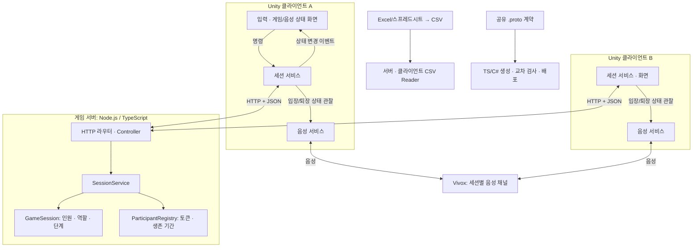
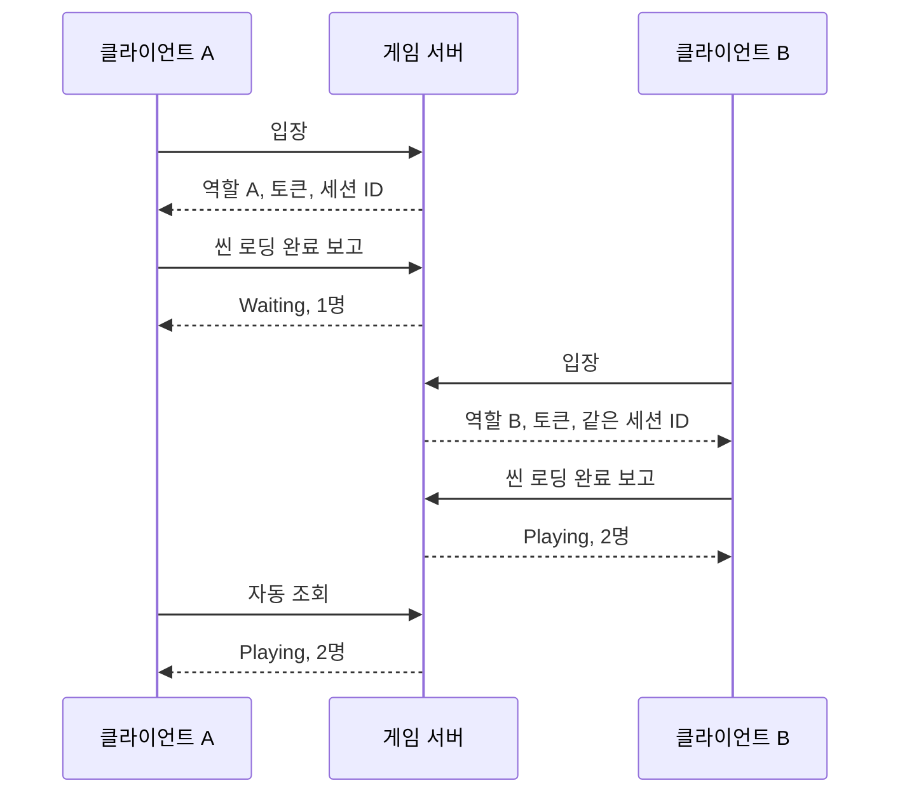

# 2인 네트워크 방탈출 — 서버·클라이언트 종합

기준일: **2026-10-15**. 콘텐츠 개발 전까지 만든 기반 기능과 현재 확인 범위를 정리합니다.

Unity 6 클라이언트 두 개가 같은 게임 서버에 입장하는 방탈출 프로토타입입니다. 지금까지 **두 참가자의 입장 → 자동 씬 준비 보고 → 서버가 정한 단계 반영 → 연결 유지 → 퇴장·단절 정리**를 만들었습니다.

쉽게 비유하면 서버는 두 자리의 명부를 관리하고, 클라이언트는 참가자의 조작과 화면을 담당합니다. Vivox는 같은 참가자끼리 통화하는 별도의 음성 서비스입니다. CSV Reader는 추후 사용할 데이터 문서를 읽는 도구입니다. 퍼즐 규칙이나 콘텐츠는 아직 구현하지 않았습니다.

## 1. 문서와 프로젝트 위치

| 목적 | 문서 위치 |
|---|---|
| 전체 기능과 연결 이해 | 이 README |
| 서버 실행·API·내부 구조 | [서버 README](../../README.md) |
| Unity 구성·화면·검사 | 별도 Unity 프로젝트 루트의 README.md |
| 두 PC 검사 순서 | [빌드 테스트 가이드](../TestGuid.md) |

문서에서 반복되는 용어는 다음 의미입니다.

| 용어 | 쉬운 설명 |
|---|---|
| 세션 | 두 참가자가 함께 들어가는 게임 공간과 그 상태 |
| 스냅샷 | 현재 단계·인원 등을 조회한 시점의 상태 사본 |
| 참가 토큰 | 입장 때 받은 임시 참가 증명 값. 현재 서버 안의 참가 권한이며 영구 계정 로그인이 아님 |
| 명령 | 입장·퇴장처럼 어떤 일을 해 달라는 요청 |
| 이벤트 | 상태 반영이 끝났다는 소식. 이를 구독한 화면·음성 등이 각자 반응 |
| 어댑터 | 내부 기능과 외부 기술 사이의 변환 담당. 예: HTTP 결과를 세션 자료형으로 변환 |

## 2. 전체 연결도

게임 서버는 음성을 중계하지 않습니다. CSV는 양쪽에서 각자 읽을 수 있지만 서버가 CSV를 배포하거나 버전을 맞추는 기능은 아직 없습니다. Protobuf 도구가 준비되어 있어도 **현재 실제 HTTP 통신은 JSON**입니다.

## 3. 지금까지 만든 기능

| 기능 | 서버 역할 | 클라이언트 역할 | 상태 |
|---|---|---|---|
| 접속·입장 | 두 자리, 역할 A/B, 참가 토큰 발급 | 주소 입력·입장 요청·표시 | 구현, 게임 빌드 접속 통과 이력 |
| 로딩·단계 | Waiting/Loading/Playing 결정 | 씬·필수 컴포넌트 준비 확인 후 자동 보고 | 구현·검사 |
| 상태 반영 | 스냅샷 조회 응답 | 기본 1000ms 조회·단계 변경 이벤트 | 구현·검사 |
| 오류 공통화 | 결과 코드·공통 HTTP 응답 | 검증·오류 변환·화면 문구 분리 | 구현·검사 |
| 생존 확인 | 10000ms 미수신 참가자 정리 | 3000ms 전송·10000ms 응답 단절 알림 | 구현·검사 |
| 정상 퇴장 | 요청자의 토큰·자리 즉시 제거 | 자동 요청 취소·퇴장·로컬 정리 | 구현·검사 |
| 역할 분리 | 규칙·서비스·HTTP 분리 | 공개 계약·코어·Gateway·Presenter | 같은 프로젝트 안에서 책임 분리 |
| Vivox | 게임 세션 ID 제공 | 입장으로 음성 연결, 퇴장/단절로 정리 | 연결·2명 표시 확인, 실제 음성 문제 보류 |
| 실행·배포 | 환경별 실행기·Docker·SSH 도구 | 주소 선택·Windows 빌드 | 로컬 검사, 실제 클라우드 미검증 |
| Protobuf | 계약·TS 생성물·공통 도구 | C# 생성물·런타임·왕복 검사 | 준비됨, 실제 HTTP 전환 전 |
| CSV | UTF-8 파일 읽기·해석 | TextAsset/파일 읽기·수동 검사 | Reader 구현, 실제 컬럼 미정 |

구현 완료는 콘텐츠를 포함한 게임 완성을 뜻하지 않습니다. 검사 환경과 남은 범위는 뒤에서 구분합니다.

## 4. 입장에서 Playing까지

1. 첫 클라이언트가 서버 주소로 입장을 요청합니다.
2. 서버가 세션 ID, 참가자 ID, 빈 역할과 참가 토큰을 발급합니다.
3. 클라이언트가 씬 로드와 지정된 필수 컴포넌트의 활성 상태를 확인합니다.
4. 준비를 마치면 ready로 **본인의 씬 로딩 완료**를 보고합니다.
5. 다른 클라이언트도 같은 과정을 수행합니다.
6. 서버는 두 명이 모두 완료했을 때 Playing을 반환합니다.
7. 양쪽이 조회로 최신 상태를 받고 화면과 독립 기능에 이벤트를 전달합니다.

도식은 A가 먼저 준비를 끝낸 예입니다. 실제 순서는 달라질 수 있습니다. 두 명이 찼지만 누군가 준비 중이면 Loading입니다. Playing은 현재 **로딩 장벽 통과**를 뜻하며, 아직 없는 퍼즐 시작·완료 판정까지 수행하지 않습니다.

ready는 대기실 준비 버튼이나 플레이 시작 명령이 아닙니다. 같은 단계의 스냅샷을 반복 반영해도 PhaseChanged는 반복 발생하지 않습니다. StateChanged는 반영 완료된 상태를 알리고 JoinAsync 같은 명령은 작업을 요청합니다. 요청과 완료 알림을 구분하여 화면·음성·자동화가 필요한 결과를 받습니다.

## 5. 상대방이나 서버가 사라질 때

조회는 “현재 방 상태가 무엇인가요”, 생존 확인은 “저는 아직 연결되어 있습니다”라는 요청입니다. 조회 성공이 참가자 생존 시간을 연장하지는 않습니다.

| 상황 | 처리 |
|---|---|
| 나가기 선택 | 자동 요청 취소 후 leave 전송, 서버 자리·토큰 즉시 제거 |
| 클라이언트 강제 종료 | 생존 확인 중단, 서버가 마지막 수신 후 10000ms 만료 처리 |
| 잠깐 통신 실패 | 조회 재시도, 정상 생존 응답 감시 유지 |
| 마지막 정상 생존 응답 이후 10000ms | 클라이언트 연결 종료·알림, 자동 요청·음성 정리 |
| 토큰 폐기·세션 소멸 | 종료해야 하는 결과로 구분하여 연결 종료 |
| 서버 재시작 | 메모리 세션·토큰 초기화, 사용자가 신규 입장 |

서버 기본 만료 검사는 500ms 간격입니다. 타이머·네트워크·조회가 이어지므로 화면 표시 시각이 정확히 10000ms와 일치하지는 않습니다. 서버의 마지막 수신과 클라이언트의 마지막 정상 응답은 다른 기준입니다.

한 명이 사라지면 남은 참가자는 Waiting입니다. 남은 사람의 로딩 완료 값은 유지되고 새 참가자는 새로 보고합니다. 신규 입장은 새 ID·토큰을 받습니다. **이전 참가자 신분과 진행 상태를 복구하는 재접속은 아직 없습니다.**

## 6. 역할과 패턴을 나눈 이유

| 형태 | 적용 위치 | 목적 |
|---|---|---|
| 명시적 DI·조립 지점 | 서버 main, Unity Bootstrapper | 생성·주입·종료를 한곳에서 연결 |
| Facade | SessionClient, VoiceChatService, CsvLoader | 소비자가 단순한 명령·결과로 사용 |
| Adapter | HTTP/Vivox Gateway, CSV 입력 소스 | HTTP·SDK·파일·엔진 의존성 격리 |
| Observer | 게임·음성 상태 이벤트 | 반영된 변화를 독립 소비자에게 전달 |
| Presenter / View | 접속·음성 화면 | 상태 해석과 UI 컴포넌트 연결 분리 |
| Factory | Gateway 생성 | 주소별 통신 구현 생성 책임 분리 |
| Strategy | 로컬/SSH Docker 대상 | 배포 절차는 공유하고 대상 접속 방식 교체 |
| 상태 기반 처리 | 세션·연결·음성·CSV 해석 | 가능한 작업과 다음 처리 구분 |

모든 기능에 모든 패턴을 넣지는 않았습니다. enum과 조건으로 처리하는 상태도 있으며 모든 상태가 별도 GoF State 클래스인 것은 아닙니다. 로컬 메서드 호출까지 전역 이벤트 버스로 우회하지 않습니다.

UI는 ISessionConnectionService와 읽기 전용 SessionInfo를 사용합니다. 토큰·Wire DTO·UnityWebRequest는 내부 구현에 있습니다. 현재 세션 코드는 같은 Unity 어셈블리이므로 소스가 숨겨지는 DLL 배포까지 완료한 것은 아닙니다. 향후 라이브러리화를 위해 의존성 방향을 먼저 정리했습니다.

현재 서버가 세션 규칙의 권한을 가집니다. 향후 P2P·호스트·전용 서버 선택에는 명령 검증·동기화·권한 이전 설계가 추가로 필요합니다.

## 7. 시간과 데이터 기준

**시간:** Unity는 간격 int ms와 경과 long ms, 서버는 정수 ms를 사용합니다. 단조 증가 시계로 경과를 측정합니다. UnityWebRequest처럼 초 단위 API를 만나는 경계에서만 정수 초로 올림 변환합니다.

정수만으로 결정론이나 리플레이가 완성되지는 않습니다. 명령 순서·Tick·난수·상태 소유권도 추가로 명시해야 합니다. 현재는 시간 기반 자동화와 연결 관리를 구성한 단계입니다.

**CSV:** Excel·스프레드시트 → UTF-8 쉼표 CSV → 각 프로젝트의 Reader 순서입니다. 현재 결과는 헤더와 문자열 행이며 001 같은 원문을 보존합니다. 실제 컬럼·ID·타입·범위·테이블 참조는 미정입니다. 정수 콘텐츠 변환은 컬럼 확정 후 별도 계층에 연결합니다.

**Protobuf:** 공유 계약으로 TS/C#를 생성하고 바이너리 교차 검사를 합니다. Unity 런타임은 활성화했으나 HTTP는 JSON입니다. 메시지 파싱 성공과 게임 규칙 검증 성공은 다른 문제입니다.

## 8. 실행 환경

| 목적 | 서버 실행 | 클라이언트 기본 접속 주소 |
|---|---|---|
| 같은 PC 개발 | run-local.cmd / sh run-local.sh | http://127.0.0.1:3000 |
| Docker 없이 두 PC | run-test.cmd / sh run-test.sh | http://서버PC의실제IP:3001 |
| 로컬 Docker 두 PC | run-docker-local.cmd / sh run-docker-local.sh | http://서버PC의실제IP:3001 |
| 클라우드 원격 도구 | deploy-cloud.cmd / sh deploy-cloud.sh | 설정한 실제 공개 주소 |

Docker 기본 포트는 PC 3001 → 컨테이너 3000입니다. 같은 PC는 127.0.0.1을 사용할 수 있고 다른 PC는 서버 PC의 실제 IP를 사용합니다. 서버 변경은 새 이미지·컨테이너, Unity 변경은 새 클라이언트 빌드에 반영해야 합니다.

기능 개발은 에디터·로컬 실행으로 검사할 수 있습니다. 로컬 Docker 도구도 준비되어 있습니다. 클라우드는 SSH 실행 절차까지만 구현했으며 실제 배포·Git CI/CD·무중단 교체는 후속입니다.

## 9. 확인한 범위와 보류

기존 기록과 사용자님 확인을 요약합니다. 이번 문서 작성에서 새 게임 빌드나 실제 두 PC 검사를 실행하지는 않았습니다.

| 대상 | 확인한 범위 | 남은 확인·해결 |
|---|---|---|
| 서버 | 작성일 직전 자동 검사 77개 통과 | 콘텐츠·실제 클라우드 |
| 게임 세션 | 에디터 입장·자동 준비·조회·만료·종료, 게임 빌드 접속 통과 이력 | 새 기능 추가 후 빌드 회귀 검사 |
| 로컬 Docker | 이미지 빌드·실행·교체·health와 사용자님 빌드 접속 이력 | 실제 배포 대상 검사 |
| Vivox | 이전 수동 샘플 음성 검사, 자동 입장·종료, 새 두 PC 연결됨(2명) | 자동 연결 빌드 양방향 음성 안 들림·Bluetooth 장치 문제 보류 |
| Protobuf | 생성·배포·교차 검사, Unity 런타임 왕복 확인 이력 | 실제 HTTP 전환·전체 계약 확장 |
| CSV | 서버 검사 30개 포함, 공통 27개 교차 검사·독립 C#·Unity DLL 참조 컴파일 | 실제 테이블, 최신 CSV의 Editor import/Play·새 빌드 |

음성의 연결됨(2명)은 채널 참가 상태입니다. 마이크·출력 확인을 통과한 기록으로 대체하지 않습니다. 해당 문제는 사용자님 요청으로 보류 중입니다.

## 10. 콘텐츠 작업에 앞서 남아 있는 경계

1. **콘텐츠·테이블:** 아직 미정입니다. 타입 변환·필수값·ID 중복·범위·참조 검사와 조회 서비스를 Reader 위에 연결할 단계가 남았습니다.
2. **게임 명령·상태 동기화:** 퍼즐·아이템·상호작용 입력과 판정은 아직 없습니다. 현재 세션 조회만으로 게임 월드가 동기화되지는 않습니다.
3. **복구·여러 방·저장:** 단일 메모리 세션과 신규 입장만 지원합니다. 이전 신분·진행 복구, 여러 세션, 영속 저장은 별도 기능입니다.
4. **Protobuf 실통신:** 준비한 생성물과 JSON API 사이의 전환이 남았습니다.
5. **음성 장치:** 자동 연결과 별개로 실제 송수신을 확인해야 합니다.
6. **클라우드 운영:** 실제 SSH 배포 검사, 이후 Git 자동 빌드·배포가 최종 목표로 남았습니다.

이 목록은 현재 구현과 구분한 후속 범위입니다. 작업 순서는 사용자님 검토를 거쳐 결정합니다.

## 11. 앞으로 기능을 붙일 기준

기능 정의 → 책임 경계 → 데이터 → 상태·명령 → 완료 이벤트 → 어댑터·컴포넌트 → 성능·네트워크 영향 → 집중 검사 순서로 진행합니다. 읽기 전용 정의와 플레이 중 변경되는 상태를 나누고 CSV·통신·결과 처리를 콘텐츠마다 다시 만들지 않습니다.

서버는 판정·상태 소유, 클라이언트는 입력·표현·엔진 연결을 맡도록 확장합니다. 경계를 넘을 때는 엔진 객체 대신 직렬화 가능한 ID·상태를 사용합니다. 사용자님께 변경 의도와 연결을 설명하고 검토 후 다음 기능으로 진행합니다.

## 12. 상세 문서

- [서버 README](../../README.md)
- [두 PC 빌드 테스트](../TestGuid.md)
- [퇴장·음성 코드 해설](../session-leave-and-voice.md)
- [Docker 안내](../docker-deployment.md)
- [Protobuf 도구](../../protocol/TOOL.md)
- [CSV Reader](../csv-reader.md)
- 클라이언트 저장소: README.md, Docs/SessionArchitecture.md, Docs/SessionLeaveAndVoice.md, Docs/CsvReader.md
