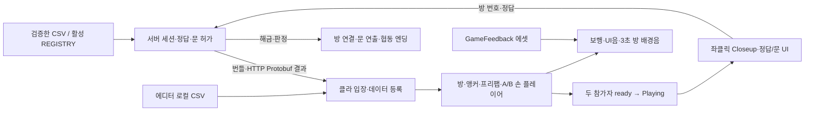

# 2인 방탈출 — 서버·클라이언트 종합

기준일: **2026-10-23**. [서버 README](../../README.md), [서버 구조 점검](../ArchitectureReview.md), [서버 상세 구조](../ServerCodeArchitecture.md)를 봅니다. 클라이언트 상세와 종합 도식은 Unity 프로젝트 `Docs/ClientArchitectureReview.md`, `Docs/ArchitectureReview.md`에 있습니다.

## 현재 책임과 연결

서버는 프로세스당 메모리 세션 하나와 A/B 정답·허가·누적 해금을 소유합니다. 위치·문 각도·카메라·음원은 로컬 표현입니다. 음성은 별도의 Vivox 어댑터로 연결됩니다. 온라인은 서버 번들, 로컬 테스트는 클라 CSV를 사용하며 온라인 오류를 로컬 판정으로 대체하지 않습니다.

## 구현과 확인을 구분한 현재 범위

| 영역 | 코드에 연결된 기능 | 추가 확인/미구현 |
|---|---|---|
| 접속 | Editor/Test/Stable config 주소 선택·Start_UI 버튼 입장·조건부 WaitingRoom_UI, ready/heartbeat/퇴장 | 재접속 신분 복구·다중 세션·영구 저장 |
| 데이터/생성 | 검증·타입 주입·번들, proto/OpenAPI/콘텐츠 계약 생성 도구 | 새 기능의 실제 Handler는 별도 구현 |
| 방/입력 | A/B 방 계획, 공통/역할 앵커, 손 모델·WASD·시점·좌클릭 | 전체 방 프리팹/충돌/실제 빌드 확인 |
| 상호작용 | Closeup·정답 제출·문 허가 캐시·로컬 개폐·누적 다음 방 | 새 콘텐츠 규칙·전체 조작 시나리오 |
| 엔딩/연출 | 양쪽 7번 방 정답→영상→시간/Result_UI→확인 종료, 보행/사운드 | 실제 영상·출력 장치·음성 청취 재검증 |
| 운영 | Swagger UI, HTTP 접근 stdout 로그, Docker 로그 회전 | Error 전용 앱 파일 로그·무중단 배포·자동 롤백 |

이번 구조 점검에서 활성 시트 주입을 TS/C#에서 통일하고, 방 조회 할당·배경음 반복 갱신·엔딩 영상 자원 보유·사운드 enum ID·이벤트 중복 연결을 보강했습니다. 조명/Light Probe와 R01_LEDPanel 소리는 보류입니다.

## 검증

서버 176개, 클라 순수 핵심 회귀 329개, 플레이어 78개, 사운드/보행 48개, 엔딩 41개, 실제 C#↔Node HTTP/Protobuf 24개를 통과했습니다. 서버 원본 CSV 24개/활성 14개, 클라 원본 CSV 14개/활성 14개이며 오류는 0개입니다. 원본·활성·고정 코퍼스의 개수는 서로 다른 의미입니다.

Unity DLL 참조 분리 컴파일과 실제 Unity Play·GPU/Memory Profiler·두 PC 음성/클라우드 검증을 구분합니다. 이번에는 실제 EC2 재배포·Unity Play를 수행하지 않았습니다. 정수 단위/계약 분리만으로 P2P 전환·replay 결정성이 완성되지는 않습니다.
