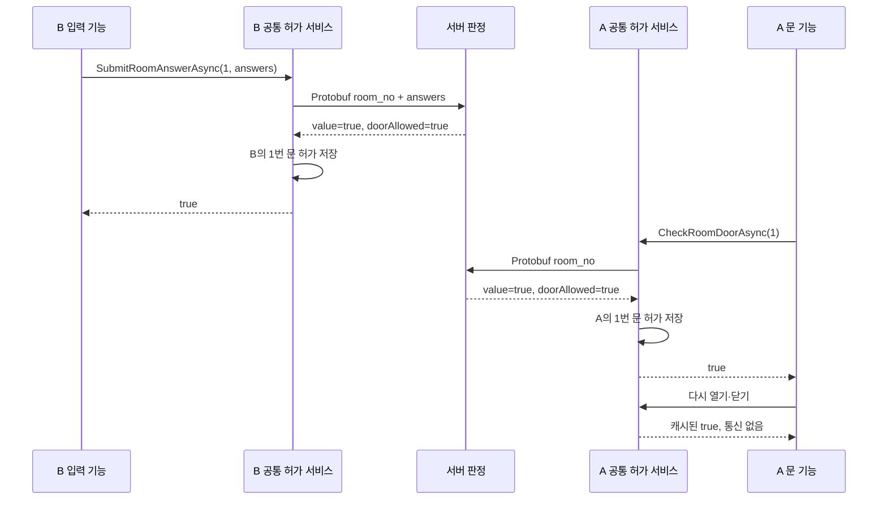

# 문·정답 API와 Protobuf 실통신

2026-10-19. 이번 기능은 서버 판정, Protobuf 전송, 생성 코드 로컬 배포, 클라이언트 문 허가 캐시입니다. 1인칭 플레이어·Raycast·실제 문 애니메이션·정답 입력 UI는 다음 검토 단위입니다.

## 동작 규칙

클라이언트는 방 번호와 정답 목록을 전달합니다. 서버는 참가 토큰에서 A/B를 결정하고 해당 ROOM의 PuzzleID와 PUZZLE.Type을 조회합니다. 클라이언트가 판정 방식이나 역할을 지정하지 않습니다.

정답 응답의 value는 정답=true/오답=false입니다. 문 확인 응답의 value는 허가=true/잠김=false입니다. 인증 실패·역할 위반·게임 준비 미완료·잘못된 요청은 failure 분기로 반환하며 false로 바꾸지 않습니다. 정상 false도 room outcome이 존재하므로 빈 메시지와 구분됩니다.

문을 허가받으면 클라이언트가 방 번호별로 기억합니다. 이후 문 열기·닫기는 이 허가를 재사용하고 HTTP 요청을 보내지 않습니다. 잠김 false는 영구 캐시하지 않아 상대가 문제를 푼 후 다시 확인할 수 있습니다. 재입장·퇴장·연결 종료 시 캐시를 비우고, 이전 요청의 늦은 응답이 새 입장에 허가를 추가하지 못하게 합니다. 문 열림/닫힘과 애니메이션 상태는 이 허가 상태와 별개입니다.

R01의 예: B가 정답을 맞히면 B의 1번 문과 다음 방 1004가 허가됩니다. A의 다음 방 1003은 아직 추가되지 않습니다. A가 자기 문을 확인하면 서버가 이미 해결된 퍼즐 5001을 확인하고 A의 문과 다음 방을 허가합니다. 두 참가자 모두 이전 방을 유지합니다.

7번 방의 BothSolved는 예외 규칙이 아니라 CSV 정책입니다. 한쪽 정답이 맞아 value=true여도 양쪽 퍼즐이 끝나지 않았다면 doorAllowed=false입니다. 따라서 정답 여부와 문 허가를 구분합니다. Next=0이므로 별도 엔딩 기능을 실행하지 않습니다.

## API 계약

게임 응답은 모두 `Content-Type: application/protobuf`의 `GameApiResponse`입니다. 입력 본문도 Protobuf이며 JSON 폴백은 없습니다. 운영 확인 `/health`와 계약 문서 `/openapi.json`은 JSON입니다. 참가자는 `x-participant-token` 헤더로 인증합니다.

| 경로 | 메서드 | 요청 메시지 | 성공 outcome |
|---|---|---|---|
| /sessions/join | POST | 없음 | joined, 201 |
| /sessions/{id} | GET | 없음 | snapshot, 200 |
| /sessions/{id}/ready | POST | 없음 | snapshot, 200 |
| /sessions/{id}/heartbeat | POST | 없음 | completed, 200 |
| /sessions/{id}/leave | POST | 없음 | completed, 200 |
| /sessions/{id}/data | GET | 없음 | data, 200 |
| /sessions/{id}/rooms/answer | POST | RoomCommandRequest | room, 200 |
| /sessions/{id}/rooms/door | POST | RoomCommandRequest | room, 200 |
| /sessions/{id}/puzzles/{puzzleId}/submit | POST | PuzzleCommandRequest | puzzle, 200 |

기존 puzzleId 경로는 디버그/검증 호출을 위한 호환 진입점이며 본문도 Protobuf입니다. 콘텐츠 입력은 roomNo 경로를 사용합니다. 두 경로는 같은 RoomProgression과 슬롯 판정을 사용합니다.

```proto
message RoomCommandRequest {
  int32 room_no = 1;
  repeated string answers = 2;
}
message RoomDecisionReply {
  int32 room_no = 1;
  bool value = 2;
  bool door_allowed = 3;
  SessionSnapshot snapshot = 4;
}
```

문 요청은 answers를 비웁니다. 서버는 양의 int32 방 번호, 본문 8192바이트, 답 최대 64개·각 길이 256을 확인합니다. 정답은 숫자·방향·색·글자를 포함하므로 string을 유지합니다. ID·방 번호·enum·ms는 정수입니다.

| 실패 코드 | HTTP | 의미 |
|---|---|---|
| SESSION_FULL | 409 | 정원 초과 |
| PARTICIPANT_TOKEN_REQUIRED | 400 | 토큰 누락 |
| INVALID_PARTICIPANT | 403 | 만료·무효 참가자 |
| SESSION_NOT_FOUND / ROOM_NOT_FOUND | 404 | 없는 세션/방 |
| GAME_NOT_PLAYING | 409 | 플레이 준비 미완료 |
| SUBMISSION_NOT_ALLOWED | 409 | Solver 자격/해금 조건 위반 |
| INVALID_REQUEST | 400 | 잘못된 Protobuf/매개변수 |
| UNSUPPORTED_MEDIA_TYPE | 415 | JSON 등 지원하지 않는 입력 형식 |
| PAYLOAD_TOO_LARGE | 413 | 본문 제한 초과 |

## 파일별 코드와 의도

| 파일 | 책임 |
|---|---|
| `protocol/escape/v1/game_api.proto` | 메시지 원본과 명시적인 결과/실패 oneof. 기존 필드 번호와 enum 숫자를 유지하며 확장 |
| `protocol/http/openapi.json` | Swagger/OpenAPI 3.0.3의 HTTP 경로·인증·Protobuf 미디어 타입·메시지 연결 |
| `scripts/generate-http-api.cjs` | OpenAPI → 서버 경로 메타데이터, C# IGameApi·GameApiClientBase·GameApiRoutes 생성. 메시지 DTO는 proto에서만 생성 |
| `createSessionHttpServer.ts` | 생성된 경로 매칭 후 Controller 호출. JSON 게임 라우터를 제거하고 공통 Protobuf 오류 반환 |
| `ProtobufHttp.ts`, `ParticipantHttpHandler.ts` | 제한된 바이너리 입력, 인증 헤더, 도메인 값의 wire 변환·HTTP 상태·응답 헤더 공통화 |
| `SessionController.ts` | 요청 해석을 공통 경계에 위임하고 SessionService로 연결 |
| `SessionService.decideRoom` | 참가자와 Playing 검사, 내 방 조회, 도메인 판정 조정 |
| `RoomProgression.ts` | solved, permitted, unlocked를 분리. 정답은 제출자 방만, 상대는 자기 문 확인 때 허가 |
| `PuzzleAnswerRules.ts` | CSV Type으로 판정 정책 선택. 현재 7종은 동일 SlotAnswerRule을 재사용하고 필요한 경우 별도 정책을 주입 |
| 클라 `ProtobufGameApiClient` | 생성된 메서드 아래에서 UnityWebRequest 전송·정수 ms 제한·취소·바이너리 파싱 |
| 클라 `ProtobufApiResponseValidator` | HTTP 상태·미디어 타입·oneof·오류 enum 일치 검사. 빈 메시지나 통신 실패를 false로 만들지 않음 |
| 클라 `SessionApiClient`, `HttpSessionGateway` | 생성 메시지를 기존 내부 값과 공개 세션 계약으로 변환하는 Adapter. 기존 내부 DTO 이름이 남아 있지만 JSON 직렬화/역직렬화에는 사용하지 않음 |
| 클라 `ISessionRoomService`, Coordinator, SessionClient | 참가 토큰을 숨긴 공개 계약, 기존 요청 직렬화·취소·스냅샷 반영 경로 재사용 |
| 클라 `RoomPermissionService` | 모든 문이 공유하는 허가 캐시·중복 요청·늦은 결과 방지 |
| 클라 `GameEntryService`, `LocalRoomProgression` | 온라인과 서버 없는 로컬 테스트를 같은 bool 진입점으로 연결 |

Strategy는 판정 규칙 차이를 위한 경계이고, Adapter는 전송 형식과 도메인 표현을 분리하는 경계입니다. 공통 요청 처리나 인증을 퍼즐별 클래스에 복사하지 않습니다. View·입력·문 애니메이션은 HTTP DTO나 참가 토큰을 알 필요가 없습니다.



## 콘텐츠에서 호출하는 형태

```csharp
bool correct = await entryService.SubmitRoomAnswerAsync(roomNo, answers, token);
// correct는 정답 표시용입니다. BothSolved에서는 문 허가가 아직 없을 수 있습니다.
bool mayUseDoor = await entryService.CheckRoomDoorAsync(roomNo, token);
if (mayUseDoor) { /* 로컬 문 열기/닫기 표현 실행 */ }
// 이미 허가받은 경우 CheckRoomDoorAsync는 네트워크를 사용하지 않습니다.
```

## 로컬 생성·배포

Node.js 24와 .NET SDK 10, 기존 proto 도구 및 Unity의 Google.Protobuf.dll이 필요합니다. 대상은 Git 제외 `protocol.projects.local.json`으로 지정합니다.

```powershell
# 현재 서버/클라 소스로 실제 HTTP 왕복 검사
npm.cmd run api:verify

# 새 proto + OpenAPI로 생성·컴파일·교차 검증·임시 클라 HTTP 검사, 미리보기
npm.cmd run api:sync

# 모든 검사가 통과하면 서버/클라 로컬 생성 폴더에 적용
npm.cmd run api:sync -- --apply
```

생성 대상은 서버 `src/generated`, 클라 `Assets/3.Script/Generated/Protocol`입니다. 출력에는 메시지 클래스와 실제 호출 메서드를 가진 기본 클래스가 포함됩니다. 손으로 작성한 게임 로직이나 프리팹은 자동 생성 대상이 아닙니다. Git stage/commit/push는 수행하지 않습니다. 일반 서버 실행 때 Unity 소스를 덮어쓰지 않습니다.

배포 도구는 Windows Git의 LF/CRLF 변환만 동일 내용으로 인정하고 실제 코드 변경은 계속 차단합니다. 계획 후 변경 감지는 원본 바이트 단위로 유지합니다. meta와 사용자 파일을 보존하고 백업을 만듭니다.

## 검증과 사용자님 검사

- 서버 빌드 및 자동 검사 142개 통과.
- 클라 기존 154개 + 문 허가/Protobuf 30개 = 184개 통과. 같은 소스를 임시 net10 프로젝트로 실행했으며 기존 net8 검사 프로젝트 대상은 유지합니다.
- 생성된 메서드·실제 클라 mapper/Gateway/SessionClient/GameEntryService를 사용한 C# ↔ TS Protobuf HTTP 검사 18개 통과. 테스트용 .NET HTTP 어댑터를 사용하며 실제 UnityWebRequest 실행과 구분합니다.
- Unity 6000.2.8f1 참조 컴파일 통과. 실제 Editor Play·새 Windows 빌드의 입력/연출은 미검증입니다.
- 별도 Docker 검사 이미지 빌드와 컨테이너 안 서버 시작·입장·ready·잠긴 문·정답·문 허가 바이너리 왕복 통과. 기존 LAN 컨테이너는 교체하지 않았습니다.

서버와 새 클라를 함께 사용해야 합니다. 기존 Docker LAN 서버는 `npm.cmd run docker:local`로 새 코드를 빌드·교체한 후 테스트합니다. config와 CSV·씬·프리팹 배치는 이번 기능에서 변경하지 않았습니다. 현재 UI에 플레이어·문 클릭·정답 입력 연결을 추가한 것은 아니므로 우선 `api:verify` 결과로 검토하고 다음 기능에서 실제 상호작용을 붙입니다.
