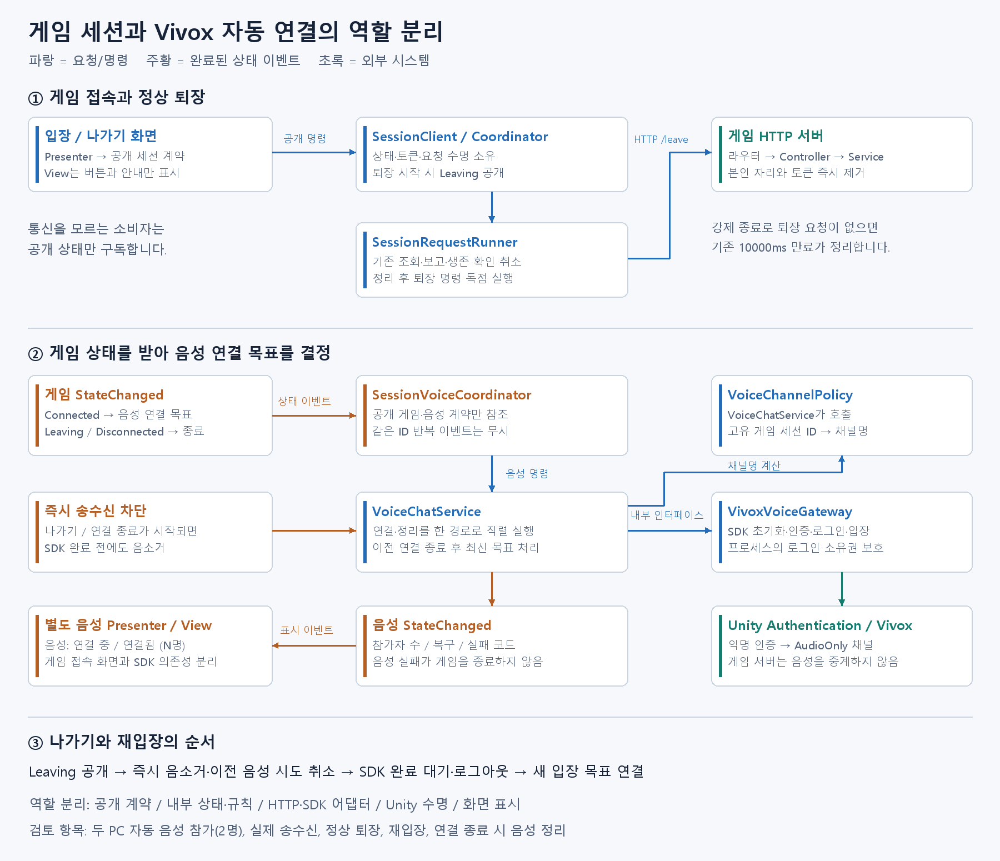

# 정상 퇴장과 Vivox 자동 연결

> 문서 대조일: **2026-10-26**. 현재 코드·설정을 기준으로 설명을 점검했습니다. 본문의 과거 검사 수치·실행 기록은 해당 날짜의 결과입니다. [현재 상태·문서 검토 범위](문서_현행화_점검표.md)를 함께 확인합니다.

## 1. 추가한 기능과 의도

이번 기능은 두 가지입니다. 첫째, 사용자가 나가기를 누르면 서버의 자리를 바로 비웁니다. 둘째, 게임에 입장하면 같은 세션의 음성방에 자동으로 입장하고, 나가거나 연결이 끊기면 음성을 종료합니다.

쉽게 비유하면 게임 세션은 두 사람이 앉는 책상이고, 음성 채널은 그 책상에서 사용하는 전화입니다. 책상에 앉았다는 소식을 전화 담당자가 듣고 전화를 연결합니다. 책상 담당자는 전화 연결 방법을 몰라도 됩니다. 전화가 고장 나도 책상에서 누가 앉아 있는지까지 바꾸지 않습니다.

음성 연결은 입장 성공 직후 시작합니다. Playing 진입까지 기다리지 않으므로 상대방을 기다리거나 씬을 준비하는 동안에도 대화할 수 있습니다. Playing은 기존대로 서버가 두 참가자의 씬 준비 완료를 확인한 뒤 결정합니다.

## 2. 수정 전후 비교

| 항목 | 기존 | 변경 후 |
|---|---|---|
| 정상 퇴장 | 명시적인 서버 퇴장 API 없음 | POST leave로 본인의 자리·토큰 즉시 제거 |
| 강제 종료 | 생존 확인 미수신 만료 | 기존 10000ms 만료 유지 |
| 접속 버튼 | 입장 | 상태에 따라 입장 / 나가기 / 퇴장 중 |
| 요청 실행 | 일반 요청과 생존 확인 독립 실행 | 종료 명령은 두 경로를 정리한 뒤 독점 실행 |
| 음성 연결 | Vivox 샘플 화면에서 수동 로그인·채널 입력 | 게임 입장 이벤트로 자동 연결 |
| 음성 실패 | 게임 화면과 연결되지 않음 | 별도 음성 상태 표시, 게임 상태는 유지 |
| 세션 ID | 서버 실행에서 고정 session-001 | 서버 시작마다 session-UUID |

퇴장과 연결 끊김은 다른 결과입니다. 정상 퇴장에서는 연결 끊김 팝업을 띄우지 않습니다. 서버에 퇴장 확인을 받지 못하면 로컬은 종료하되 서버 자리는 만료 후 정리된다고 안내합니다.

## 3. 서버: 라우터부터 자리 제거까지

### createSessionHttpServer.ts — 요청 경로

`src/infrastructure/http/createSessionHttpServer.ts`의 참가자 경로 정규식에 leave를 추가했습니다. POST /sessions/{id}/leave 요청을 SessionController.leave에 전달합니다. 라우터는 HTTP 경로와 메서드만 판단합니다.

### SessionController.ts / ParticipantHttpHandler.ts — 공통 응답 처리 재사용

Controller의 leave는 기존 ParticipantHttpHandler를 호출합니다. 헤더 누락 400, 잘못된 토큰 403, 없는 세션 404, 성공 200 및 no-store 처리를 새 기능마다 복사하지 않습니다.

### SessionService.ts — 참가자 확인과 제거

`leave(sessionId, participantToken)`은 validateParticipant를 재사용합니다. 성공하면 기존 removeParticipant를 호출하여 ParticipantRegistry의 토큰과 GameSession의 참가자를 함께 제거합니다. 정상 퇴장과 시간 초과가 같은 제거 경로를 사용하므로 한쪽에서만 정리되는 차이를 줄였습니다.

GameSession은 기존 규칙대로 남은 인원을 보고 phase를 다시 계산합니다. 두 명이 Playing 중 한 명이 나가면 남은 한 명의 스냅샷은 Waiting입니다. 역할 빈자리 재사용도 기존 규칙을 사용합니다.

### SessionResults.ts / main.ts — 결과와 고유 세션 ID

LeaveResult는 성공 또는 기존 참가자 실패 코드만 표현합니다. 서버 내부 예외 문자열을 클라이언트에 추가하지 않습니다.

main의 세션 ID는 randomUUID로 생성합니다. 서로 다른 서버가 같은 Vivox 프로젝트를 사용하면서 session-001을 공유하면 의도치 않게 같은 음성방에 모일 수 있으므로 구분했습니다. 클라이언트 주소는 바뀌지 않습니다. ID는 입장 응답에서 받습니다.

이 ID는 서버 프로세스가 살아 있는 동안 유지됩니다. 게임 라운드마다 새 세션을 만드는 다중 방 시스템은 이번 범위가 아닙니다.

## 4. 클라이언트: 정상 퇴장

### 공개 계약

`Session/Contracts/ISessionConnectionService.cs`에 LeaveAsync를 추가했습니다. UI는 HTTP 경로나 인증 토큰을 몰라도 퇴장을 요청할 수 있습니다.

SessionConnectionStatus에 Leaving을 추가했습니다. 게임 phase와 별개인 연결 상태입니다. Leaving에서는 SessionInfo.IsJoined가 false이므로 자동 조회·씬 준비 보고·생존 확인이 새 요청을 시작하지 않습니다.

SessionFailureCode.LeaveUnconfirmed는 서버 퇴장 확인을 받지 못했다는 결과입니다. 사용자가 누른 나가기를 일반적인 연결 끊김 팝업과 구분합니다.

### SessionClient.LeaveAsync

1. 이미 퇴장 중이면 Busy, 입장하지 않았다면 InvalidState를 반환합니다.
2. Leaving 상태를 먼저 공개하고 연결 버전을 올립니다. 음성 구독자는 이 시점에 즉시 송수신을 차단합니다.
3. 현재 연결 수명의 요청을 취소합니다. 이전 연결의 늦은 결과는 버전 검사로 무시합니다.
4. 퇴장 명령은 별도 취소 수명으로 실행합니다. 앞에서 취소한 토큰을 그대로 쓰면 정작 퇴장도 전송할 수 없기 때문입니다.
5. 성공 여부와 관계없이 로컬 ID·인증 토큰·Coordinator를 정리합니다.
6. 이미 만료되었거나 서버 세션이 없다는 응답은 로컬 종료 완료로 처리합니다. 통신 실패는 LeaveUnconfirmed로 안내합니다.

### SessionRequestRunner.RunExclusiveAsync

기존 일반 요청 한 개와 생존 확인 한 개를 담당하는 실행기에 종료 전용 경로를 추가했습니다. 먼저 새로운 요청의 진입을 막고, 취소된 기존 요청들이 끝날 때까지 기다린 뒤 퇴장을 보냅니다. 각 기능에 중복 방지 플래그를 흩어 넣지 않습니다.

기존 MonoBehaviour 코루틴이나 float 시간은 추가하지 않았습니다. Task.Yield는 현재 요청의 비동기 정리를 기다릴 때 사용하며 타임아웃 측정 수단이 아닙니다.

### Coordinator / Gateway / API / Validator

Coordinator는 내부 상태에서 세션 ID와 참가 토큰을 확보하고 실행기에 퇴장을 예약합니다. ISessionGateway는 전송 중립 인터페이스입니다. HttpSessionGateway가 API 결과를 기존 SessionFailureCode로 바꿉니다.

SessionApiClient는 POST 경로와 참가 토큰 헤더를 구성합니다. LeaveResponseDto와 SessionResultValidator.ValidateLeave는 기존 참가자 응답 형식 검증을 재사용합니다. 기존 일반 요청 제한 10000ms를 사용하고 새 시간 체계를 만들지 않았습니다.

### Presenter / View

ISessionConnectionView에 LeaveRequested를 추가했습니다. 같은 버튼이라도 입력 의도는 입장과 퇴장으로 나눕니다.

SessionConnectionPresenter는 사용자 명령과 공개 상태만 해석합니다. 조회 중에도 나가기는 가능하며, 실제 취소 순서는 SessionClient와 실행기에 맡깁니다. SessionConnectionPresentation에 CanLeave와 IsLeaving을 추가하여 View는 버튼 모양과 문구만 반영합니다.

SessionConnectionView는 버튼을 입장 / 나가기 / 퇴장 중으로 표시합니다. Vivox를 참조하지 않습니다.

## 5. 음성: 파일별 역할

### Voice/Contracts — 외부에서 사용할 약속

`IVoiceChatService`는 ConnectAsync, DisconnectAsync, StopTransmission과 State/StateChanged를 공개합니다. `VoiceConnectionRequest`는 세션 ID, 게임 참가자 ID, 표시 이름을 검증하는 불변 데이터입니다.

`VoiceInfo`는 연결 상태, 실패 코드, 세션/참가자 ID, 채널명, 참가자 수만 공개합니다. 참가자 수는 int입니다. SDK 객체와 인증 정보는 포함하지 않습니다.

음성 연결 결과는 StateChanged의 상태와 실패 코드로 확인합니다. ConnectAsync의 Task 완료만으로 성공이라고 판단하지 않습니다. 초기화·인증·로그인·입장·정리 실패를 구분하며 상세 SDK 예외는 내부 진단으로 남깁니다.

### VoiceChannelPolicy — 같은 게임 세션에서 같은 음성방 계산

세션 ID의 SHA-256 앞 16바이트를 32자리 16진수로 바꾸고 escape_를 붙입니다. 같은 세션의 역할 A와 B는 같은 채널을 얻습니다. 서로 다른 서버 세션 ID는 다른 채널을 얻습니다. LAN 주소와 localhost가 섞여도 영향이 없습니다.

채널명을 계산하는 규칙을 한곳으로 모았습니다. 채널명은 접근 권한 증명이나 참가 토큰이 아닙니다. 실제 운영용 음성 접근 통제는 별도 권한/토큰 설계가 필요합니다.

### SessionVoiceCoordinator — 게임과 음성을 연결하는 Observer

이 클래스는 ISessionConnectionService와 IVoiceChatService만 받습니다. 게임 StateChanged를 구독하고, 입장 상태라면 음성 연결 목표를 만듭니다. 퇴장/연결 종료 상태라면 목표를 비웁니다.

같은 세션·참가자에 대한 반복 조회 이벤트에는 아무것도 하지 않습니다. 조회할 때마다 음성 로그인하지 않습니다. 새로운 목표가 생기면 기존 송수신부터 차단하고, 하나의 비동기 처리 루프가 가장 최근 목표로 수렴합니다.

사용자가 음성 로그인 도중 나갔다가 다시 들어와도 기존 SDK 작업과 새 로그인이 겹치지 않습니다. StopAsync는 이벤트 구독을 해제하고 음성 연결을 정리합니다.

### VoiceChatService — Facade와 비동기 상태 소유

SDK 앞에 둔 내부 서비스입니다. SemaphoreSlim으로 연결과 정리를 직렬화합니다. SDK 작업 자체가 취소를 지원하지 않는 경우에도 완료를 기다린 뒤 보상 로그아웃을 합니다.

StopTransmission은 기다리지 않고 마이크·출력을 음소거하고 연결 시도를 취소합니다. DisconnectAsync는 이미 시작한 정리를 끝까지 기다립니다. 늦은 로그인 성공이 다시 마이크를 켜거나 다음 입장을 덮어쓰는 상황을 막기 위한 순서입니다.

음성 참가자 변경, SDK 복구 시작/성공, 최종 연결 실패를 공개 상태 이벤트로 변환합니다. 음성 실패를 게임 Disconnect로 연결하지 않았습니다. 복구 실패 후 같은 게임 참가자에 대해 무한 로그인 재시도하지 않으며, 새 게임 입장 시 다시 시도합니다.

### IVoiceGateway / VivoxVoiceGateway — SDK 어댑터

IVoiceGateway는 내부용 SDK 경계입니다. 실제 Unity.Services 참조는 Infrastructure/VivoxVoiceGateway.cs 한 곳에 있습니다.

연결 순서는 Unity Services 초기화 → Vivox 초기화 → Unity Authentication 익명 인증(필요할 때만) → Vivox 로그인 → 입출력 음소거 → AudioOnly 채널 입장 → 취소 여부 확인 → 음소거 해제입니다. 각 대기 작업 사이에 취소를 확인합니다.

Unity Authentication이 이미 로그인되어 있으면 해당 인증을 재사용합니다. 인증 사용 시 Vivox 계정 ID는 Unity Authentication 기준이므로 게임 참가자 ID와 동일하다고 가정하지 않습니다. 게임 참가자 ID는 음성 서비스의 접속 목표 식별에 사용합니다.

프로세스 내 SDK 소유자를 관리합니다. 다른 자동 연결 객체나 수동 Vivox 샘플이 로그인 중이면 InUse로 실패하며 다른 기능의 로그인을 임의로 종료하지 않습니다. 정리 시에는 자신이 시작한 로그인만 로그아웃합니다. 정리 실패도 실패 상태로 남깁니다.

SDK 이벤트 구독과 해제도 여기서 한 쌍으로 관리합니다. Authentication의 전역 로그인은 음성 퇴장 시 로그아웃하지 않습니다.

### VoiceBootstrapper — Unity 조립과 수명

SessionBootstrapper, SDK 어댑터, 서비스, 조정기를 조립합니다. OnDisable에서 즉시 음소거하고 이벤트 연결을 정리하며, OnDestroy에서 남은 정리를 관찰합니다. 빠른 비활성화/재활성화에서는 이전 정리가 끝난 뒤 다시 연결합니다.

실제 로컬 플레이어인 SampleScene/SessionJointest에만 붙였습니다. SessionJointest_2는 같은 Editor에서 서버 인원 검사를 하는 보조 객체이며 음성 연결을 소유하지 않습니다.

### VoiceStatusPresenter / IVoiceStatusView / VoiceStatusScreen — 별도 화면 경로

Presenter는 음성 공개 상태만 보고 `음성: 연결됨 (N명)` 같은 문구로 변환합니다. View 인터페이스는 Render만 제공합니다. Screen은 TMP_Text와 Presenter의 수명을 연결하는 얇은 MonoBehaviour입니다.

게임 접속 Presenter에 Vivox 코드나 음성 분기문을 넣지 않았습니다. 나중에 다른 화면에서도 같은 음성 서비스를 사용할 수 있습니다.

## 6. 선택한 패턴과 의존성

| 형태 | 적용 | 해결하려는 책임 |
|---|---|---|
| Observer | 게임/음성 StateChanged 구독 | 완료된 상태를 독립 소비자에게 전달 |
| Facade | SessionClient, VoiceChatService | UI에 단순한 명령·읽기 전용 상태 공개 |
| Adapter | HttpSessionGateway, VivoxVoiceGateway | 전송/SDK 자료형과 규칙을 내부 경계에 격리 |
| Presenter | 게임 접속 화면, 음성 상태 화면 | 기능 상태를 한국어 표시로 변환 |
| 명시적 DI / 조립 지점 | 두 Bootstrapper | 구현 선택과 서비스 수명을 한곳에서 구성 |
| 상태 기반 처리 | Leaving과 음성 연결 상태 | 요청 가능 여부와 정리 순서 명확화 |

상태별 클래스가 필요할 정도로 복잡하지 않아 GoF State 클래스를 추가하지 않았습니다. 모듈을 나누는 목적은 파일 수를 늘리는 것이 아니라 변경 이유와 의존성을 분리하는 것입니다.

게임 규칙은 서버가 결정합니다. 음성 채널은 Vivox가 제공하며 게임 HTTP 서버가 음성 데이터를 중계하지 않습니다. 전송 방식 교체, P2P나 전용 서버 변경은 별도의 권한·동기화 작업이 필요합니다.

## 7. 완료한 검사와 사용자님 확인 순서

자동 검사: 서버 37개, 기존 클라이언트 83개와 새 퇴장/음성 검사 37개, 합계 클라이언트 120개를 통과했습니다. 계약과 Presenter 별도 컴파일, Unity/HTTP 없는 코어 검사, Unity DLL 참조 컴파일 및 실제 Editor 오류 0개를 확인했습니다.

에디터 실제 검사: 게임 2명 Playing, 자동 Vivox 인증/로그인/AudioOnly 채널 1개 참가(본인 1명), UI 표시, 정상 퇴장 후 남은 참가자 Waiting/1명과 SDK 로그아웃/0채널, 재입장 후 게임 Playing 및 음성 재연결, 서버 중단 후 ConnectionTimedOut 팝업과 음성 Idle/로그아웃을 확인했습니다. 보조 게임 객체는 음성을 쓰지 않으므로 이것만으로 두 PC 음성 송수신이 검증된 것은 아닙니다.

사용자님 최종 검사:

1. 새 서버 코드를 실행합니다. Docker를 사용한다면 기존 컨테이너에는 새 leave API가 없으므로 이미지와 컨테이너를 갱신해야 합니다.
2. 두 PC가 동일 Cloud 프로젝트/Vivox 설정으로 새 클라이언트를 실행합니다. 빌드에는 SampleScene이 포함되어야 합니다.
3. 두 PC에서 같은 게임 서버에 입장합니다. 채널을 직접 입력하지 않아도 두 화면에서 음성이 연결되고 참가자 수가 2명인지 확인합니다.
4. 서로 말해서 들리는지 확인합니다. 각 PC의 마이크/출력 장치도 확인합니다.
5. 한쪽에서 나가기를 누릅니다. 해당 화면은 접속 전/음성 대기, 남은 쪽은 Waiting/1명 및 음성 1명인지 확인합니다.
6. 다시 입장합니다. 두 참가자가 Playing, 음성 2명으로 돌아오고 송수신이 되는지 확인합니다.
7. 한쪽 강제 종료와 서버 중단은 정상 퇴장과 구분합니다. 기존 10000ms 생존 확인 만료 및 종료 알림이 유지되어야 합니다.

이번에는 새 Windows 실행 파일을 만들지 않았습니다. 기존 실행 파일에는 이 변경이 없습니다. 실제 두 PC 음성 송수신과 새 빌드 확인은 사용자님 검토 항목으로 남습니다.

