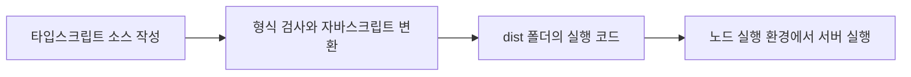
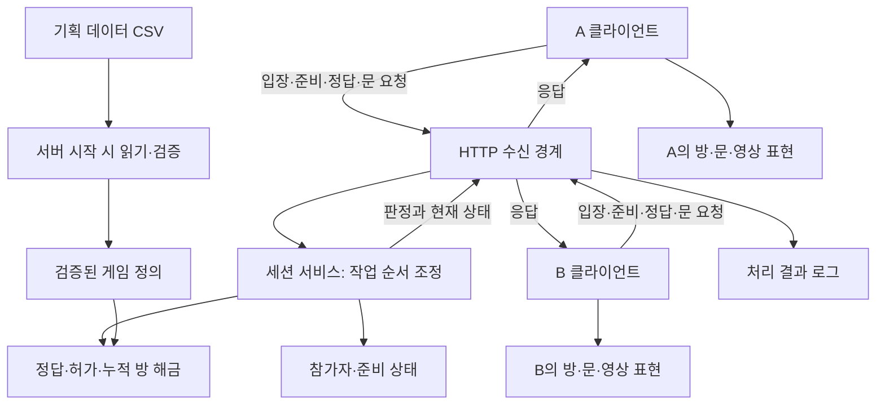
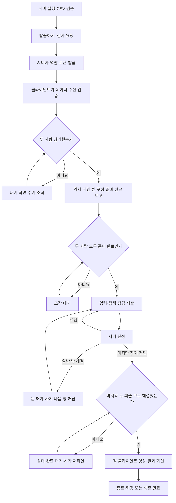
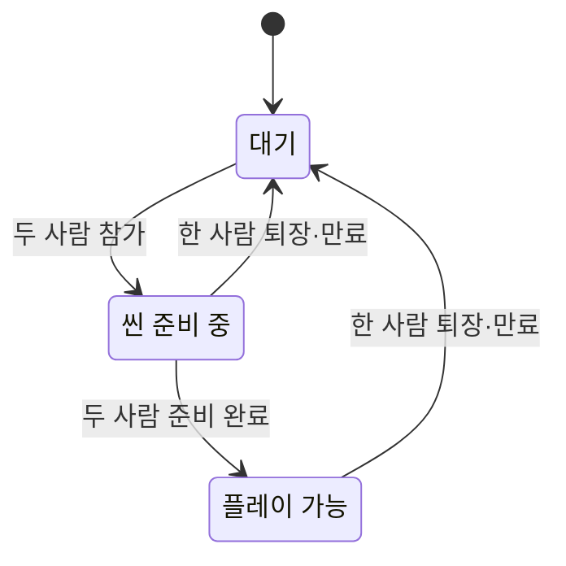
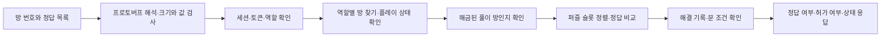
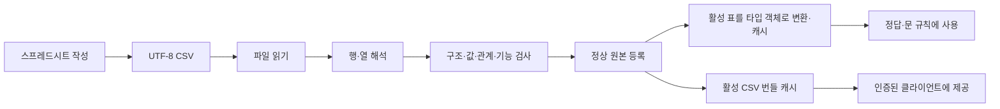
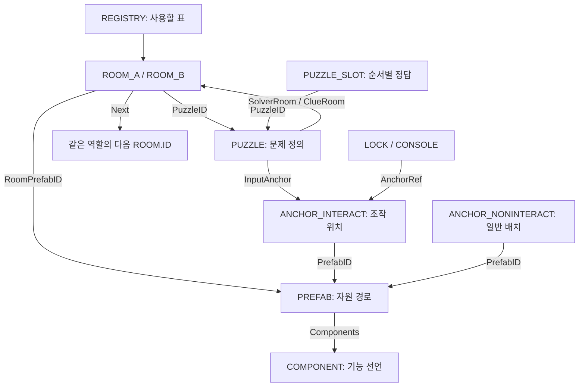
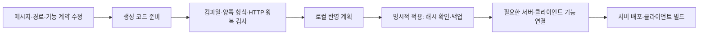

# 서버 플레이 흐름과 구조 통합 안내서

> 문서 대조일: **2026-10-26**. 현재 코드·설정을 기준으로 설명을 점검했습니다. 본문의 과거 검사 수치·실행 기록은 해당 날짜의 결과입니다. [현재 상태·문서 검토 범위](문서_현행화_점검표.md)를 함께 확인합니다.

기준일: **2026년 10월 26일**. 서버를 처음 접하는 기획자·작업자도 전체 흐름을 이해하고, 필요한 경우 실제 코드를 찾아갈 수 있도록 작성했습니다.

가장 먼저 사용하는 언어와 통신 방식을 설명하고, 전체 역할 → 플레이 순서 → 내부 코드 → 데이터 → 실행·운영 순서로 범위를 좁힙니다. 기술 이름은 실제 파일이나 설정을 찾을 때 필요한 경우에 함께 표기합니다.

이 문서는 현재 소스와 데이터를 기준으로 기존 서버 문서를 종합한 안내서입니다. 언어·통신 방식의 선택 이유는 **현재 게임 요구와 구현에 어떻게 맞는지**를 설명합니다. 기록되지 않은 과거 의사결정이나 측정하지 않은 성능을 사실로 단정하지 않습니다. 기존 문서의 과거 검사 결과와 당시의 후속 계획은 현재 구현 여부와 구분해서 읽습니다.

## 목차

1. [어떤 언어로 만들었고 왜 이 구성을 사용하는가](#chapter-1)
2. [어떤 통신 방식이며 왜 이 게임에 맞는가](#chapter-2)
3. [서버가 맡는 일과 전체 연결](#chapter-3)
4. [플레이 순서대로 따라가는 서버 코드](#chapter-4)
5. [큰 기능을 작은 책임으로 나눈 내부 구조](#chapter-5)
6. [데이터 테이블이 기능으로 연결되는 과정](#chapter-6)
7. [서버 실행·도커·클라우드 배포](#chapter-7)
8. [로그와 오류를 읽는 방법](#chapter-8)
9. [통신 계약과 자동 생성·동기화 도구](#chapter-9)
10. [검사 방법과 작업별 변경 순서](#chapter-10)
11. [현재 가능한 일과 앞으로 필요한 일](#chapter-11)
12. [기존 문서 찾아보기와 용어 사전](#chapter-12)

<a id="chapter-1"></a>

## 1. 어떤 언어로 만들었고 왜 이 구성을 사용하는가

### 1.1 서버의 중심 언어는 타입스크립트입니다

게임 판정을 담당하는 코드는 **타입스크립트(`TypeScript`)**로 작성되어 있습니다. 파일 이름 끝이 `.ts`인 [src 폴더](../src)의 코드가 여기에 해당합니다.

타입스크립트는 자바스크립트에 **값의 종류를 미리 확인하는 규칙**을 더한 언어입니다. 예를 들어 방 번호에는 숫자가 들어가야 하고, 참가 토큰에는 문자열이 들어가야 하며, 처리 결과에는 성공 또는 실패에 맞는 정보가 있어야 한다고 작성할 수 있습니다.

이 검사는 개발 중 실수를 줄이는 데 도움이 됩니다. 다만 외부에서 들어온 잘못된 통신이나 CSV까지 자동으로 검증하지는 않습니다. 그래서 이 프로젝트에는 요청 본문 검사와 데이터 검증 코드가 별도로 있습니다.

타입스크립트는 읽기 쉬운 코드를 쓰기 위한 도구이고, 게임의 정답 자체는 CSV에 있습니다. 따라서 “정답 수정”과 “서버 프로그램 수정”은 서로 다른 작업입니다.

### 1.2 작성한 언어와 실제 실행 환경은 다릅니다



| 구분 | 현재 구성 | 쉬운 설명 |
|---|---|---|
| 서버 게임 코드 | 타입스크립트 | 사람이 수정하는 게임 규칙과 서버 처리 코드 |
| 실행 코드 | 자바스크립트 | 변환 후 실제로 실행되는 코드 |
| 실행 환경 | 노드(`Node.js`), 프로젝트 요구 버전 24 이상 | 유니티 실행기처럼 서버 코드를 실행해 주는 프로그램 |
| 보조 도구 | 자바스크립트 `.cjs` | 배포·코드 생성·검사 절차를 실행하는 도구 |
| 클라이언트 코드 | C# | 유니티에서 화면·입력·방·문을 처리하는 별도 코드 |

`npm.cmd run build`는 [tsconfig.json](../tsconfig.json)의 설정을 따라 `src`의 소스를 검사하고 `dist`로 변환합니다. `npm.cmd start`는 변환된 `dist/main.js`를 실행합니다. **소스만 고치고 예전 실행 코드를 계속 켜면 수정 전 동작이 남을 수 있는 이유**입니다.

`strict: true`는 느슨한 값 처리를 줄이기 위한 엄격한 검사 설정입니다. `ES2022`와 `CommonJS`는 변환 결과의 문법·모듈 연결 방식이며, 게임 플레이어가 조정할 설정은 아닙니다.

근거: [package.json](../package.json), [tsconfig.json](../tsconfig.json).

### 1.3 현재 구조에서 이 언어를 사용하는 이유

1. **게임 규칙을 명확한 자료형으로 표현하기 좋습니다.** 참가자, 방, 정답 제출 결과를 구분하고 성공 결과와 실패 결과의 혼동을 줄일 수 있습니다.
2. **통신 대기와 파일 읽기를 다루기 좋습니다.** 현재 서버는 복잡한 물리 계산보다 요청을 받아 작은 상태를 확인하고 응답하는 일이 중심입니다. 노드의 비동기 입출력 방식이 이 작업에 맞습니다.
3. **설계 책임을 나누기 좋습니다.** 클래스·인터페이스·생성자 주입으로 정답 규칙과 통신 코드를 분리할 수 있습니다.
4. **서버·생성·배포 도구를 같은 실행 환경으로 다룰 수 있습니다.** 프로젝트의 실행 명령과 계약 생성 도구가 노드 기반으로 연결되어 있습니다.
5. **C#과 같은 언어를 쓰지 않아도 통신 약속을 공유할 수 있습니다.** 뒤에서 설명하는 메시지 정의로 타입스크립트용·C#용 통신 코드를 각각 만듭니다.

언어만으로 메모리 사용량이나 처리 속도가 보장되는 것은 아닙니다. 특히 무거운 계산을 긴 시간 수행하면 요청 처리가 지연될 수 있습니다. 현재 서버가 유니티 물리 시뮬레이션이나 모든 프레임의 캐릭터 이동을 실행하지 않는 점이 이 구성에 중요합니다.

<a id="chapter-2"></a>

## 2. 어떤 통신 방식이며 왜 이 게임에 맞는가

### 2.1 통신은 세 가지를 나눠서 이해합니다

| 층 | 사용하는 기술 | 비유 |
|---|---|---|
| 요청을 보내는 방식 | HTTP 요청·응답 | 질문서를 보내고 답변서를 받는 절차 |
| 질문·답변의 표현 형식 | 구글 프로토버프(`Google Protobuf`) | 양쪽이 약속한 항목 번호대로 내용을 적는 서식 |
| 실제 보낼 내용 | 방 번호·정답 목록·참가 정보·허가 결과 | 그 서식 안에 적는 게임 정보 |

**게임 요청은 HTTP로 보내고, 본문은 프로토버프 바이너리로 표현합니다.** `Content-Type: application/protobuf`는 본문이 이 형식이라는 표시입니다.

바이너리는 사람이 읽는 글 대신 프로그램이 해석할 수 있는 바이트로 표현한 데이터입니다. `.proto` 파일에 항목 이름·종류·번호를 정의하고, 양쪽 프로그램이 그 정의로 읽고 씁니다. 프로토버프를 쓴다고 통신이 암호화되는 것은 아닙니다.

운영용 `/health`, `/openapi.json`은 사람이 확인하기 쉬운 JSON 형식입니다. `/swagger/`는 설명 화면을 보여주는 웹 페이지입니다. 따라서 모든 경로의 본문 형식이 동일하지는 않습니다.

### 2.2 HTTP 요청·응답을 사용하는 이유

현재 게임에서 서버가 자주 처리하는 일은 다음과 같습니다.

- 사람이 입장하거나 나갔는지 확인합니다.
- 두 사람의 씬 준비가 끝났는지 확인합니다.
- 제출한 답이 맞는지 판정합니다.
- 해당 문을 사용할 수 있는지 판정합니다.
- 참가자가 연결을 유지하는지 확인합니다.

이 작업은 각각 **요청 한 번 → 판정 한 번 → 결과 한 번**으로 표현하기 좋습니다. 매 프레임 손이나 카메라 위치를 전송하는 구조가 아니므로, 현재 범위에서는 지속적인 실시간 위치 통신을 먼저 구성할 필요가 작습니다. 또한 상태 확인·로그·도커 배포 도구와 연결하기 쉽습니다.

현재 서버는 먼저 상대에게 상태를 밀어 보내는 방식이 아닙니다. 클라이언트가 일정 간격으로 상태를 묻는 **주기 조회**를 사용합니다. 구현을 단순하게 유지하는 대신, 상대의 변화가 다음 조회 때 반영될 수 있습니다. 두 영상이 정확히 같은 프레임에 시작하는 방식도 아닙니다.

### 2.3 프로토버프를 사용하는 이유

- **양쪽 언어가 같은 항목 정의를 공유합니다.** 서버의 타입스크립트와 클라이언트의 C# 사이에서 이름·종류·배열 구조를 손으로 맞추는 부담을 줄입니다.
- **코드 생성과 교차 검사를 연결할 수 있습니다.** 한쪽에서 만든 메시지를 다른 언어가 같은 의미로 읽는지 검사합니다.
- **필드 이름을 문자열로 반복하는 텍스트 본문보다 작은 표현이 가능한 형식입니다.** 다만 현재 2인 게임에서 얼마나 빨라지고 작아졌는지는 별도 측정하지 않았습니다.
- **결과의 종류를 명확히 나눌 수 있습니다.** 정상 오답과 요청 실패를 별도 결과로 표현합니다.

대신 원본 바이너리는 터미널에서 바로 읽기 어렵고, 생성 코드·런타임 라이브러리를 함께 관리해야 합니다. 일반 JSON을 게임 API에 보내면 현재 서버는 형식 오류로 거절합니다.

이 프로젝트는 **프로토버프를 쓰는 HTTP 서버**입니다. 별도의 gRPC 서버를 구성한 상태는 아닙니다. 도구 이름에 `Grpc.Tools`가 나오는 것은 메시지 생성용 컴파일러를 공급하기 위한 사용입니다.

### 2.4 “틀린 답”과 “요청 실패”를 구분합니다

| 상황 | 게임 관점 | 통신 결과 예시 |
|---|---|---|
| 정상적으로 보냈지만 답이 틀림 | 다시 풀면 됨 | HTTP 200, `room.value=false` |
| 정상적으로 물었지만 문 조건 미충족 | 문이 잠겨 있음 | HTTP 200, 문 허가 `false` |
| 참가 토큰이 만료됨 | 현재 참가자로 처리할 수 없음 | HTTP 403, `failure` |
| 두 사람 준비가 끝나지 않음 | 게임 판정을 시작할 수 없음 | HTTP 409, `GAME_NOT_PLAYING` |
| 잘못된 본문 형식 | 요청 자체를 읽을 수 없음 | HTTP 400 또는 415, `failure` |

`GameApiResponse`의 `oneof`는 입장 결과·상태·정답 결과·실패 중 **어떤 결과가 실제로 들어 있는지** 구분하는 약속입니다. 정상적인 `false`를 “내용이 없는 응답”이나 통신 오류로 오인하지 않도록 양쪽에서 결과 종류를 확인해야 합니다.

근거: [메시지 정의](../protocol/escape/v1/game_api.proto), [HTTP 변환·입력 검사](../src/controllers/http/ProtobufHttp.ts).

<a id="chapter-3"></a>

## 3. 서버가 맡는 일과 전체 연결

### 3.1 서버는 두 사람의 공통 판정자입니다

두 플레이어가 자기 화면에서만 “정답이다”라고 결정하면 진행 상태가 어긋날 수 있습니다. 온라인 플레이에서는 서버가 정답과 진행 허가를 결정하고, 클라이언트가 그 결과를 화면에 적용합니다. 이것을 **서버 권한**이라고 부릅니다.

| 기능 | 서버가 소유하는 부분 | 유니티 클라이언트가 소유하는 부분 |
|---|---|---|
| 입장 | 빈자리·A/B 배정·참가 토큰 | 탈출하기 버튼·대기 화면 |
| 시작 | 두 참가자의 준비 상태 | 실제 방·플레이어·입력 준비와 조작 잠금 |
| 정답 | 제출 자격·정답 비교·해결 기록 | 입력창·다이얼·클로즈업 화면 |
| 문 | 사용 허가와 다음 방 해금 | 경첩 회전·문 열기·닫기 |
| 방 | 사용할 수 있는 방 ID 목록 | 프리팹 생성·앵커 배치·방 접합 |
| 엔딩 | 마지막 두 퍼즐의 해결 조건 | 상대 완료 대기·영상·탈출 시간·결과 화면 |
| 음성 | 세션 식별 정보 제공 | 별도 음성 서비스 연결·마이크·재생 |

서버에서 허가가 났어도 잘못된 프리팹이나 앵커 때문에 화면에서 방이 안 보일 수 있습니다. **서버 판정 성공과 유니티의 생성 성공은 확인 지점이 다릅니다.**

### 3.2 전체 구조 한눈에 보기



현재 서버 프로세스 하나가 **게임 세션 하나, 최대 두 사람**을 메모리에 보관합니다. 메모리는 실행 중 사용하는 임시 보관 공간이므로 재시작하면 참가자와 진행이 사라집니다. 별도 데이터베이스에 플레이를 저장하지 않습니다.

<a id="chapter-4"></a>

## 4. 플레이 순서대로 따라가는 서버 코드

### 4.1 전체 플레이 순서



이 도식은 역할별 방의 연결을 요약합니다. 서버가 영상을 전송하거나 결과 화면을 직접 생성하는 것은 아닙니다.

### 4.2 0단계: 서버가 먼저 준비됩니다

진입점은 [src/main.ts](../src/main.ts)의 `start()`입니다. 유니티에서 여러 구성 요소를 연결하는 초기화 지점과 비슷합니다.

1. `loadGameData()`가 `data` 폴더의 CSV를 읽습니다.
2. 문법·값·참조·방 연결·기능 계약을 검사합니다. 오류가 있으면 정상 수신을 시작하지 않습니다.
3. 실행 환경에서 주소·포트·참가자 만료 시간을 읽고 검증합니다.
4. 새 세션 ID를 만들고 A/B 두 자리를 준비합니다.
5. 참가자 관리·세션 서비스·요청 처리·로그 객체를 생성해 연결합니다.
6. 지정 주소에서 HTTP 요청을 받기 시작하고 만료 검사 타이머를 시작합니다.

이 단계에서 정답 정의는 준비되지만, 아직 누구도 문제를 해결한 상태는 아닙니다. **게임의 정의와 이번 플레이의 진행 상태를 따로 생성**하기 때문입니다.

### 4.3 1단계: 탈출하기를 누르면 역할과 참가 토큰을 받습니다

요청: `POST /sessions/join`.

호출 순서: `createSessionHttpServer` → `SessionController.join` → `SessionService.join` → `GameSession.addPlayer`.

`SessionService.join()`은 만료된 참가자를 먼저 정리합니다. 아무도 남아 있지 않으면 진행 기록을 초기화하고, 비어 있는 첫 역할을 배정합니다. 최초 두 입장이라면 먼저 A, 다음 B입니다. 이미 두 자리가 차 있으면 정원 초과로 거절합니다.

입장 응답에는 세 가지 식별 정보가 있습니다.

| 정보 | 뜻 | 용도 |
|---|---|---|
| `session_id` | 이번 서버 실행의 게임 식별자 | 어느 세션에 요청하는지 지정 |
| `player_id` | 이번 참가자의 식별자 | 참가자 상태와 로그 구분 |
| `participant_token` | 이 참가자의 요청 자격을 증명하는 값 | 이후 요청의 인증 헤더 |

이후 게임 요청에는 `x-participant-token` 헤더로 토큰을 보냅니다. 토큰 앞에 `Bearer`를 붙이는 구조는 아닙니다. 서버는 토큰으로 역할을 찾으므로 클라이언트가 요청 본문에 “나는 B다”라고 적어 권한을 바꾸지 않습니다.

토큰 등록 도중 실패하면 이미 확보한 자리도 되돌립니다. 토큰 없이 자리만 남는 불일치를 피하려는 정리 경로입니다.

관련 코드: [SessionService.join](../src/services/SessionService.ts), [GameSession.addPlayer](../src/models/GameSession.ts), [ParticipantRegistry.register](../src/services/ParticipantRegistry.ts).

### 4.4 2단계: 검증된 데이터를 받고 상대를 기다립니다

데이터 요청: `GET /sessions/{sessionId}/data`.

상태 조회: `GET /sessions/{sessionId}`.

서버는 시작 시 검증한 활성 CSV를 `{name, csv}` 목록과 내용 식별값 `version`으로 제공합니다. 클라이언트도 받은 내용을 검증한 뒤 사용합니다. 이 다운로드는 **표 데이터 문자열**이며 방 모델·텍스처·영상 파일을 내려받는 기능이 아닙니다. 실제 유니티 자원은 클라이언트에 있어야 합니다.

첫 사람만 있으면 대기 상태이고 클라이언트가 대기 화면을 보여줍니다. 두 번째 사람이 들어왔을 때 이미 상대가 확인된다면 클라이언트는 대기 화면을 생략하고 씬 준비로 넘어갈 수 있습니다. **대기 화면을 보여줄지는 클라이언트의 표현 결정이고, 두 사람이 준비됐는지는 서버의 판정**입니다.

데이터 요청은 [SessionService.data](../src/services/SessionService.ts), 번들 생성은 [GameDataBundle.ts](../src/data/GameDataBundle.ts), 상태 복사는 [GameSession.getSnapshot](../src/models/GameSession.ts)에 있습니다.

### 4.5 3단계: 두 사람의 실제 씬 준비를 확인합니다

요청: `POST /sessions/{sessionId}/ready`.

이 요청은 대기실의 수동 준비 버튼이 아니라 **내 클라이언트의 게임 씬 준비가 끝났다는 보고**입니다. 서버가 직접 유니티의 방·입력 상태를 관찰하는 것은 아니므로 실제 준비를 확인하고 보고하는 책임은 클라이언트에 있습니다.

`GameSession.phase`는 별도 저장 값을 바꾸는 대신 참가자 수와 준비 여부를 보고 계산합니다.

| 상태 | 코드 이름 | 조건 |
|---|---|---|
| 대기 | `Waiting` | A/B 두 자리가 모두 차지 않음 |
| 씬 준비 중 | `Loading` | 두 명은 있지만 한 명 이상 준비 미완료 |
| 플레이 가능 | `Playing` | 두 명 모두 준비 완료 |



정답·문 요청은 `Playing`이어야 처리합니다. 따라서 상대가 오기 전에 에디터가 먼저 씬에 들어갔더라도, 온라인 게임 판정을 바로 진행할 수 있는 것은 아닙니다.

### 4.6 4단계: 플레이 중 상태 조회와 생존 확인을 나눕니다

세 가지 요청을 혼동하지 않는 것이 중요합니다.

| 구분 | 질문 | 현재 기준 |
|---|---|---|
| 서버 상태 확인 `/health` | 서버가 HTTP 응답을 하는가? | 운영·접속 진단 때 사용 |
| 세션 상태 조회 | 누가 있고, 준비됐고, 어느 방이 해금됐는가? | 클라이언트 기본값: 대기·준비 중 1초, 플레이 중 5초 |
| 생존 확인 `/heartbeat` | 이 참가자가 연결을 유지하는가? | 클라이언트 기본값 3초, 서버 기본 만료 10초 |

**상태 조회를 자주 해도 생존 시간은 연장되지 않습니다.** `heartbeat`만 참가자의 생존 시간을 갱신합니다. 반대로 생존 확인 응답에는 전체 상태가 들어 있지 않습니다.

서버는 기본 0.5초 간격으로 만료자를 정리하고, 인증이 필요한 요청을 처리할 때도 만료를 확인합니다. 0.5초는 서버 내부 검사 간격이며 모든 클라이언트가 0.5초마다 통신한다는 뜻은 아닙니다.

생존 시간은 컴퓨터의 시계 표시가 바뀌어도 경과 시간을 계산할 수 있는 **단조 시계**를 사용합니다. 이미 만료된 토큰은 늦게 도착한 생존 확인으로 되살리지 않습니다.

관련 코드: [HeartbeatLease](../src/common/liveness/HeartbeatLease.ts), [ParticipantRegistry](../src/services/ParticipantRegistry.ts), [ServerConfig](../src/config/ServerConfig.ts), [단조 시계](../src/common/MonotonicMillisecondClock.ts). 조회·전송 주기는 클라이언트 설정이며 서버 코드에 5초 규칙을 넣은 것은 아닙니다.

### 4.7 5단계: 입력한 정답을 판정합니다

요청: `POST /sessions/{sessionId}/rooms/answer`.

본문은 `RoomCommandRequest`이며, 화면의 방 번호 `room_no`와 슬롯 순서대로 입력한 문자열 목록 `answers`를 보냅니다.



실제 호출 순서는 다음과 같습니다.

1. [SessionController.room](../src/controllers/SessionController.ts)이 본문을 읽고 기본 입력을 검사합니다.
2. [ParticipantHttpHandler](../src/controllers/http/ParticipantHttpHandler.ts)가 참가 토큰 헤더를 읽습니다.
3. [SessionService.decideRoom](../src/services/SessionService.ts)이 세션·역할·방·플레이 가능 상태를 확인합니다.
4. [RoomProgression.submit](../src/models/RoomProgression.ts)이 활성 퍼즐과 해당 역할의 해금된 풀이 방을 확인합니다.
5. [PuzzleAnswerRules.evaluate](../src/models/PuzzleAnswerRules.ts)가 판정 규칙을 선택합니다.
6. `SlotAnswerRule.matches()`가 슬롯 수와 순서별 정답 문자열을 비교합니다.
7. 정답이면 해결 기록을 남기고 제출한 사람의 방에 대해 문 조건을 확인합니다.
8. 결과를 프로토버프로 변환해 돌려줍니다.

현재 지원하는 퍼즐 종류 이름은 7개이지만 **정답 비교는 모두 같은 슬롯 비교 방식**입니다. 다이얼·방향·문자 입력의 화면 모양이 달라도 서버는 완성된 문자열 목록을 받습니다. 문자열은 대문자로 맞춰 비교하고, 앞뒤 공백 제거나 숫자 변환은 하지 않습니다. 예를 들어 `03`과 `3`은 다른 문자열입니다.

요청 본문 제한은 8192바이트이고, 정답은 최대 64개·각 문자열 길이 최대 256입니다. 이 제한은 잘못된 입력을 막기 위한 통신 경계 규칙이며 실제 퍼즐의 슬롯 수는 데이터에 따로 있습니다.

### 4.8 6단계: 문을 허가하고 다음 방을 누적 해금합니다

요청: `POST /sessions/{sessionId}/rooms/door`. 방 번호를 보내고 `answers`는 비워 둡니다.

서버는 세 가지 기록을 구분합니다.

| 내부 기록 | 저장하는 번호 | 의미 |
|---|---|---|
| `solved` | 퍼즐 ID | 정답을 맞힌 퍼즐 |
| `permitted` | 방의 고유 ID | 문 사용이 허가된 방 |
| `unlocked` | 방의 고유 ID | 로드할 수 있도록 해금된 방 |

정답을 맞혔다는 사실과 문을 사용할 수 있다는 사실을 나눈 이유는 마지막 방처럼 **상대의 정답까지 기다려야 하는 조건**이 있기 때문입니다. 문이 허가되면 그 방의 `Next`를 해금 목록에 추가합니다. 이전 방은 목록에서 제거하지 않으므로 문 뒤로 이전 방을 볼 수 있는 게임 구조와 연결됩니다.

허가 후 실제 문 회전은 클라이언트가 처리합니다. 클라이언트가 허가를 기억하므로 이미 허가받은 문을 열고 닫을 때 서버 요청이 매번 발생하지 않을 수 있습니다. 서버에 문 각도나 현재 열린 각도를 저장하는 기능은 없습니다.

#### 실제 예: B가 1번 방을 푸는 경우

| 항목 | A의 1번 방 | B의 1번 방 |
|---|---|---|
| 화면 방 번호 `RoomNo` | 1 | 1 |
| 방 고유 ID `ROOM.ID` | 1001 | 1002 |
| 연결된 퍼즐 | 5001 | 5001 |
| 담당 | 단서 제공 | 정답 입력 |
| 다음 방 고유 ID | 1003 | 1004 |

1. 시작 시 해금 목록은 `[1001, 1002]`입니다.
2. B가 1번 방 정답을 맞히면 퍼즐 `5001`이 해결됩니다.
3. B의 문이 허가되며 B의 다음 방 `1004`가 추가됩니다. 목록은 `[1001, 1002, 1004]`입니다.
4. A가 자기 1번 방 문 허가를 확인하면 같은 퍼즐의 해결 기록을 확인합니다.
5. A의 문과 다음 방 `1003`도 허가·해금됩니다. 목록은 `[1001, 1002, 1003, 1004]`입니다.

즉 **B의 정답 응답 한 번이 A/B의 다음 방을 모두 즉시 추가하는 구조는 아닙니다.** A 쪽의 허가 확인이 이어집니다. 단서 담당 A가 같은 퍼즐의 답을 직접 제출하는 요청은 제출 자격 오류로 거절됩니다.

근거: [RoomProgression.checkDoor](../src/models/RoomProgression.ts), [실제 방 API 검사](../tests/room-api.test.cjs), [ROOM_A](../data/ROOM_A.csv), [ROOM_B](../data/ROOM_B.csv).

### 4.9 7단계: 마지막 두 퍼즐이 해결되면 엔딩으로 이어집니다

현재 데이터는 A의 마지막 방 `1013`과 B의 마지막 방 `1014`가 모두 `RoomNo=7`, `ExitRule=BothSolved`, `Next=0`입니다. A의 퍼즐은 `5007`, B의 퍼즐은 `5008`로 서로 다릅니다.

| 규칙 | 뜻 | 현재 사용 |
|---|---|---|
| `SolvedEach` | 이 방에 연결된 퍼즐이 해결되면 허가 | 1~6번 방 |
| `BothSolved` | 같은 방 번호의 A/B 퍼즐이 모두 해결돼야 허가 | 7번 방 |

A가 먼저 마지막 답을 맞히면 응답의 정답 `value=true`, 문 허가 `door_allowed=false`가 될 수 있습니다. 이것은 실패가 아니라 **자기 문제는 풀었고 상대를 기다리는 정상 상태**입니다.

B도 맞히면 B의 판정 과정에서 조건이 충족됩니다. A는 클라이언트의 완료 대기 흐름에서 문 허가를 다시 확인해 공동 완료를 알게 됩니다. 이때의 문 API는 실제 문을 열기 위한 버튼뿐 아니라 **공동 완료 조건 확인**에 재사용됩니다. 일반 세션 상태 조회만으로 A의 문 허가를 새로 계산하는 것은 아닙니다.

그 다음 영상·탈출 시간·결과 화면은 각 클라이언트가 처리합니다. **문을 열거나 문턱을 지나야 엔딩이 시작되는 조건은 아닙니다.** 서버에는 별도 엔딩 API나 `Ended` 세션 단계가 없으며, 현재 `phase`는 계속 `Playing`일 수 있습니다. 영상의 정확한 동시 시작이나 결과 시간의 서버 기록 기능도 없습니다.

서버 근거: [RoomExitRules](../src/data/RoomExitRules.ts), [RoomProgression](../src/models/RoomProgression.ts), [마지막 방 검사](../tests/room-api.test.cjs). 클라이언트 연결 지점은 유니티 프로젝트의 `EndingCompletionController`, `EndingVideoDirector`입니다.

### 4.10 8단계: 나가거나 연결이 끊기면 자리를 정리합니다

정상 퇴장 요청은 `POST /sessions/{sessionId}/leave`입니다. 서버는 토큰을 확인한 뒤 참가자 기록과 역할 자리를 함께 제거합니다.

프로그램 강제 종료처럼 퇴장 요청이 오지 않으면 생존 확인이 끊기고 만료 처리로 자리를 회수합니다. 한 사람이 없어지면 세션 단계는 `Waiting`으로 계산됩니다. 남은 사람의 준비 여부와 진행 기록을 즉시 지우는 구조는 아닙니다.

모두 나간 뒤 다음 사람이 입장할 때 진행이 초기화됩니다. 서버 자체를 재시작하거나 컨테이너를 교체하면 메모리 전체가 사라져 세션 ID·토큰·진행을 새로 만듭니다. 이전 토큰을 자동으로 복구해 이어 하는 기능은 없습니다.

<a id="chapter-5"></a>

## 5. 큰 기능을 작은 책임으로 나눈 내부 구조

### 5.1 왜 파일을 여러 계층으로 나눴는가

한 파일에서 요청을 받고, CSV를 읽고, 정답을 비교하고, 로그까지 출력하면 작은 변경도 여러 기능에 영향을 줍니다. 현재 구조는 **정의·진행 상태·규칙·통신·외부 환경을 분리**합니다.

아래 순서대로 읽으면 큰 흐름에서 세부 구현으로 내려갈 수 있습니다.

```text
서버 조립과 전체 수명
└─ main.ts
   ├─ 데이터 읽기·검증·등록
   ├─ 참가자와 세션 객체 생성
   └─ HTTP 수신과 만료 검사 시작

요청 처리
└─ createSessionHttpServer
   └─ SessionController
      ├─ ProtobufHttp: 본문 해석·응답 변환
      ├─ ParticipantHttpHandler: 인증 헤더 연결
      └─ SessionService: 작업 순서 조정
         ├─ GameSession: 자리·준비·현재 단계
         ├─ ParticipantRegistry: 토큰·생존 시간
         └─ RoomProgression: 해결·허가·해금
            └─ PuzzleAnswerRules: 판정 방식 선택
               └─ SlotAnswerRule: 실제 답 비교

공통 외부 연결
├─ 파일 입력 어댑터
├─ 시계·타이머 어댑터
└─ HTTP 완료 관찰 → 로그 출력 어댑터
```

### 5.2 주요 파일별 책임과 분리 이유

| 계층 | 먼저 볼 파일 | 담당 | 나눈 이유 |
|---|---|---|---|
| 조립 | [main.ts](../src/main.ts) | 생성·연결·시작·종료 | 전역에서 객체를 찾기보다 누가 만들고 주는지 명확히 함 |
| 요청 경로 | [createSessionHttpServer.ts](../src/infrastructure/http/createSessionHttpServer.ts) | 주소·요청 종류를 기능에 연결 | 경로 변경이 정답 알고리즘으로 번지지 않음 |
| 요청 처리 | [SessionController.ts](../src/controllers/SessionController.ts) | 본문 해석·입력 검사·서비스 호출 | 외부 통신과 내부 게임 작업을 연결 |
| 형식 변환 | [ProtobufHttp.ts](../src/controllers/http/ProtobufHttp.ts) | 게임 결과를 메시지·상태 코드로 변환 | 내부 모델에 HTTP 객체를 넣지 않음 |
| 인증 연결 | [ParticipantHttpHandler.ts](../src/controllers/http/ParticipantHttpHandler.ts) | 토큰 헤더 확인·공통 결과 처리 | 각 API의 중복 헤더 처리를 줄임 |
| 작업 조정 | [SessionService.ts](../src/services/SessionService.ts) | 인증·입장·준비·진행 호출 순서 | 여러 모델을 Controller가 직접 조작하지 않음 |
| 세션 상태 | [GameSession.ts](../src/models/GameSession.ts) | 참가자·준비·단계 | 게임 규칙과 통신 형식을 분리 |
| 참가 수명 | [ParticipantRegistry.ts](../src/services/ParticipantRegistry.ts) | 토큰과 생존 기록 | 정상 퇴장·만료의 자리 정리를 일관되게 함 |
| 진행 규칙 | [RoomProgression.ts](../src/models/RoomProgression.ts) | 정답 기록·문 조건·해금 | 정의와 이번 플레이의 변경 값을 분리 |
| 답 비교 | [PuzzleAnswerRules.ts](../src/models/PuzzleAnswerRules.ts) | 퍼즐 종류별 규칙 선택·답 비교 | 새 판정 방식이 생겨도 인증 코드를 복제하지 않음 |
| 데이터 정의 | [CsvGameData.ts](../src/data/tables/CsvGameData.ts) | 검증된 표를 읽기 전용 객체로 제공 | 규칙 코드가 CSV 셀 문자열을 직접 해석하지 않음 |

### 5.3 사용한 설계 방식의 뜻

패턴은 반복되는 문제를 해결하는 구성 방법입니다. 이름을 많이 사용하는 것이 목적은 아니며, 아래 책임을 해결하는 곳에 사용합니다.

| 설계 방식 | 쉬운 뜻 | 실제 사용 |
|---|---|---|
| 의존성 주입 | 객체가 필요한 도구를 몰래 찾지 않고 바깥에서 받음 | `main`이 시계·참가자 관리·서비스를 생성해 전달 |
| 파사드·응용 서비스 | 여러 부품의 작업을 한 입구에서 순서대로 진행 | `SessionService`가 인증 후 참가·진행 모델을 연결 |
| 전략 | 호출 약속을 유지하면서 처리 방식을 교체 | `IPuzzleAnswerRule`과 종류별 규칙 선택 |
| 어댑터 | 외부 기술을 내부에서 쓰는 약속으로 변환 | HTTP·프로토버프, 파일 입력, 노드 타이머, 로그 출력 |
| 관찰자 | 작업 완료 알림을 필요한 곳이 구독 | 데이터 등록 완료, HTTP 응답 완료·연결 종료 관찰 |
| 데이터 매핑 | 표의 문자열 행을 의미 있는 객체로 변환 | `CsvTableMapping`, `RoomAData`, `PuzzleData` 등 |
| 상속 | 정말 공통인 정의를 공유 | `RoomAData`·`RoomBData`가 `RoomData`의 공통 필드를 사용 |

`IPuzzleAnswerRule`은 실제 비교 코드를 바꿔도 호출자가 같은 약속으로 실행하게 해 주는 **다형성**의 예입니다. 반면 `Waiting/Loading/Playing`은 조건으로 계산하는 상태 모델이며, 상태마다 별도 객체를 만드는 상태 패턴을 사용한 것은 아닙니다.

로컬 메서드 호출을 모두 전역 이벤트로 바꾸지 않았습니다. 정답 제출은 직접 요청하고 결과를 반환받습니다. 독립적인 기록·알림이 필요한 완료 지점에서 이벤트를 사용합니다.

### 5.4 자원과 상태의 수명을 누가 책임지는가

| 대상 | 만들어지는 때 | 정리·갱신 기준 |
|---|---|---|
| 게임 정의·CSV 번들 | 서버 시작 | 프로세스 종료까지 재사용 |
| 세션·진행 상태 | 서버 시작 | 모두 퇴장 후 새 입장 시 진행 초기화, 재시작 시 전체 소멸 |
| 참가 토큰과 생존 기록 | 참가 성공 | 정상 퇴장 또는 만료 때 제거 |
| 만료 검사 타이머 | HTTP 수신 시작 | 종료 신호·서버 닫힘 때 중지 |
| 요청별 로그 정보 | HTTP 요청마다 생성 | 응답 완료 또는 중단 때 한 번 기록 후 해제 |
| 데이터 등록 구독 | 명시적으로 연결할 때 | 반환받은 구독 해제 함수로 정리 |

`PeriodicTask.start()`는 중복 타이머 생성을 막고 `stop()`은 반복 호출해도 정리된 상태를 유지합니다. 접근 로그도 응답 완료와 연결 종료가 모두 발생해도 한 번만 기록합니다. 이 서버에는 유니티 객체가 없으므로 유니티의 파괴 순서와는 별개이며, 서버의 타이머·리스너·참가 기록 수명으로 관리합니다.

종료 시 `server.close()`로 수신 종료를 요청하지만 세션을 저장하거나 모든 진행 중 작업을 영구 보관하는 완전한 종료 절차까지 구현한 것은 아닙니다.

<a id="chapter-6"></a>

## 6. 데이터 테이블이 기능으로 연결되는 과정

### 6.1 데이터는 “무엇이 있는가”, 코드는 “어떻게 처리하는가”를 정합니다

CSV는 스프레드시트의 행·열을 텍스트로 저장한 파일입니다. 기획 작업자는 방 연결·정답·프리팹 ID를 작성하고, 서버는 검증 후 해당 값으로 동작합니다.

예를 들어 다음 방 번호마다 `if`문을 추가하는 대신 `ROOM.Next`를 읽습니다. 정답을 코드에 적는 대신 `PUZZLE_SLOT.Answer`를 읽습니다. **기존에 구현된 기능의 데이터를 바꾸면 코드 변경 없이 적용할 수 있도록 하는 방향**입니다. 새로운 판정 알고리즘이나 유니티 기능까지 표의 행 하나로 자동 개발되는 것은 아닙니다.

### 6.2 시작 시 읽고 검사한 뒤 재사용합니다



| 단계 | 파일·객체 | 책임 |
|---|---|---|
| 파일 입력 | [loadGameData](../src/infrastructure/data/loadGameData.ts), [Utf8CsvFileSource](../src/infrastructure/data/Utf8CsvFileSource.ts) | 폴더 탐색·엄격한 UTF-8 읽기 |
| 문법 | [CsvParser](../src/common/csv/CsvParser.ts) | 쉼표·따옴표·줄바꿈·헤더 해석 |
| 원본 묶음 | [CsvDataSet](../src/data/CsvDataSet.ts) | 문서와 읽기·파싱 문제를 보관 |
| 의미 검사 | [CsvValidator](../src/data/validation/CsvValidator.ts) | 자료형·ID·참조·게임 관계 검사 |
| 등록 | [CsvDataStore](../src/data/CsvDataStore.ts) | 정상 원본만 등록하고 변환 결과를 캐시 |
| 타입 변환 | [CsvTableMapping](../src/data/CsvTableMapping.ts), [tables 폴더](../src/data/tables) | 문자열을 방·퍼즐 등 명확한 정의로 변환 |
| 전송 준비 | [GameDataBundle](../src/data/GameDataBundle.ts) | 활성 표를 문자열 목록과 내용 식별값으로 구성 |

현재 요청마다 CSV 파일을 다시 열지 않습니다. `SessionService` 생성 때 전송 번들도 한 번 준비합니다. 서버 가동 중 파일을 고쳤다고 이미 생성된 정의와 진행 객체가 자동 교체되는 구조는 아닙니다. 반영하려면 검증·재시작 또는 새 이미지 배포가 필요합니다.

### 6.3 활성 시트와 파일 존재는 다릅니다

현재 서버 폴더에는 CSV 파일 **24개**가 있고 `REGISTRY.Active=Y`는 **14개**입니다. 기준일에 확인한 현황이며 고정된 게임 규칙은 아닙니다.

`REGISTRY`는 사용할 표의 목록과 관계를 선언합니다. 현재 `CsvGameData`와 클라이언트에 보낼 번들은 활성 등록된 시트를 기준으로 합니다. 파일이 남아 있어도 비활성·미등록이면 실행용 목록에는 들어가지 않습니다. 다만 폴더의 원본 파일 읽기·검증 대상에서는 남을 수 있습니다.

| 상태 | 테이블 | 의미 |
|---|---|---|
| 활성 | `REGISTRY`, `GAME_CONFIG`, `CHARACTER_STAT` | 사용할 표 목록·설정·캐릭터 수치 |
| 활성 | `COMPONENT`, `PREFAB` | 자원의 기능 선언·프리팹 경로 |
| 활성 | `ROOM_A`, `ROOM_B` | 역할별 방·문 조건·다음 방 |
| 활성 | `ANCHOR_INTERACT`, `ANCHOR_NONINTERACT` | 조작 대상과 일반 배치 대상 |
| 활성 | `LOCK`, `CONSOLE` | 정답 입력 대상의 세부 설정 |
| 활성 | `PUZZLE`, `PUZZLE_SLOT`, `COLOR_LETTER` | 퍼즐 연결·입력 순서·정답·색 문자 콘텐츠 |
| 비활성 등록 | `SOUND`, `SOUND_LINK` | 현재 게임 소리는 클라이언트 설정 에셋 사용 |
| 파일만 남아 있음 | `ARROW`, `CARD`, `FORMULA`, `FRAME`, `PAPER`, `TV`, `WIRE` | 현재 활성 목록에서 제외. 모델·형식 지원과 실제 사용은 별개 |
| 파일만 남아 있음 | `ROOM_LIGHT_SPAWNTABLE` | 폐기한 별도 조명 스폰 표. 현재 사용 경로는 기존 앵커 구조 |

표의 `REGISTRY.File`에는 원본 스프레드시트 이름이 적혀 있습니다. 서버 파일 로더가 그 이름으로 엑셀 파일을 열어 자동 추출하는 구조는 아닙니다. 서버는 `data` 폴더의 CSV 파일명을 시트 이름으로 사용합니다.

### 6.4 관계를 따라가는 법



| 이름 | 정확한 뜻 | 혼동하면 생기는 문제 |
|---|---|---|
| `ROOM.ID` | A/B를 구별하는 방 고유 번호 | 다음 방·해금 대상이 잘못 연결됨 |
| `RoomNo` | 화면에서 말하는 1~7번 방 | 고유 ID 대신 보내면 방 검색 실패 |
| 참가자 역할 A/B | 어느 플레이어인가 | 서버가 토큰으로 판단 |
| `ROOM.Role`의 `Clue/Solver` | 그 방이 단서 담당인지 풀이 담당인지 | 참가자 역할 A/B와 다른 구분 |
| `PUZZLE.ID` | 문제 고유 번호 | 해결 기록과 정답 슬롯이 다른 문제에 연결됨 |
| `ANCHOR_INTERACT.ID` | 배치 행의 고유 번호 | `InputAnchor`, `AnchorRef` 연결 실패 |
| `AnchorID` | 실제 유니티 배치 지점을 찾는 이름 | 표는 맞아도 씬에서 오브젝트 생성 실패 |
| `PrefabID` | 사용할 자원 정의 번호 | 모델이나 기능이 잘못 연결됨 |

1번 방 퍼즐 `5001`은 `SolverRoom=1002`, `ClueRoom=1001`, `InputAnchor=2030`, 슬롯 4개로 연결되어 있습니다. 서버는 네 슬롯의 답을 판정하고, 유니티는 입력 앵커와 프리팹 설정으로 화면을 구성합니다. 서버가 `LOCK`의 화면 설정을 읽어 직접 다이얼 UI를 만드는 것은 아닙니다.

### 6.5 어떤 오류를 잡는가

- UTF-8·따옴표·칸 수·헤더 문법을 확인합니다.
- 필수 컬럼·정수·허용 값·범위·중복 ID를 확인합니다.
- 다른 표의 ID가 실제로 존재하는지 확인합니다.
- 역할별 방의 시작점·다음 방 연결·순환·도달 관계를 확인합니다.
- 퍼즐의 풀이 방·단서 방·입력 앵커·슬롯 수와 순서를 확인합니다.
- 프리팹 기능 이름·파라미터·필수 조합과 캐릭터 수치 관계를 확인합니다.

**오류**는 정상 등록을 막고, **경고**는 추가 검토가 필요하지만 등록을 허용할 수 있는 항목입니다. 서버가 유니티 파일의 실제 경첩·충돌체·셰이더·라이트 배치를 검사할 수는 없습니다. 데이터 검증 통과와 실제 플레이 검사를 함께 해야 합니다.

현재 배포하는 CSV 번들에는 `PUZZLE_SLOT.Answer`도 포함됩니다. 서버가 최종 판정 권한을 갖는 것과 클라이언트에 정답을 숨기는 것은 다른 문제이며, 현재는 정답을 비공개로 전달하는 설계가 아닙니다.

<a id="chapter-7"></a>

## 7. 서버 실행·도커·클라우드 배포

### 7.1 같은 프로그램을 어디에서 실행하느냐의 차이입니다

| 실행 형태 | 위치 | 목적 |
|---|---|---|
| 로컬 실행 | 내 PC의 노드 | 코드 수정과 빠른 확인 |
| 로컬 도커 | 내 PC의 도커 | 배포와 비슷한 환경으로 확인 |
| 클라우드 도커 | 원격 서버의 도커 | 다른 PC에서도 접속할 서버 운영 |

**이미지**는 실행 코드·필요 라이브러리·데이터를 묶은 실행 재료이고, **컨테이너**는 그 이미지로 실제 실행 중인 서버입니다. 새 이미지를 빌드하는 동안 기존 컨테이너가 계속 켜져 있는 것은 현재 배포 절차의 정상 동작입니다.

### 7.2 실행 파일과 명령

아래 명령은 **서버 프로젝트 폴더의 파워셸**에서 실행합니다. 일반 실행과 도커 실행은 서로 다른 선택지이므로 같은 포트를 쓰는 여러 서버를 동시에 켜지 않도록 실행 대상을 확인합니다.

```powershell
# 처음 의존성을 준비할 때
npm.cmd ci

# 내 PC에서 직접 실행
.\run-local.cmd

# 같은 네트워크의 다른 PC와 테스트할 주소로 직접 실행
.\run-test.cmd

# 로컬 도커에 빌드·배포
.\run-docker-local.cmd

# 설정된 클라우드 도커에 빌드·배포
.\deploy-cloud.cmd
```

실행 도구는 환경 파일로 설정을 읽습니다. 필요한 최초 준비와 SSH 키 설정은 [도커 배포 가이드](docker-deployment.md), [EC2 배포 가이드](ec2-deployment-guide.md)에 있습니다. 일반 서버 실행 자체에는 C# 검사용 .NET SDK가 필요하지 않습니다.

### 7.3 주소·포트·환경 파일을 구분합니다

| 항목 | 뜻 | 현재 기본·예시 |
|---|---|---|
| `HOST` | 서버가 어느 네트워크 주소에서 받을지 | 같은 PC `127.0.0.1`, 외부 수신 `0.0.0.0` |
| `PORT` | 서버 프로그램 내부 수신 번호 | 기본 3000 |
| `HOST_PORT` | 도커가 외부에 공개할 포트 | 로컬 3001, 클라우드 3000 |
| `CONTAINER_PORT` | 컨테이너 안에서 받는 포트 | 3000 |
| `PARTICIPANT_TIMEOUT_MS` | 생존 확인이 끊긴 뒤 만료 기준 | 기본 10000밀리초, 즉 10초 |
| `EXPIRATION_CHECK_INTERVAL_MS` | 서버 내부 만료 확인 간격 | 기본 500밀리초 |

`0.0.0.0`은 클라이언트가 입력할 서버 주소가 아닙니다. 서버가 여러 네트워크 인터페이스에서 요청을 받겠다는 설정입니다. 클라이언트에는 실제 서버 PC의 주소나 공인 IP를 넣습니다. `127.0.0.1`은 요청을 보내는 장치 자신을 가리키므로 다른 PC에서 서버 PC를 뜻하지 않습니다.

환경 파일은 크게 둘로 나뉩니다.

- **서버 실행 설정:** `.env.local`, `.env.test`, `.env.docker-test`, `.env.docker-cloud`.
- **배포 도구 설정:** `.env.deploy-local`, `.env.deploy-cloud`. 이미지·컨테이너 이름, 대상, 공개 포트, 상태 확인 주소, 로그 보관량 등을 정합니다.

로컬 도커 기본 연결은 **내 PC 3001 → 컨테이너 3000**입니다. 현재 클라우드 배포 설정의 상태 확인 주소는 `http://32.236.55.218:3000/health`입니다. 이 주소는 저장된 설정값을 설명한 것이며 이번 문서 작성에서 실제 서버 연결을 검사한 결과는 아닙니다. 인스턴스를 재생성했다면 현재 주소로 바꿔야 합니다.

외부 접속에는 서버 수신뿐 아니라 클라우드 보안 그룹과 네트워크 허용도 맞아야 합니다. 기존처럼 테스트 PC만 허용할 때는 공유기 안의 사설 IP가 아니라 **외부에서 보이는 공인 IP**를 소스로 사용합니다.

### 7.4 배포 도구가 실제로 하는 일

1. 로컬 또는 SSH 대상의 도커 엔진을 확인합니다.
2. 기존 서버를 유지한 채 새 이미지를 만듭니다.
3. 새 이미지의 실제 서버 코드로 환경 설정과 CSV를 검증합니다.
4. 지정한 이름의 기존 컨테이너를 중지·제거합니다.
5. 검증한 이미지 ID로 새 컨테이너를 시작합니다.
6. 컨테이너 내부 `/health`와 외부 접속 주소의 `/health`를 모두 확인합니다.

이미지 빌드·사전 검증 실패는 기존 컨테이너 교체 전 단계입니다. 반대로 교체한 뒤 상태 확인이 실패하면 새 컨테이너와 로그를 남기고 오류를 알립니다. 이전 서버로 자동 복구하는 기능은 없고, 교체 구간에 중단이 생길 수 있습니다. 재배포하면 메모리 세션도 초기화됩니다.

[Dockerfile](../Dockerfile)은 빌드 단계에서 타입스크립트를 변환하고, 실행 단계에는 실행 코드·필요 의존성·CSV를 복사합니다. 일반 사용자 `node`로 실행합니다. `EXPOSE 3000`만으로 외부 포트나 AWS 방화벽이 자동 개방되는 것은 아닙니다.

### 7.5 도커 로그 제한의 정확한 범위

배포 도구는 도커의 `json-file` 로그에 기본 **파일당 10MB·최대 3개** 보관을 설정합니다. `LOG_MAX_SIZE_MB`, `LOG_MAX_FILES`로 조정합니다. 오래된 파일부터 교체하는 방식입니다.

이것은 도커가 관리하는 로그 보관 기준입니다. 서버 전체 디스크·이미지 크기·메모리·CPU를 제한하는 옵션은 아닙니다. 현재 배포 도구에는 `--memory`, `--cpus` 설정이나 게임 코드의 오류 전용 파일 로거가 없습니다.

### 7.6 실행한 서버에 응답을 물어봅니다

서버를 켠 창은 유지하고 **별도의 파워셸 창**에서 해당 환경의 명령 하나를 실행합니다.

```powershell
# 같은 PC 직접 실행의 기본 주소
Invoke-RestMethod -Uri 'http://127.0.0.1:3000/health' -TimeoutSec 10

# 로컬 도커의 기본 공개 포트
Invoke-RestMethod -Uri 'http://127.0.0.1:3001/health' -TimeoutSec 10

# 현재 저장된 클라우드 주소
Invoke-RestMethod -Uri 'http://32.236.55.218:3000/health' -TimeoutSec 10
```

`status` 아래 `ok`가 보이면 그 주소의 서버가 응답한 것입니다. 다음 확인은 클라이언트 두 명의 입장·준비·정답·문 흐름입니다. `ok` 자체가 게임 전체를 검사한 결과는 아닙니다.

<a id="chapter-8"></a>

## 8. 로그와 오류를 읽는 방법

### 8.1 현재 로그가 기록하는 것

서버는 HTTP 요청이 끝났을 때 처리 결과를 JSON 한 줄로 출력합니다. 이를 **표준 출력**이라고 하며, 도커가 이 출력을 수집합니다. 애플리케이션이 별도 오류 파일을 직접 만드는 구조는 아닙니다.

호출 흐름은 요청 수신 → `HttpAccessLogger.observe()` → 판정 → 응답 완료 관찰 → `ConsoleJsonLogSink.write()`입니다. 완료와 중단의 이벤트 구독을 정리하고 요청당 한 번만 출력합니다.

| 필드 | 읽는 방법 |
|---|---|
| `timestamp` | 기록 시각. `Z`가 붙으면 UTC이므로 한국 시각과 9시간 차이 |
| `requestId` | 같은 요청을 추적하는 고유 번호. 응답의 `X-Request-Id`와 대응 |
| `operation` | 입장·정답·문 등 처리 기능 |
| `role`, `roomNo`, `puzzleId` | 누가 어느 방·퍼즐을 요청했는지 |
| `statusCode` | HTTP 수준에서 성공·실패했는지 |
| `result` | 정답·오답·허가·잠김 등 게임 결과 |
| `doorAllowed` | 실제 문 허가 여부 |
| `unlockedRoomIds` | 이번 결과의 누적 해금 목록 |
| `durationMs` | 요청 처리에 걸린 밀리초 |
| `completion` | 정상 응답 완료인지, 완료 전 연결 중단인지 |

토큰·정답 문자열·원본 본문은 기록하지 않습니다. 정답 **개수**와 판정 결과만 남깁니다. `finish`는 서버가 응답 쓰기를 완료했다는 뜻이며 클라이언트에서 방 생성까지 성공했다는 확인은 아닙니다.

다음은 실제 출력 필드 일부만 뽑아 만든 읽기 예시입니다.

```json
{"operation":"SubmitRoomAnswer","role":"A","roomNo":7,"statusCode":200,"result":"correct","doorAllowed":false}
```

이 줄은 “A의 7번 방 요청이 정상 처리됐고 답도 맞지만, 아직 문 허가는 나지 않았다”로 읽습니다. 마지막 방이라면 상대 정답을 기다리는 상황인지 이어서 확인합니다. `statusCode=200`만 보고 엔딩까지 완료됐다고 판단하지 않습니다.

### 8.2 파워셸에서 실시간 보기

클라우드 서버: SSH 별칭 `escape-cloud`가 준비된 PC의 파워셸에서 실행합니다.

```powershell
ssh escape-cloud "docker logs --follow --tail 100 --timestamps escape-server-cloud"
```

로컬 도커:

```powershell
docker logs --follow --tail 100 --timestamps escape-server-lan-test
```

최근 10분을 한 번만 보려면:

```powershell
ssh escape-cloud "docker logs --since 10m --timestamps escape-server-cloud"
```

`Ctrl+C`는 이 로그 보기 명령을 끝냅니다. 컨테이너는 계속 실행됩니다. 다만 서버를 직접 켠 `run-local.cmd` 창에서 `Ctrl+C`를 누르면 직접 실행 중인 서버를 종료한다는 차이가 있습니다.

컨테이너를 찾지 못하면 배포 설정의 `CONTAINER_NAME`과 실제 이름을 확인합니다.

```powershell
ssh escape-cloud "docker ps -a"
```

### 8.3 정답·문 문제를 로그로 찾는 순서

1. **요청이 있는가:** 없으면 클라이언트 입력·허가 캐시·주소·연결 상태를 확인합니다.
2. **역할과 방 번호가 맞는가:** `roomNo`에 방 고유 ID를 넣지 않았는지 확인합니다.
3. **통신 실패인가 정상 게임 결과인가:** 403·409 등 실패를 정상 오답과 구분합니다.
4. **정답과 문 허가가 다른가:** 마지막 방의 `correct=true`, `doorAllowed=false`는 상대 대기일 수 있습니다.
5. **다음 방 ID가 응답에 있는가:** 없으면 `Next`·문 조건·해당 역할의 허가 확인을 봅니다.
6. **해금 ID가 있는데 화면에 없는가:** 클라이언트의 데이터 등록·역할별 방 선택·프리팹·앵커·생성 오류를 봅니다.

현재 접근 로그는 요청의 최종 결과를 추적하는 기능입니다. 네트워크의 모든 원시 패킷, 처리 내부의 모든 단계, 자동 재전송, 오류 전용 파일 저장까지 구현된 것은 아닙니다. 확장 지점은 [ILogSink](../src/common/logging/ILogSink.ts)이며, 상세 구조는 [로그 안내](http-access-logging.md)에 있습니다.

### 8.4 오류 상태를 쉽게 읽기

| 상태 | 뜻 | 먼저 확인할 내용 |
|---|---|---|
| 400 | 요청 항목이 잘못됨 | 토큰 누락·방 번호·본문·답 개수 |
| 403 | 참가자로 인정할 수 없음 | 토큰 만료·이전 세션·재입장 여부 |
| 404 | 요청 대상 없음 | 세션 ID·방 번호·경로 |
| 409 | 현재 게임 조건에서 실행 불가 | 정원·양쪽 준비·풀이 역할·방 해금 |
| 413 | 본문이 너무 큼 | 8192바이트 제한 |
| 415 | 본문 형식이 다름 | `application/protobuf` 여부 |
| 500 | 서버 내부 처리 실패 | 서버 로그와 재현 순서 |

연결 자체가 안 되는 경우에는 위 상태 코드를 받지 못할 수 있습니다. 이때는 먼저 서버 실행·포트 공개·주소·방화벽을 확인합니다.

<a id="chapter-9"></a>

## 9. 통신 계약과 자동 생성·동기화 도구

### 9.1 계약은 양쪽이 지켜야 할 서식입니다

| 원본 | 정하는 것 | 생성·연결되는 곳 |
|---|---|---|
| [protocol/escape/v1](../protocol/escape/v1) | 메시지 필드·번호·결과 종류 | 타입스크립트·C# 통신 메시지 |
| [openapi.json](../protocol/http/openapi.json) | HTTP 경로·메서드·처리 이름 | 서버 경로 정보·클라이언트 호출 계약·설명 화면 |
| [content-contract.json](../protocol/data/content-contract.json) | 공통 기능명·파라미터·퍼즐 종류 | 서버·클라이언트의 콘텐츠 검사 기준 |

생성 파일은 원본을 바꾸고 도구로 다시 만들어야 합니다. 생성된 서버 코드만 손으로 고치면 다음 생성 때 사라지거나 클라이언트와 달라질 수 있습니다. 프로토버프 항목 번호는 의미가 유지돼야 하므로 삭제한 번호를 다른 의미에 재사용하지 않습니다.

### 9.2 자동화하는 범위와 직접 구현할 범위



도구는 서식 생성과 호환성 검사, 관리 대상 생성 파일의 로컬 반영을 자동화합니다. 새 게임 규칙·유니티 입력 화면·프리팹·이벤트 소비자까지 자동 작성하지 않습니다. 서버를 실행하거나 도커를 배포한다고 로컬 C# 소스가 자동 갱신되는 것도 아닙니다.

| 명령 | 목적 |
|---|---|
| `npm.cmd run content:check` | 콘텐츠 공통 생성물이 원본 계약과 맞는지 검사 |
| `npm.cmd run content:generate` | 콘텐츠 공통 코드 생성 |
| `npm.cmd run proto:generate` | 프로토버프 메시지 코드 생성 |
| `npm.cmd run proto:verify` | 메시지 생성·컴파일·언어 간 해석 검사 |
| `npm.cmd run api:verify` | 현재 양쪽 코드의 실제 HTTP 왕복 검사 |
| `npm.cmd run api:sync` | 생성·검증 후 로컬 반영 계획 준비 |
| `npm.cmd run api:sync -- --apply` | 검증 후 관리 대상 생성 파일 반영 |
| `npm.cmd run api:docs:update` | API 설명 모델 갱신 |
| `npm.cmd run api:docs:verify` | 설명과 계약의 일치 검사 |

`--apply`는 단순 조회가 아니라 로컬 생성 파일을 바꾸는 단계입니다. 도구는 변경 감지·해시 비교·백업을 사용하고 Git 커밋·푸시는 하지 않습니다. 필요 도구 준비와 실제 대상 경로는 [프로토버프 안내](../protocol/README.md), [생성물 반영 도구](../protocol/TOOL.md)를 따릅니다.

### 9.3 스웨거 화면은 어디에 쓰는가

스웨거(`Swagger`)는 API의 주소·입력·출력·실패를 찾아보는 설명 화면입니다. 서버가 켜져 있어야 같은 서버에서 제공합니다.

| 환경 | 기본 접속 주소 |
|---|---|
| 같은 PC 직접 실행 | `http://127.0.0.1:3000/swagger/` |
| 현재 로컬 도커 기본 포트 | `http://127.0.0.1:3001/swagger/` |
| 저장된 클라우드 설정 | `http://32.236.55.218:3000/swagger/` |

현재 화면은 **문서 조회용**입니다. 화면의 논리 구조를 JSON으로 적는다고 프로토버프 바이너리로 자동 변환되지 않으므로 요청 실행 버튼은 비활성화되어 있습니다. 실제 게임 요청은 클라이언트나 교차 검사 도구를 사용합니다.

서버가 꺼져 있으면 `/swagger/`도 열리지 않습니다. 자세한 경로와 갱신 방법은 [스웨거 안내](swagger-api-guide.md)에 있습니다.

### 9.4 현재 API 전체 목록

입장 외 게임 API는 참가 토큰이 필요합니다. `{sessionId}`는 입장 응답의 세션 ID입니다.

| 요청 | 기능 | 플레이 시점 |
|---|---|---|
| `POST /sessions/join` | 자리·역할·토큰 발급 | 탈출하기 |
| `GET /sessions/{sessionId}` | 현재 참가자·준비·해금 조회 | 대기·게임 중 |
| `GET /sessions/{sessionId}/data` | 활성 CSV 번들 | 입장 준비 |
| `POST /sessions/{sessionId}/ready` | 씬 준비 완료 보고 | 첫 게임 준비 완료 |
| `POST /sessions/{sessionId}/heartbeat` | 참가 생존 갱신 | 입장 유지 중 |
| `POST /sessions/{sessionId}/rooms/answer` | 방 기준 정답 판정 | 정답 제출 |
| `POST /sessions/{sessionId}/rooms/door` | 문 허가·해금 확인 | 문 사용·상대 완료 확인 |
| `POST /sessions/{sessionId}/leave` | 정상 퇴장 | 나가기·종료 정리 |
| `POST /sessions/{sessionId}/puzzles/{puzzleId}/submit` | 퍼즐 ID 기준 제출 | 기존 호환·검사용 |
| `GET /health` | HTTP 응답 상태 | 접속·배포 진단 |
| `GET /openapi.json` | API 계약 | 문서·도구 |
| `GET /swagger/` | API 설명 화면 | 작업자 확인 |

기존 퍼즐 ID 제출 경로는 제출 불가를 HTTP 200의 `accepted=false`로 반환할 수 있습니다. 방 번호 경로의 `SUBMISSION_NOT_ALLOWED` 실패와 해석이 같지 않으므로 새 콘텐츠 연결은 방 번호 API를 기준으로 합니다.

<a id="chapter-10"></a>

## 10. 검사 방법과 작업별 변경 순서

### 10.1 검사마다 확인하는 범위가 다릅니다

| 검사 | 명령·수단 | 확인하는 것 | 이것만으로 알 수 없는 것 |
|---|---|---|---|
| 소스 검사·빌드 | `npm.cmd run build` | 타입·참조·실행 코드 생성 | 정답·화면의 실제 동작 |
| 서버 회귀 | `npm.cmd test` | 상태·인증·만료·정답·HTTP·로그·배포 도구 등 기존 검사 | 실제 원격 서버·유니티 전체 플레이 |
| 현재 CSV | `npm.cmd run csv:validate` | 현재 데이터 구조·값·연결 | 프리팹·충돌·실제 배치 |
| 서버·클라 CSV 호환 | `npm.cmd run csv:verify-client` | 양쪽 데이터 해석과 검사 계약 | 실제 렌더링 |
| 메시지·HTTP 왕복 | `npm.cmd run api:verify` | C#과 서버 사이 실제 HTTP·프로토버프 처리 | 두 PC 음성·모든 콘텐츠 |
| 상태 확인 | `/health` | 그 서버의 HTTP 응답 | 두 사람 준비·모든 방 로드 |
| 실제 두 클라이언트 | 에디터·실행 파일·로그 | 입장·준비·방·정답·문·엔딩 연결 | 검사하지 않은 장치·네트워크 조건 |

주요 검사 파일은 [tests 폴더](../tests)에 있습니다. `room-api.test.cjs`는 방·정답·문, `session-http.test.cjs`는 참가·준비·퇴장, `http-access-log.test.cjs`는 로그, `docker-deployment.test.cjs`는 배포 절차를 확인합니다.

이번 문서 작성에서는 실제 소스·데이터·설정·기존 문서를 대조하고 문서 링크와 항목을 검사했습니다. 이번 후속 현행화에서 서버 전체 회귀 176개와 현재 CSV 검증을 재실행했습니다. 서버 재배포·새 클라이언트 빌드·두 PC 플레이·클라이언트 전체 회귀를 새로 수행한 것은 아닙니다. 기존 문서의 “몇 개 통과”는 그 문서에 적힌 당시 검사 기록입니다.

### 10.2 기획 데이터만 바꿀 때

1. 원본 스프레드시트에서 안정적인 ID를 유지하며 값을 수정합니다.
2. UTF-8 CSV로 추출하고 서버 `data`에 반영합니다.
3. 활성 시트·참조·다음 방·슬롯 관계를 검증합니다.
4. 온라인은 서버 재시작 또는 새 이미지 배포로 정의를 다시 읽힙니다.
5. 클라이언트 자원이 추가됐다면 클라이언트의 자원 연결과 빌드도 수행합니다.
6. 새 입장으로 서버 번들을 받아 실제 기능을 검사합니다.

서버 없는 유니티 테스트는 클라이언트의 로컬 CSV를 사용합니다. 서버 CSV만 수정하면 서버 없는 테스트까지 자동 반영되는 것은 아닙니다. 반대로 온라인 요청 실패를 클라이언트의 로컬 정답 판정으로 우회하지 않습니다.

### 10.3 새 판정 방식이나 API를 추가할 때

1. 어떤 기능이고 누가 상태와 권한을 소유하는지 정합니다.
2. 기존 데이터로 표현할 수 있는지 확인하고 필요한 계약을 정의합니다.
3. 새 판정 방식이면 `IPuzzleAnswerRule` 구현과 규칙 선택 등록을 준비합니다.
4. API 항목이 달라지면 메시지·경로 원본을 바꾸고 생성·동기화합니다.
5. 서비스 호출·서버 규칙·클라이언트 입력 어댑터를 각각 연결합니다.
6. 성공·오답·잘못된 역할·미해금·만료·반복 호출을 검사합니다.
7. 서버 배포와 클라이언트 빌드를 별도 단계로 진행합니다.

기능별 설명에 패턴을 억지로 추가하지 않고, **기능 → 책임 → 데이터 → 요청과 상태 → 완료 알림 → 외부 연결 → 수명과 실패 → 검사** 순서로 설계를 확장합니다.

### 10.4 자주 생기는 문제를 나눠서 찾기

| 증상 | 먼저 확인할 경계 |
|---|---|
| 상태 확인 주소에도 연결 안 됨 | 서버 실행·공개 포트·보안 그룹·주소 |
| 상태 확인은 되는데 입장 실패 | 게임 요청·정원·계약·실패 코드 |
| 두 명인데 조작 대기 | 두 참가자의 실제 준비 보고와 `Playing` |
| 정답이 맞아 보이는데 거절 | 풀이 역할·현재 방 해금·방 번호 |
| 정상 오답 | 슬롯 순서·문자열·공백·현재 서버 데이터 |
| 정답인데 마지막 방 대기 | 상대 마지막 퍼즐 해결과 허가 재확인 |
| 문 허가는 됐는데 안 열림 | 클라이언트 문 컴포넌트·경첩·표현 상태 |
| 다음 방 ID가 해금됐는데 안 보임 | 클라이언트 방 선택·자원·앵커·생성 로그 |
| 새 코드가 반영되지 않음 | `dist` 빌드·실제 컨테이너 교체·접속 대상 |
| 새 데이터가 반영되지 않음 | 수정한 데이터 위치·서버 재시작·새 입장 |
| 참가자가 계속 남음 | 생존 확인·만료 설정·만료 검사 로그 |

<a id="chapter-11"></a>

## 11. 현재 가능한 일과 앞으로 필요한 일

### 11.1 현재 구현된 중심 범위

- 하나의 메모리 세션에 두 사람을 배정하고 준비·생존·퇴장을 관리합니다.
- 검증된 데이터로 정답·문 사용 조건·누적 방 해금을 판정합니다.
- 마지막 두 퍼즐을 기다리는 조건을 기존 문 허가 규칙으로 표현합니다.
- 활성 CSV 번들, 프로토버프 메시지, HTTP API 설명, 접근 로그를 제공합니다.
- 생성·교차 검사·로컬 반영·도커 배포 절차를 도구로 연결합니다.

### 11.2 현재 구현으로 간주하면 안 되는 부분

| 항목 | 현재 경계와 추가 작업 |
|---|---|
| 여러 쌍의 동시 매칭 | 현재 세션 하나. 여러 세션 저장·배정·격리 필요 |
| 영구 저장·진행 복구 | 데이터베이스와 저장·불러오기 정책 필요 |
| 재접속 신분 복구 | 만료된 토큰을 기존 참가자로 복구하는 계약 없음 |
| 서버에서 제한 시간 승패 판정 | `TargetMs`는 데이터지만 현재 서버가 제한 시간 실패를 계산하지 않음 |
| 플레이어 위치·문 각도 동기화 | 현재 로컬 표현. 상태 복제·지연·권한 설계 필요 |
| 엔딩의 완전한 동시 재생 | 서버 시작 시각·동기화·재생 지연 조정 없음 |
| 음성 서버 | 게임 HTTP 서버가 음성을 중계하지 않음. 별도 음성 서비스 영역 |
| 실시간 데이터 자동 교체 | 파일 감시·기존 진행 상태와 새 정의의 전환 정책 없음 |
| 오류 전용 파일·전체 패킷 추적 | 현재는 HTTP 완료 접근 로그와 도커 수집 |
| 무중단·자동 되돌리기 배포 | 현재 컨테이너 교체·상태 확인 절차 |
| CPU·메모리 제한 | 현재 배포 설정에는 없음 |

프로토버프·토큰·정수 시간을 사용한다는 이유만으로 통신 보안, 완전한 재현 실행, 여러 서버의 상태 공유가 완성되는 것은 아닙니다. 현재 HTTP 수신 코드 자체에는 TLS 설정이 없고, 토큰은 이 메모리 세션의 참가 자격이며 영구 계정 로그인과 다릅니다.

P2P나 전용 서버 형태를 바꾸려면 통신 어댑터뿐 아니라 **누가 최종 판정하는지, 어떤 상태를 복제하는지, 요청 순서·끊김·재접속을 어떻게 처리하는지**도 설계해야 합니다. 현재 책임 분리는 그 작업을 찾기 쉽게 하는 기반입니다.

<a id="chapter-12"></a>

## 12. 기존 문서 찾아보기와 용어 사전

### 12.1 어떤 문서를 언제 읽는가

이 통합 문서로 전체 흐름을 먼저 익히고, 실제 변경·설정은 아래 상세 문서로 내려갑니다. 기존 기능 문서의 “후속 작업”과 수치는 당시 기록일 수 있으므로 현재 코드와 이 문서의 구현 경계를 우선 대조합니다. 초기 단계 이후 추가된 값·참조 검증, 문 API, 손·조명·결과 연결을 본문에 반영했습니다. 작성 당시의 검사 수치는 날짜가 있는 기록으로 읽고, 이번 검사 결과는 문서 현행화 점검표에서 확인합니다.

| 자료 | 필요한 상황 | 이 문서와의 관계 |
|---|---|---|
| [서버 첫 안내](../README.md) | 설치·실행·핵심 명령 확인 | 프로젝트 입구 |
| [서버 상세 구조](ServerCodeArchitecture.md) | 클래스·메서드를 더 깊게 추적 | 내부 계층 설명 |
| [서버 구조 점검](ArchitectureReview.md) | 변경 이유·설계 판단 확인 | 리팩터링과 과거 검사 기록 |
| [서버·클라이언트 종합](project-overview/README.md) | 양쪽의 책임 연결 확인 | 전체 책임 지도 |
| [문·정답 API와 실통신](room-api-and-protobuf.md) | 정답·문 계약과 검사를 변경 | 통신 상세 |
| [정답 입력 UI 연결](AnswerApiConnection.md) | 클라이언트 입력과 서버 응답을 추적 | 양쪽 연결의 기능 기록 |
| [환경별 접속 계획](client-environment-and-api-plan.md) | 초기 주소·통신 설계 배경 확인 | 초기 계획 기록. 현재 구현 여부와 구분 |
| [정상 퇴장·음성 연결](session-leave-and-voice.md) | 자리 반환과 음성 연결 관계 확인 | 게임 서버와 외부 음성 경계 |
| [공통 CSV 읽기](csv-reader.md) | CSV 문법·인코딩·취소 처리 확인 | 초기 읽기 계층. 의미 검증은 현재 코드에 추가됨 |
| [기획 작업자 데이터 가이드](DesignerDataTableGuide.md) | 방·앵커·자원·정답을 작성 | 상세 작성 규칙과 과거 적용 기록 |
| [데이터 기반 상호작용](DataDrivenInteraction.md) | 기능 선언과 클라이언트 조립 이해 | 데이터에서 표현으로 이어지는 연결 |
| [콘텐츠 검토 수정](content-review-fixes.md) | 방 그래프·오답과 거절 분리 이유 확인 | 과거 수정 의도 |
| [두 PC 검사](TestGuid.md) | 실제 두 실행 파일로 확인 | 수동 검사 절차 |
| [상호작용 검사](InteractionTestGuide.md) | 클릭·입력·생성·정리를 확인 | 유니티 쪽 확인 지점 |
| [도커 배포](docker-deployment.md) | 실행 파일·환경·로그 제한을 조정 | 운영 상세 |
| [EC2 배포](ec2-deployment-guide.md) | SSH·클라우드 포트·배포 확인 | 현재 설정과 실제 주소 확인 필요 |
| [접근 로그](http-access-logging.md) | 필드·출력·추적 범위를 확인 | 로그 설계와 확인 절차 |
| [스웨거 사용](swagger-api-guide.md) | API 설명 화면과 갱신을 확인 | 조회 전용 API 문서 |
| [프로토버프 계약](../protocol/README.md) | 메시지 정의·도구·호환성 확인 | 통신 계약 원본 |
| [생성물 반영 도구](../protocol/TOOL.md) | 생성된 TS/C# 파일을 반영 | 계약 생성·로컬 적용 절차 |

서버 폴더에 남아 있는 [과거 클라이언트 구조 문서](ClientCodeArchitecture.md)는 연결 배경을 볼 때 참고합니다. 현재 유니티의 자원·입력·영상·조명·손 애니메이션 작업은 **클라이언트 프로젝트의 `Docs`와 README**를 기준으로 확인합니다.

### 12.2 처음 보는 용어

| 용어 | 이 프로젝트에서의 뜻 |
|---|---|
| 서버 | 두 참가자의 요청을 받고 공통 상태와 판정을 관리하는 프로그램 |
| 클라이언트 | 플레이어가 실행하는 유니티 게임 |
| 프로세스 | 운영체제에서 실제로 실행 중인 프로그램 하나 |
| 세션 | 함께 플레이하는 참가자와 진행 상태의 한 묶음 |
| API | 프로그램끼리 어떤 요청을 보내고 무엇을 돌려받을지 정한 약속 |
| 경로 | `/sessions/join`처럼 기능을 찾아가는 주소 부분 |
| 헤더 | 요청 본문과 별도로 붙이는 형식·인증 등의 부가 정보 |
| 토큰 | 이번 참가자의 요청 자격을 확인하는 값 |
| 직렬화·역직렬화 | 프로그램의 값을 전송 바이트로 바꾸기·다시 값으로 읽기 |
| 스냅샷 | 응답 시점 상태를 복사한 요약. 영구 저장 파일이라는 뜻은 아님 |
| 캐시 | 한 번 준비한 내용을 다시 만들지 않고 재사용하는 보관 |
| 해금 | 해당 방을 사용할 수 있는 ID 목록에 추가하는 것 |
| 앵커 | 유니티에서 오브젝트를 배치·연결하는 기준 지점 |
| 프리팹 | 미리 구성해 둔 유니티 오브젝트 자원 |
| 계약 | 양쪽 코드·데이터가 지켜야 할 형식·이름·규칙 |
| 번들 | 여기서는 여러 CSV 문자열을 묶은 응답. 유니티 자원 묶음과 구별 |
| 회귀 검사 | 수정 후 기존 동작이 깨지지 않았는지 다시 확인하는 자동 검사 |
| 어댑터 | 내부 약속과 외부 기술 사이를 연결하는 코드 |
| 로그 회전 | 보관량에 맞춰 오래된 로그부터 교체하는 방식 |

### 12.3 처음 코드를 읽는 권장 순서

`main.ts` → `createSessionHttpServer.ts` → `SessionController.ts` → `SessionService.ts` → `GameSession.ts`·`ParticipantRegistry.ts` → `RoomProgression.ts` → `PuzzleAnswerRules.ts` → 데이터 로더·검증기 → 로그·배포 도구 순서로 읽습니다.

처음에는 생성 코드 전체를 읽기보다 **한 번의 플레이 행동이 어느 메서드를 거쳐 어떤 상태를 바꾸는지**를 따라가면 됩니다. 예를 들어 “B가 1번 방 정답을 보냄”을 출발점으로 이 문서의 4.7~4.8절과 실제 검사 코드를 함께 보면 요청·정답·문·다음 방이 연결되는 이유를 확인할 수 있습니다.
